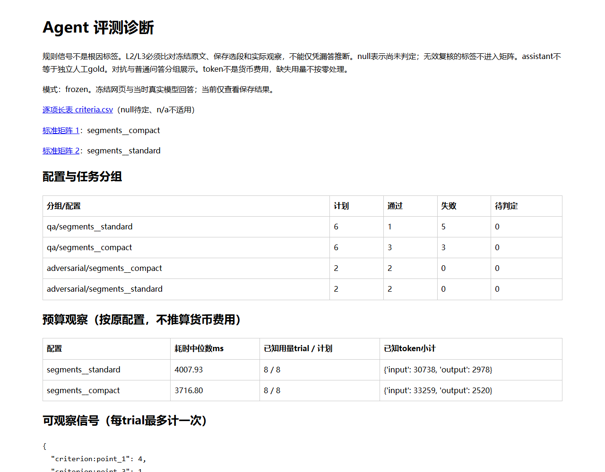

# AgentScope Evidence Researcher

在硬预算内搜索、读页、回答，保留可复核的证据、引用与trace。基于AgentScope 2.0.8，当前 **0.40.0**；一个研究Agent、两个只读工具。模型提议动作，应用决定权限、预算和证据提交，不要求LangChain/LangGraph。

```text
问题 → AgentScope Agent ↔ 模型
              ↓ 工具请求       ↑ 观察回流
         ResearchSession → 搜索 / 读页
         来源、预算、去重、原子提交
              ↓
     回答 + 证据 + trace → 保存run
              ↓ 循环之外
     任务复核 → 诊断网页/矩阵 → 固定条件改进
     批次执行器：独占锁、启动记录、提交凭据、安全续跑
```

## 先跑，再看真实样例

当前机器在项目目录执行 `.\start.bat`。新环境有Python3.13和uv后：

```powershell
uv sync --locked --extra browser
uv run --no-sync python scripts/restore_test_fixtures.py
uv run --no-sync as-research --interactive
```

browser是可选静态Edge依赖；只用HTTP可不安装，已有环境同步则保留原extra。恢复命令从随源码的固定包补缺失测试原件，不联网、不覆盖不同已有文件。

三分钟演示：主页1看离线搜索→读页→回答；主页4→7直接看随源码携带的**历史真实A/B回答**，c作同题对照、d导出网页与标准矩阵；主页4→8先预览搜索服务对照，输入SEARCH才真实搜索。真实研究须确认LIVE。查看历史样例和固定流程不消耗模型费用，Tavily搜索可能消耗积分。



完整[终端输出示例](examples/portfolio/terminal-demo.txt)、[静态诊断页](examples/portfolio/diagnostics/index.html)和[原件清单](examples/portfolio/manifest.json)随源码携带。GitHub不直接运行HTML，下载后本地打开，或从终端d生成。原坏结果和assistant标签保留，不冒充人工gold。

## 三个能展开讲的工程点

- **资源与证据边界**：[ResearchSession](src/as_researcher/researcher.py)管理预算、来源资格和原子提交；[evidence.py](src/as_researcher/evidence.py)区分搜索摘要@snippet和实际正文@page。引用存在不等于支持事实。
- **安全续跑**：[batch_runtime.py](src/as_researcher/batch_runtime.py)只补全新未启动trial，已提交结果可凭收据登记；已启动但结果不明的行不自动重跑。独占锁防并发，配置/代码/语料有绑定；不宣称Agent状态恢复或exactly-once计费。
- **诊断驱动改进**：[diagnostics.py](src/as_researcher/diagnostics.py)把观察信号与根因候选分开；普通问答/对抗分表，逐标准CSV可追溯到原回答。可选balanced-v3只改善一个明确API夹中文时的定义定位。

## 测量结果与边界

| 固定范围 | 结果 | 能说明什么 |
|---|---|---|
| 本轮10个混合focus场景×3预算 | 字面目标共现7/27→13/27；原8场景保持11/21 | 有限选段回归，非答案准确率；默认segments/BM25输出未变 |
| 同两查询×2次，当前网络/时点 | Tavily4/4有目标官方主机结果；DDG0/4，类别“无结果或不可用” | 当前服务可用性，不能推断全球故障、排名或事实质量 |
| 真实模型烟测 | 冻结两题分段/续跑完成；Tavily local/MCP各一题搜索→读页→回答完成 | 接线与恢复，4个开发trial非总体准确率；本地Tavily回答537字符超500，失败保留 |

旧0.37格式组（4题×2格式×2次）长度3/8→6/8，但语义通过均6/8。因此默认仍 **segments / standard / 缩稿关闭**。所有真实语义标签仍是助手复核；独立人工校准和未见保留组尚未完成。

## 验证与学习

```powershell
uv run --no-sync python -m unittest discover -s tests -t .
uv run --no-sync python scripts/verify_source.py
```

本轮481项离线测试通过，应用源码本进程语句覆盖90.3%、分支83.7%（不含SDK/子进程）；源码烟测含分段→续跑→原run不变。CI配置可供GitHub执行，远程尚未发布，不能提前称CI绿。

| 用途 | 现有指南 |
|---|---|
| 从零操作 | [学习指南](从零上手与面试学习指南.md) |
| **结构、循环、函数关系** | [架构](项目架构与运行指南.md)第15节 |
| 面试讲法、所有评测与新菜单 | [面试手册](docs/INTERVIEW_GUIDE_ZH.md)16.13～16.16 |
| SDK/Tavily/DDGS、对象与新状态 | [概念速查](项目概念与数据结构速查.md) |
| 安装、CI、覆盖率、GitHub发布步骤 | [统一验收](统一离线验收与核心代码走读.md)第11节 |
| 当前事实 / 下一步 / 归属 | [STATUS](docs/STATUS.md)、[NEXT](docs/NEXT_STEPS_ZH.md)、[来源记录](docs/UPSTREAM_AND_CHANGES.md) |

.env、环境、缓存和完整reports不纳入Git。公开样例与固定包提供可离线检查的子集；旧版本全量实验仍需另带原件。暂无目标GitHub URL，本轮只本地提交；发布步骤已经写好。

参考[Local Deep Researcher](https://github.com/langchain-ai/local-deep-researcher)，[MIT归属](LICENSE)保留，开发有AI协助。无生产级隔离、多用户服务或跨题长期记忆；个人贡献应以理解、复现、反例和取舍说明。
