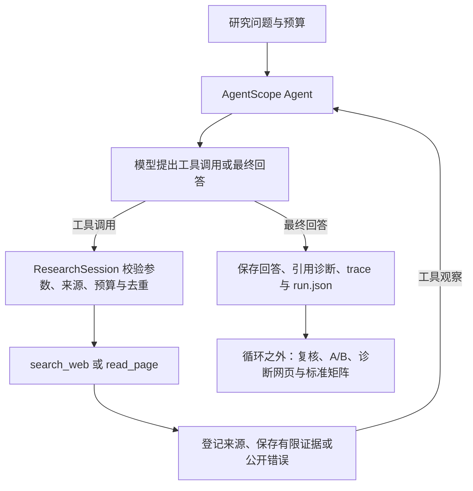

# AgentScope Evidence Researcher

[](https://github.com/YangSiyi30/agentscope-evidence-researcher/actions/workflows/ci.yml)

**一个证据优先、预算受控、结果可复核的研究 Agent。** 基于 AgentScope 2.0.8，让模型通过搜索和读页回答问题，并保存来源、证据片段、引用、工具轨迹与运行结果。当前版本 **0.41.0**。

项目关注三个实际问题：模型拿到了什么证据、失败发生在哪一层、实验中断后能否继续而不误重跑已完成任务。采用单 Agent、两个只读业务工具，不需要 LangChain、LangGraph 或向量数据库。

## 一次研究怎样运行



模型选择动作，应用决定工具是否执行。搜索摘要标为 `@snippet`，实际读取并保存的正文标为 `@page`，两者不能混用。引用 ID 存在，只能证明引用对象可定位，不能自动证明结论受到证据支持。

批次执行器位于循环之外：启动前预留 `attempt`，worker 一次性领取 `claim`，保存结果后写 `receipt`。恢复时保留已登记结果、采用有效收据，只启动真正未开始的题；已启动但结果不明的题不自动重试。它不恢复 Agent 中间状态，也不保证外部 API 只计费一次。

## 快速开始

推荐 **Python 3.13、uv、Windows PowerShell**，项目要求 Python 3.11–3.13。自动检查范围以工作流配置为准。

```powershell
git clone https://github.com/YangSiyi30/agentscope-evidence-researcher.git
cd agentscope-evidence-researcher
uv sync --locked --group dev
uv run --no-sync python scripts/restore_test_fixtures.py
uv run --no-sync as-research --interactive
```

已有本地环境可直接运行 `start.bat`。恢复脚本从随源码携带的固定数据包补齐 31 份测试原件，不联网、不覆盖已有的不同文件；这些是程序回归材料，不是新的人类评测结果。先选择主页 **1：离线固定演示**，无需密钥；Agent/工具控制流实际执行，但模型响应和资料固定。

### 真实模型与 Tavily

首次配置时复制 `.env.example` 为 `.env`，填写自己的凭据；已有 `.env` 请直接编辑，保留原配置。

```dotenv
MODEL_BASE_URL=https://dashscope.aliyuncs.com/compatible-mode/v1
MODEL_NAME=qwen-plus
MODEL_API_KEY=填写模型密钥
TAVILY_API_KEY=填写搜索密钥
```

模型端点需支持 OpenAI 兼容的 Chat Completions 与工具调用。Tavily 是外部搜索服务，搜索凭据与模型凭据不同；本项目通过 HTTPX 直接调用其 API，没有使用 Tavily Python SDK。没有搜索 key 时可选择 DDGS 库的 DuckDuckGo 路径，仍依赖网络和服务可用性。

菜单主页 **2** 进入真实研究设置，预览预算后输入 `LIVE` 才执行。等价命令示例：

```powershell
uv run --no-sync as-research "MCP stdio 的 stdin、stdout 与日志各有什么规则？" --live --search-provider tavily --reader http --searches 1 --pages 2 --timeout 90 --max-answer-chars 500
```

增加 `--transport mcp` 可通过本地 stdio 工具服务器执行相同规则。HTTP 读页无需浏览器；可选静态浏览器抽取需要 `uv sync --locked --extra browser`，默认使用本机 Edge，并非完整操作系统隔离沙箱。已有 browser 环境再次同步时请保留该 extra。

真实模型和搜索可能计费。默认不自动重试、不自动缩稿；用量为 `null` 表示未知，不能解释为零费用。`.env` 不进入 Git。

## 终端主要操作

| 路径 | 做什么 | 怎样理解结果 |
|---|---|---|
| 主页 1 | 离线搜索、读页、回答演示 | 理解流程，不测真实模型知识 |
| 主页 2 | 真实研究，配置问题、来源与预算 | 先看预算，再 `LIVE`；真实请求可能失败 |
| 主页 3 | 查看保存的回答、trace、run | 只读查看不重跑；可用默认程序打开文件 |
| 主页 4 → 1 | 一题一次固定评测 | 固定模型，语义标签保留待判定 |
| 主页 4 → 2 / 3 | 预设题 / 自定义问题与必答点 | 冻结网页、实时 URL、公共搜索是不同环境 |
| 主页 4 → 4 | 同 HTML 的选段对照 | 字面目标与资源，非答案准确率 |
| 主页 4 → 5 | 已有批次与复核 | `c` 同题 A/B；`r` 建新实验；`u` 预览续跑 |
| 主页 4 → 7 | 随源码的历史真实样例 | 16 次 A/B，保留失败与 assistant 标签，只读 |
| 主页 4 → 8 | 同查询 DDG/Tavily 诊断 | 先预览，`SEARCH` 才真实搜；无模型、无读页 |

**冻结网页**使用预先保存、带 hash 的 HTML；**实时 URL**重新读取给定页面；**公共搜索**先检索来源再读页。固定资料不等于固定模型。自定义实验在新目录保存问题和标准，不修改预设题库。

普通批次 `d` 导出诊断网页与 CSV，`s` 根据已有复核生成成绩单；具体题的复核需用户填写标准和理由，再 `SAVE` 保存。公开只读样例隐藏修改和续跑入口。`r` 是新实验，`u` 是续跑，二者不同。

## 看什么结果，怎样决定下一步

```text
reports/<运行ID>/
  report.md    可读报告：回答、引用、资源、诊断
  run.json     机器记录：配置、证据、模型/工具轨迹、停止原因
```

评测批次另外保存 `plan.json`、`suite.json`、`index.json`、每题原件与复核。诊断导出生成 `index.html`、`diagnostics.json`、`criteria.csv`、`matrix-N.csv`。`true / false / null` 分别表示通过、不通过、待判定；`completed` 只表示程序完成，不代表事实正确。

按顺序定位：工具有没有执行 → 证据有没有保存 → 关键内容有没有选中 → 回答有没有覆盖与支持 → 评分标准是否合理。诊断给出症状与候选层，根因未确认时保留为空。找到反例后，先固定题、标准、材料与预算，每次只改变一个主要变量，比较全部结果。


无需请求模型即可查看[终端输出](examples/portfolio/terminal-demo.txt)、[原件 hash 清单](examples/portfolio/manifest.json)与[静态诊断页](examples/portfolio/diagnostics/index.html)。GitHub 不直接执行 HTML，请下载后本地打开，或从终端导出。保留原回答和坏结果，标签为助手复核。

### 固定流程、续跑与自定义测试

以下固定两次试验无需真实模型或密钥。先跑一题时预期退出码为 `4`，表示主动分段停止。已有输出拒绝覆盖，请选新的目录。

```powershell
uv run --no-sync python scripts/benchmark_research.py run --execute --mode fixture --case mcp_stdio --strategy segments --repeats 2 --corpus reports/evaluation-20261101/corpus-exposed --output reports/my-demo --max-new-trials 1
uv run --no-sync python scripts/benchmark_research.py resume --batch reports/my-demo
uv run --no-sync python scripts/benchmark_research.py resume --batch reports/my-demo --execute
uv run --no-sync python scripts/benchmark_research.py diagnose --batch reports/my-demo --output reports/my-demo-diagnostics
```

不带 `--execute` 的 resume 只读预览。续跑要求源码、入口、题库、语料和模型配置绑定一致；升级代码后应建立新实验，旧结果仍可只读查看。没有有效收据的已启动任务不会自动重试。

自定义测试从主页 **4 → 3** 输入问题与 1–5 个必答点。例如问“`asyncio.wait_for` 超时后何时返回？”，必答点可写“请求取消”“等待取消完成”“实际耗时可能超过 timeout”。先选已有冻结页保持材料一致，再选单配置或 A/B；完成后 `c` 看完整回答、逐项复核，`d` 看失败矩阵。已用于调试的题属于开发集，不能再称未见测试集。

## 已有测量与限制

以下是带原件的历史开发实验，不是公开排行榜或总体准确率：

| 范围 | 观察结果 | 结论边界 |
|---|---|---|
| 4 题 × 2 格式 × 2 次，共 16 trial | standard/compact 长度合规 3/8 → 6/8；助手语义均 6/8；综合通过 3/8 → 5/8 | 该样本改善长度，没有证明语义更好，默认仍 standard |
| 10 混合中文/API 场景 × 3 预算 | balanced-v3 字面目标共现 7/27 → 13/27；旧场景 11/21 不变 | 选段开发回归；3 个缺目标组合保留 null，非 QA 准确率或 holdout |
| 两查询 × 2 次，2026-11-09 本机网络 | Tavily 4/4 有目标官方主机来源；DDG 0/4 无结果或不可用 | 服务时点诊断，非全球故障、事实质量或稳定排名 |
| 4 次真实模型烟测 | 冻结两题续跑完成；Tavily local/MCP 各一题完成搜索→读页→回答 | 接线与恢复；本地 Tavily 537 字符超 500，失败保留 |

默认仍为 `segments / standard / 缩稿关闭`。独立人工盲评、未参与调试的新题评估尚未完成；代码覆盖率、字面命中、完成率和语义质量分别统计。没有生产级多用户服务、分布式恢复或自动事实正确性认证。

## 代码地图

| 文件 / 目录 | 职责 |
|---|---|
| [cli.py](src/as_researcher/cli.py)、[terminal.py](src/as_researcher/terminal.py) | 启动、配置、保存、终端交互 |
| [researcher.py](src/as_researcher/researcher.py)、[core.py](src/as_researcher/core.py) | Agent 装配、Session、预算、状态与报告 |
| [models.py](src/as_researcher/models.py)、[execution.py](src/as_researcher/execution.py) | 模型适配、执行观察、请求与错误记账 |
| [search.py](src/as_researcher/search.py)、[pages.py](src/as_researcher/pages.py) | 搜索和受限读页后端 |
| [segments.py](src/as_researcher/segments.py)、[evidence.py](src/as_researcher/evidence.py) | 正文选段、来源、引用层次 |
| [mcp_bridge.py](src/as_researcher/mcp_bridge.py)、[mcp_server.py](src/as_researcher/mcp_server.py) | 本地 MCP 传输与服务器 |
| [benchmark.py](src/as_researcher/benchmark.py)、[batch_runtime.py](src/as_researcher/batch_runtime.py) | 评分、原件绑定、批次恢复 |
| [diagnostics.py](src/as_researcher/diagnostics.py)、[evaluation_terminal.py](src/as_researcher/evaluation_terminal.py) | 症状、HTML/CSV、评测中心与复核 |
| scripts / eval / tests | 验收入口、开发题库与标准、离线回归与进程测试 |
| examples/portfolio / assets | 历史真实样例、原件清单与 README 图示 |

从 `run_research()` 看 Agent/工具装配，再读 `ResearchSession.search_web/read_page()` 的许可与记账；`parse_document/select_passages()` 处理证据，`load_bound_batch/assess_saved_batch()` 核对评测原件，`recovery_preview()` 判断哪些任务可以继续。

## 验证与 CI

```powershell
uv run --no-sync ruff check src scripts tests
uv run --no-sync python -m unittest discover -s tests -t .
uv run --no-sync python scripts/verify_source.py
```

源码烟测固定五步：本地工具 → MCP → 固定批次先一题 → 续跑剩余 → 诊断，核对首份 run 字节未变、语义标签仍待判定，无需真实 key。完整历史材料审计另有 `verify_offline.py`；只下载源码的环境请用上述源码烟测。

[GitHub Actions](https://github.com/YangSiyi30/agentscope-evidence-researcher/actions) 在 Windows / Python 3.11 与 3.13 执行锁依赖、恢复原件、Ruff、离线测试、分支覆盖率和五步烟测。通过表示这些程序验证通过，不代表回答都正确。覆盖率和烟测结果位于对应运行的 `offline-checks-python-*` artifact；在线状态以顶部徽章和具体提交为准。

详细个人学习资料和维护记录仅保留本地，公开说明入口统一为本 README。实验中的 `report.md` 是原始结果，继续随样例保留。停止跟踪文档不删除已有 Git 历史。

## 来源与许可证

参考 [Local Deep Researcher](https://github.com/langchain-ai/local-deep-researcher) 的研究助手思路，当前实现使用 AgentScope，运行时不依赖 LangChain/LangGraph。保留原 [MIT 许可证](LICENSE) 与归属；各依赖遵循自身许可证。开发有 AI 协助，项目价值通过可理解的代码、反例、原件与可复现实验说明。
