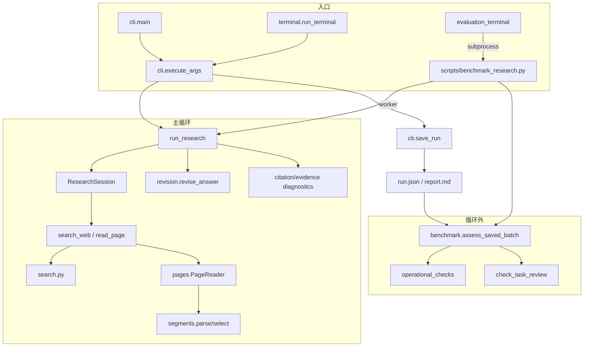

# AgentScope Evidence Researcher：从最小骨架到测评诊断

> 六阶段重整理。阶段一~四讲"程序是什么、怎么跑"，阶段五讲"怎样从回答、trace、run.json 判断哪里要改"，阶段六给出总调用图与可落地的优化清单。
>
> 基线：`pyproject.toml` 版本 `0.38.0`；框架 `agentscope==2.0.8`；`run.json` 的 `schema_version=8`、`report_renderer_version=6`、`execution_trace_version=1`；默认 `segments` 选段、`standard` 回答格式、缩稿关闭。
>
> 读法建议：第一次读按阶段顺序；第二次只读阶段五，把它当诊断手册；要改代码时读阶段六的模块索引与优化表；遇到"为什么这里要这么写"先查附录 D。文中 `路径:行号` 均对应当前源码。现有 9 份主文档仍是权威交付说明，本文是把它们按"骨架 → 能力 → 循环 → 循环外 → 测评 → 优化"重新组织的一份新说明，不替换旧件。

这个项目做的是：**给定一个问题，在硬预算内让模型搜索、读页、写一份带层次引用的中文报告，并把整个过程存成可复核的 run**。它不做：多轮对话、跨题记忆、任意网页交互、自动事实核验或自动生成人工 gold。理解这个边界，后面每一处"为什么程序要管这么细"都会变得自然。

**目录**

- 阶段一 最小骨架：一次研究由什么组成
- 阶段二 证据从哪里来：搜索、抓页、切段、引用契约
- 阶段三 主循环：Agent 与 Session 怎样协作
- 阶段四 循环之外：报告、执行摘要与三层复核
- 阶段五 测评：怎样从回答和 trace/run 看出该优化什么
- 阶段六 总调用图与优化路线
- 附录 A 命令速查 / B 错误码 / C 术语 / D 关键设计问答 / E 一页总结

---

## 阶段一 最小骨架：一次研究由什么组成

### 1.1 一句话架构

> 一个 AgentScope `Agent` 拿着两个只读工具（`search_web`、`read_page`）做 ReAct 循环；`ResearchSession` 在工具内部做预算、去重、来源登记和证据保存；循环结束后由**纯程序**做一次引用检查、缩稿检查和保存。

模型只负责"下一步做什么"和"最终写什么"。**能不能搜、能搜几次、能读哪一页、引用是否成立、回答是否超长**，全部由 Python 决定。这条分工是整个项目所有设计选择的源头，也是后面所有"可诊断性"的来源：凡是程序决定的，run.json 里一定有计数或错误码；凡是模型决定的，run.json 里只有文本和完成原因。

### 1.2 五个角色

| 角色 | 代码位置 | 只做什么 | 不做什么 |
|---|---|---|---|
| 模型 | `src/as_researcher/models.py:137` `live_model()` / `models.py:174` `ScriptedModel` | 返回工具调用或最终文本 | 不掌控预算、不能构造任意 URL、不能改状态 |
| AgentScope Agent | `researcher.py:355` `Agent(...)` | 组织消息、按 `ReActConfig` 迭代、把工具结果回填上下文 | 不理解"证据层次"，只当普通工具返回 |
| 业务会话 | `researcher.py:53` `ResearchSession` | 预算、去重、来源表、页面证据表、trace、`stop_reason` | 不生成文本、不判断事实 |
| 工具面 | `researcher.py:308` `toolkit()` → `search_web` / `read_page` | 参数校验、状态机、JSON 观察回流 | 不直接访问网络 |
| 后端 | `search.py`、`pages.py`、`mcp_bridge.py` | 真正搜索、真正取 HTML、真正切段 | 不知道预算，只接收单次请求 |

一句话记法：**模型提议、Agent 转发、Session 许可、工具执行、后端落实、程序记账。**

### 1.3 模块地图（22 个文件，21 个有逻辑）

| 模块 | 职责 | 关键符号 | 被谁调用 |
|---|---|---|---|
| `core.py` | 配置、URL 规范化、来源 ID、引用 ID 诊断 | `ResearchConfig`、`canonical_url()`、`source_id()`、`citation_diagnostics()` | 几乎所有模块 |
| `source_inputs.py` | 用户给定 URL 的校验与登记标记 | `normalize_source_urls()`、`SOURCE_CONTEXT_MARKER` | `cli.py`、`researcher.py`、`models.py` |
| `search.py` | 搜索适配器与错误分类 | `make_search()`、`DDGSearch`、`TavilySearch`、`FixtureSearch` | `cli.py`、`mcp_server.py`、benchmark worker |
| `pages.py` | 公共 HTML 抓取、正文抽取、SSRF/DNS 校验 | `validate_public_url()`、`fetch_html()`、`PageReader`、`select_excerpt()` | `cli.py`、`mcp_server.py`、`benchmark.py` |
| `segments.py` | 结构化分块、词法/BM25/balanced 选段 | `parse_document()`、`select_passages()`、`select_balanced()`、`bm25_scores()` | `pages.py`、`benchmark.py`、抽取对照 |
| `evidence.py` | 证据层次引用契约、读取安全白名单 | `evidence_diagnostics()`、`citation_refs()`、`page_observation()`、`reader_page_data()` | `researcher.py`、`revision.py`、`review.py`、`benchmark.py` |
| `models.py` | 真实模型构造、离线脚本模型、服务商观测 | `ObservedOpenAIChatModel`、`ScriptedModel`、`thinking_parameters()` | `cli.py`、benchmark worker |
| `model_diagnostics.py` | 模型错误分类与日志脱敏 | `model_error_details()`、`protect_retry_logging()` | `models.py` |
| `researcher.py` | 会话、两个工具、主循环、run 组装、报告渲染、提示词 | `ResearchSession`、`run_research()`、`render_report()`、`SYSTEM_PROMPT` | `cli.py`、`terminal.py`、benchmark worker |
| `revision.py` | 可选一次无工具缩稿 | `revise_answer()`、`revision_length_budget()`、`revision_integrity_errors()` | `researcher.py`、`comparison.py` |
| `execution.py` | 从 trace 反算执行计数并做一致性校验 | `execution_summary()`、`render_execution_summary()` | `researcher.py`、`terminal.py` |
| `review.py` | 行级复核包、机械校验 | `prepare_review()`、`check_review()`、`candidate_units()` | `review_run.py`、`comparison.py`、`worksheet.py`、`benchmark.py`（指纹） |
| `atomic_review.py` | 原子声明复核（偏移锚定） | `prepare_atomic_review()`、`check_atomic_review()`、`answer_units()` | `review_run.py`、`comparison.py` |
| `comparison.py` | 原稿/候选双锚定对照与 HTML 导出 | `prepare_comparison()`、`check_comparison()`、`render_comparison()` | `scripts/review_revision.py`、`scripts/replay_revision.py`、审计脚本 |
| `worksheet.py` | 只读 Markdown 复核工作表 | `render_worksheet()` | `review_run.py` |
| `benchmark.py` | 题库模型、冻结语料、门槛与语义判定、汇总、盲评 | `ResearchSuite`、`ResearchTask`、`operational_checks()`、`check_task_review()`、`summarize_trials()` | `evaluation_terminal.py`、`scripts/benchmark_research.py` |
| `evaluation_terminal.py` | 终端评测中心（在 Agent 循环之外） | `run_evaluation_center()`、`configure()`、`perform_evaluation()`、`view_batch()` | `terminal.py` |
| `terminal.py` | 单次研究向导、结果查看、历史浏览 | `run_terminal()`、`collect_task()`、`inspect_run()`、`show_trace()` | `cli.main(--interactive)` |
| `cli.py` | 参数解析、执行、保存、退出码 | `create_parser()`、`execute_args()`、`save_run()`、`result_exit_code()` | `terminal.py`、`scripts/*` |
| `mcp_server.py` | 本地 MCP 工具服务（stdio） | `search()`、`read_public_page()` | `mcp_bridge.py` 启动的子进程 |
| `mcp_bridge.py` | MCP 客户端适配到同一业务边界 | `MCPBackends`、`MCPBackendError` | `cli.py`、benchmark worker |
| `__init__.py` | 包标记 | — | — |

### 1.4 三条入口，两个收敛点

```
start.bat
  └─ .venv\Scripts\python.exe -X utf8 -m as_researcher.cli --interactive
       └─ cli.main()                 (cli.py:285)
            └─ terminal.run_terminal()          ← 主页菜单
                 ├─ 1/2 单次研究 → collect_task() → parse_args → execute_args()
                 ├─ 3 历史记录   → browse_history() → load_saved_run() → inspect_run()
                 └─ 4 评测中心   → evaluation_terminal.run_evaluation_center()
                                      └─ subprocess: scripts/benchmark_research.py

命令行
  └─ as-research "<topic>" ...
       └─ cli.main() → create_parser() → execute_args()

离线脚本
  ├─ scripts/evaluate_offline.py   → run_research() 直接调
  └─ scripts/benchmark_research.py → _worker → run_research()
```

两个收敛点必须记住：

1. **单次研究**全部收敛到 `cli.execute_args()`（`src/as_researcher/cli.py:134`）：先构造 `ResearchConfig`、`model`、`backend`、`reader`，再调 `run_research()`，最后 `save_run()`。
2. **批量测评**全部收敛到 `scripts/benchmark_research.py` 的 `_worker`（`scripts/benchmark_research.py:198`），它内部仍然调用同一个 `run_research()`。所以"评测"不是第二套研究实现，而是同一实现的受限调用；这也意味着**评测里出现的任何行为，都能在单次 run 里复现**。

### 1.5 唯一配置对象：`ResearchConfig`

`core.py:18`。`frozen=True, extra="forbid"`，字段一旦构造不可改，未知字段直接报错。这是"预算不受模型控制"的代码基础。

| 组 | 字段 | 默认 | 约束 | 作用点 |
|---|---|---|---|---|
| 搜索 | `max_searches` | 3 | 0..10 | `search_web` 的硬上限；为 0 时工具根本不注册 |
| 搜索 | `results_per_search` | 3 | 1..5 | 每次只取前 N 条 |
| 搜索 | `chars_per_source` | 1500 | 100..4000 | 摘要截断长度 |
| 搜索 | `search_timeout` | 20s | ≤60 | `asyncio.wait_for` 包裹后端 |
| 搜索 | `early_stop_duplicates` | True | bool | 重复查询直接终止搜索阶段 |
| 页面 | `max_page_reads` | 2 | 0..5 | `read_page` 硬上限；为 0 时工具不注册 |
| 页面 | `chars_per_page` | 5000 | 100..12000 | 单页正文预算 |
| 页面 | `page_timeout` | 30s | ≤60 | 单次读取超时 |
| 循环 | `max_agent_iters` | 10 | 2..30 | `ReActConfig(max_iters=...)` |
| 循环 | `total_timeout` | 120s | ≤600 | 整个 `agent.reply()` 的总超时 |
| 回答 | `max_answer_chars` | None | 100..10000 | 非空白字符预算；只检查不截断 |
| 回答 | `answer_style` | standard | standard/compact | 只改提示词 |
| 缩稿 | `revise_answer` | False | bool | 开关；开启必须给 `max_answer_chars` |
| 缩稿 | `revision_timeout`/`revision_max_tokens`/`revision_thinking` | 30 / 1200 / provider-default | — | 缩稿独立预算 |

`validate_revision()`（`core.py:39`）强制两件事：开缩稿必须同时给字符上限；指定 thinking 模式必须同时开缩稿。这类"组合非法"在构造期就失败，而不是运行到一半才发现。

### 1.6 来源身份：`Source` 与两个 ID

```python
@dataclass(frozen=True)
class Source:            # core.py:94
    title: str
    url: str             # 已经过 canonical_url()
    content: str
    @property
    def id(self): return source_id(self.url)   # "SRC-" + sha256(url)[:8].upper()
```

三条规则决定了全部引用语义：

1. `canonical_url()`（`core.py:52`）只做**链接身份规范化**：去 utm/gclid/fbclid、去 fragment、拒绝凭据与非全局地址（localhost、私网 IP、无点主机名）；**非标准端口会被保留**，真正读页前由 `pages.validate_public_url()` 以 `port_blocked` 拒绝，并做 DNS 解析和全局地址检查。它**不是** SSRF 防护。
2. `source_id` 只由 URL 决定，所以同一 URL 在整次运行里 ID 恒定。这是"报告 ID 永远能回指同一份保存片段"的前提。
3. `Source.content` 在**首次登记时冻结**（`researcher.py:181` 附近的 `staged_sources` 逻辑）。后到的同名 URL 不会覆盖先到内容，避免报告里同一 ID 指两段不同文字。

`SEG-xxxxxxxxxxxx` 是**页内段落 ID**（`segments.py:357`），由 `document_sha256:start:end` 派生，用于定位抽取片段，**不用于回答引用**；回答里只允许 `[SRC-XXXXXXXX@snippet]` 或 `[SRC-XXXXXXXX@page]`。

### 1.7 `run.json` 的顶层骨架（schema 8）

`run_research()` 的返回值就是 `run.json`（`researcher.py:519`）：

| 字段 | 含义 | 谁读它 |
|---|---|---|
| `schema_version` / `report_renderer_version` / `execution_trace_version` | 三种契约版本，互不替代 | 读取器、测试 |
| `provenance.prompt_sha256` | 最终系统提示的哈希（含预算/格式/来源附加段） | 复现与回归 |
| `provenance.source_sha256` | `src/as_researcher/*.py` 全量哈希 | 计划绑定、防止"改了代码还比分数" |
| `provenance.tool_observation_version` | 工具返回 JSON 的版本（当前 3） | 解释预算字段语义 |
| `mode` | `live` / `live_model_snapshot` / `live_model_fixture` / `offline_fixture` / `offline_scripted_snapshot` | 决定报告顶部标签与可信范围 |
| `started_at` / `topic` / `framework` / `model` | 基本信息 | 报告、批次 |
| `config` | 本次 `ResearchConfig` 全量 | 解释预算、复现 |
| `answer` | 最终保存的回答（可能是缩稿候选） | 一切下游 |
| `revision` | 缩稿记录（原稿、候选、哈希、错误、用量） | 对照复核 |
| `metrics` | 状态、计数、引用诊断、token、warnings | **诊断主入口** |
| `sources` | 搜索摘要级证据 + 用户提供 URL 的占位 | 引用校验 |
| `page_evidence` | 实际读到的正文片段及 `segments` | 引用校验、事实复核 |
| `trace` | 应用层工具事件（每次工具调用一条） | **行为诊断主入口** |
| `provider_responses` | 每次模型响应的完成原因与 token | **截断/完成诊断** |
| `model_requests` | 每次模型请求的状态与耗时 | **失败/重试诊断** |
| `benchmark`（可选） | 题目 ID、suite/corpus 指纹、trial ID | 批次绑定 |
| `mcp`（可选） | 发现的工具名与 RPC 记录 | MCP 路径诊断 |

### 1.8 一题一次的数据流

```
topic ──┐
config ─┼─► run_research()
model  ─┤      ├─ 构造 ResearchSession（预算计数、来源表、trace）
backend─┤      ├─ 拼 system prompt（+来源段/字符预算/compact 段）
reader ─┘      ├─ Agent(...).reply(UserMsg)
               │     ├─ 模型 → ToolCallBlock(search_web/read_page)
               │     ├─ Toolkit → Session.search_web/read_page
               │     ├─ Session → backend/reader（真正的网络）
               │     └─ ToolChunk(JSON) → 下一轮上下文
               ├─ 结束后：状态判定 → 缩稿（可选）→ 引用/层次诊断 → warnings
               └─ 返回 run dict ─► save_run()：run.json + report.md(+缩稿两稿)
```

### 1.9 五条硬不变量（后面反复用到）

1. **预算是尝试次数，不是成功次数**：失败的搜索、空结果的读页都消耗额度（`researcher.py:151`、`researcher.py:248`）。
2. **拒绝不消耗后端**：重复查询、参数非法、预算耗尽都记 `backend_attempted=false`，trace 里仍有一条事件。
3. **先验证后提交**：搜索先把结果放进 `staged_sources`，全部合法才整体替换；读页先校验元数据再写入 `page_evidence`。
4. **证据与状态分离**：模型能看到的 `page_observation()` 已剔除 `segments`、`document_sha256`、`offset_basis`、`selector_version` 等内部字段；完整数据只留在 run.json。
5. **完成 ≠ 正确**：`metrics.status=completed` 只说明循环正常结束；引用 ID 存在也只说明 ID 存在。两条注释在 `core.py:117` 与 `evidence.py:187` 里都写死了。

> 阶段一小结：到这里应该能回答"一个 run.json 为什么长这样""为什么预算字段在 config 而不在提示里""为什么同一 URL 的 SRC 不变"。这三问的简答、出处和易误解点收在附录 D；下一阶段打开 `search_web`/`read_page` 背后真正取证据的两层。

---

## 阶段二 证据从哪里来：搜索、抓页、切段、引用契约

阶段一只讲了"Session 许可后调用后端"。这一阶段把后端拆开：搜索只是"拿到标题+URL+摘要"，页面读取才是"拿到有限正文"，而正文能不能用取决于切段算法把哪些段落放进了预算。

### 2.1 搜索层：三个适配器与一套错误码

```python
make_search("fixture"|"duckduckgo"|"tavily")   # search.py:73
```

| 适配器 | 实现要点 | 失败分类 |
|---|---|---|
| `FixtureSearch` | 固定返回 `example.org/memory` 或 `/evaluation`；`search_error` 场景抛 `httpx.ConnectError`，`empty` 返回 `[]` | 由调用方统一归类 |
| `DDGSearch` | `asyncio.to_thread` 包同步 `ddgs`，自带 `timeout=10`；说明"一次逻辑搜索可能发多个 HTTP 请求" | `TimeoutException`→`search_timeout`；`RatelimitException`→`search_rate_limited`；`"No results found."`→`search_no_results_or_unavailable`；其它 `DDGSException`→`search_provider_error` |
| `TavilySearch` | `httpx.AsyncClient(timeout=20, follow_redirects=False)`，`include_answer=False`、`include_raw_content=False` | 429→`search_rate_limited`；JSON 解析失败→`search_invalid_response`；`httpx.TimeoutException`→`search_timeout`；状态码其它→抛出后由 `search_error_code()` 归为 `search_provider_error` |

错误码全集在 `search.py:10`，只有五类。`SearchBackendError` 的设计目的是"**只带公开类别，不带服务商原文**"（`search.py:21`）：异常文本里可能有 key、带凭据的 URL 或请求头，所以 `search_web` 的 `except` 分支只记录 `type(exc).__name__` 与 `error_code`（`researcher.py:198`）。

整条链：

```
模型 ToolCallBlock(search_web, {query, knowledge_gap})
  → Toolkit → ResearchSession.search_web()          researcher.py:120
     ├─ async with self.lock          防并发穿过同一剩余额度
     ├─ 校验：stop_reason / 参数类型 / 空串 / 长度>400
     ├─ 去重：normalize_query(query) 是否已见
     ├─ self.attempts += 1            失败也计数
     └─ asyncio.wait_for(backend(...), timeout=search_timeout)
          ├─ 校验返回是 list[Source] 且三个字段都是 str
          ├─ canonical_url + 去空内容
          ├─ 首次登记：staged_sources[url] = Source(title[:200], url, content[:chars_per_source])
          └─ 返回 ToolChunk(JSON: status/stop/stop_reason/budget/sources)
```

`result_count` 是后端返回条数（可能大于实际新增），`new_sources` 才是通过规范化并首次登记的数量。这两个数不相等，通常意味着结果重复或 URL 被拒。

### 2.2 读页层：五个闸门

`PageReader.__call__()`（`pages.py:183`）之前和内部共有五道关：

| 闸门 | 代码 | 拒绝后果 | 为什么需要 |
|---|---|---|---|
| 1. URL 身份 | `canonical_url()` | `invalid_url` | 去掉跟踪参数、拒绝凭据与非全局主机（端口由下一道处理） |
| 2. 端口与 DNS | `validate_public_url()`（`pages.py:59`） | `port_blocked` / `private_address_blocked` | 解析所有 A/AAAA，任一非全局地址即拒绝，挡私网与 DNS 重绑定的一阶形态 |
| 3. 抓取策略 | `fetch_html()`（`pages.py:79`） | `redirect_blocked` / `unsupported_content_type` / `page_too_large` / `page_http_error` / `page_timeout` / `page_connection_error` | `follow_redirects=False`、`trust_env=False`、只收 `text/html` / `application/xhtml+xml`、1 MB 上限 |
| 4. 抽取 | `parse_document()` + `select_passages()` | `empty_page` / `excerpt_budget_insufficient` | 结构解析失败或预算装不下任何片段 |
| 5. 会话层再校验 | `read_page`（`researcher.py:217`） | `unknown_source_id` / `already_attempted` / `page_budget` / `invalid_page_metadata` / `empty_page_excerpt` / `page_budget_exceeded` | 只允许读已登记的 SRC；同一 ID 只读一次；元数据白名单；字节数再核 |

第 5 道常被忽略：**即使 reader 返回了正文，Session 仍会因"元数据不合法"或"超出 `chars_per_page`"拒绝保存**。所以 `page_read_attempts` 增加而 `pages_read` 不增加，表示"尝试了但没保存"——可能是后端失败，也可能是应用层拒绝，二者用 `trace[].error_type` 区分。

### 2.3 正文 → 证据：`segments.py` 做了什么

这是整个项目最"重算法"的文件，但它刻意只做**确定性的结构解析 + 词法排序**，不调模型、不建向量库。

**(a) 结构解析**：`BlockParser`（`segments.py:124`）边解析边维护：

- `heading_path`：当前标题栈（`h1..h6`），用于前缀显示与排序加权；
- `definition_path` / `definition_id`：`<dl>/<dt>/<dd>` 的定义作用域，用于把"定义段 + 代码"绑在一起；
- `link_density`：链接字符占比，>0.7 的段落会被重罚（导航栏、目录）；
- `kind`：`p/li/pre/td/...`，表格行走 `TableRows`（`segments.py:30`），只在"矩形表 + 单行表头"时做 `header: value` 映射，否则标 `table_unmapped`。

**(b) 代码上下文绑定**：`bind_code_context()`（`segments.py:251`）把"以冒号结尾的短引导句 + 一个或多个 `<pre>` + 最多 500 字的限定段"合成一个 `code_context`。目的只有一个：**不让"如下所示："和代码被预算切开**。函数注释明确写了"不执行代码、不做语言解析、不推断语义等价"。

**(c) 段落切分**：`parse_document()`（`segments.py:321`）把每行文本切成 `passage`：

- 普通散文按 900 字符切；
- `pre`、`code_context`、`table_*` **原子不可切**（`segments.py:352`）——宁可整段省略，也不输出半个代码示例；
- `segment_id = "SEG-" + sha256(f"{digest}:{start}:{end}")[:12]`，`start/end` 是**规范化全文**的 Unicode 码点偏移，`offset_basis="normalized_extracted_text"`。

**(d) 检索词**：`retrieval_tokens()`（`segments.py:372`）不是分词器，而是三条规则：英文/标识符按整词保留并拆出 `asyncio.wait_for` 的各级部件；中文按 bigram 切；英文停用词表过滤。这解释了为什么中文自然语言 focus 也能命中、但精度有限。

**(e) 三种排序**

| 策略 | 入口 | 打分 | 适用 |
|---|---|---|---|
| `segments`（lexical） | `select_passages(ranking="lexical")` | `4×正文命中 + 8×标题命中 + Σmin(2,词频)`；标题×0.2、代码×0.4、高链接密度×0.15、表格行+4、主定义+12 | 默认；可解释、可复现 |
| `bm25` | `select_passages(ranking="bm25")` | 页内 BM25（k1=1.2,b=0.75，标题词×2，`log1p` IDF），保留同样的结构惩罚 | 长页、自然语言 focus |
| `balanced` | `select_balanced()`（`segments.py:594`） | 先按逗号/分号拆最多 3 个 facet，每个 facet 预留 `(limit-2(n-1))//n` 配额，再全局 refill | 多关注点比较题 |

`balanced` 的关键设计是"**预留机会，不保证语义覆盖**"：`focus_allocation.facets[]` 记录每个 facet 的 `matched_candidates`、`new_segments`、`scope`（`exact_definition` 或 `page_lexical`）。如果某 facet 没有词法命中，会记 `focus_no_lexical_match`——这通常不是"页面没有该内容"，而是"你的 focus 用词和页面不一致"。

**(f) 打包与省略**：`select_passages()` 的打包循环（`segments.py:517`）在预算不够时不会截断原子段，而是跳过并计数：

- `omitted_table_rows`、`omitted_code_blocks`、`omitted_code_contexts`；
- `selection_warnings` 里出现 `code_blocks_omitted_for_budget`、`partial_prose_fragment`、`table_column_mapping_unavailable` 等；
- `code_selection`（`segments.py:724`）只列**排名候选**中的 retained/omitted，明细最多 4 条，`unlisted` 表示还有多少条没列。

模型看到的页面观察会删掉 `segments`、`document_sha256`、`offset_basis`、`selector_version`；若有 `code_selection`，还会删掉代码省略明细并过滤两条预算警告。但 `selection_warnings`、`omitted_table_rows` 等摘要仍保留，让模型知道"这次只读到有限片段"。

### 2.4 `evidence.py`：把"存在"与"支持"分开

| 函数 | 作用 | 边界 |
|---|---|---|
| `citation_refs()` | 正则抓 `[SRC-...]`，拆出 `source_id` 与 `kind` | 大小写不敏感；保留畸形形式供诊断 |
| `evidence_diagnostics()` | 把每个引用分到 `untyped` / `invalid` / `unavailable` 三类，给出 `contract_valid` | **只查层次可用性**，不查事实、不查冲突、不查时效 |
| `reader_page_data()` | 读取器返回值的白名单 + 递归深度/节点/字符上限 | 防止 reader 注入应用状态字段 |
| `page_observation()` | 给模型看的裁剪版：删 `segments/document_sha256/offset_basis/selector_version`，删代码省略明细 | 详细偏移只进 run.json |
| `quote_evidence_text()` | 按 `kind` + `field` + 可选 `segment_id` 精确取保存文本 | 不跨层、不跨字段回退；缺失返回空串，非法位置返回 `None` |
| `supported_reference_errors()` | 复核时要求"每个 @层次引用都有同层摘录" | 机械匹配，不判蕴含 |

四种引用状态要分清，这是阶段五诊断的基础：

| 状态 | 例子 | 含义 | 归因 |
|---|---|---|---|
| 合法 | `[SRC-A65ED23F@snippet]` 且 sources 里有该 ID 且有内容 | 层次与可用性都对 | — |
| 缺失层次 | `[SRC-A65ED23F]` | 老格式或模型漏写 `@page` | 提示遵循问题 |
| 格式非法 | `[SRC-123@web]` | 层次名不在 `{snippet,page}` | 提示/模型 |
| 层次不可用 | `[SRC-A65ED23F@page]` 但这次没保存正文 | 声称读了没读的正文 | 最严重的一类：幻觉引用 |

### 2.5 用户给定 URL ≠ 证据

`source_inputs.normalize_source_urls()`（`source_inputs.py:10`）最多 3 个、必须公共 HTTP(S)、标准端口、去重。登记时只创建 `Source("", url, "")` 占位（`researcher.py:66`），所以：

- `sources[]` 里会出现 `evidence_kind="source_url"`、`citation=null`、`source_origin="user_provided_url"`；
- 这种条目**引用为 `@snippet` 会被判 `unavailable`**（没有摘要内容），只有 `read_page` 成功后才产生 `@page`；
- `run_research` 会给系统提示追加一段"URL 列表不是搜索摘要或正文"的说明（`researcher.py:346`）。

### 2.6 这一层的调用关系与失败归因

```
search_web ──► backend(query, limit)
                 ├─ FixtureSearch
                 ├─ DDGSearch ──to_thread──► ddgs
                 └─ TavilySearch ──httpx──► api.tavily.com

read_page ──► reader(url, max_chars, focus)
                 ├─ FixtureReader
                 ├─ PageReader ──► fetch_html ──► validate_public_url ──► socket.getaddrinfo
                 │                   └─► parse_document ──► select_passages / select_balanced
                 └─ MCPBackends.read ──► mcp_server.read_public_page ──► PageReader
```

| 现象 | 最可能的层 | 下一个该看的字段 |
|---|---|---|
| `status=error, error_code=search_timeout` | 搜索后端 | `trace[].duration_ms`、`search_timeout` 配置 |
| `status=ok` 但 `new_sources=0` | 搜索/规范化 | `result_count`、`queries`、是否有重复 URL |
| `page_read_attempts` 增、`pages_read` 不增 | 读页第 4/5 道闸门 | `trace[].error_type`、`page_evidence` 长度 |
| `selection_warnings` 含 `code_blocks_omitted_for_budget` | 选段打包 | `page_evidence[].code_selection.omitted` |
| 引用 `unavailable_references` | 引用契约 | 该 SRC 是否只在 `sources` 而不在 `page_evidence` |

> 阶段二小结：搜索给"线索"，读页给"片段"，切段决定"哪一段进预算"，引用契约决定"能不能声称读过"。**这四步任何一步出问题，最终回答都会像"模型不会答"，但修复位置完全不同**——这正是阶段五要建立的判别能力。

---

## 阶段三 主循环：Agent 与 Session 怎样协作

### 3.1 `run_research()` 逐段拆解

`researcher.py:325`。整函数可以切成七段：

**(1) 入口校验（`:337`）**：topic 非空且 ≤2000 字符；`revise_answer=True` 时必须显式传 `revision_model`，否则直接 `ValueError`——不允许"悄悄用一个临时模型缩稿"。

**(2) 建 Session（`:342`）**：

```python
session = ResearchSession(config, backend, reader, source_urls=source_urls)
```

`ResearchSession.__init__`（`researcher.py:56`）一次性建好：`queries`、`sources`（含用户 URL 占位）、`trace`、`stop_reason`（`max_searches==0` 时预置 `"search_budget"`）、`attempts`、`page_evidence`、`page_attempts`、`read_ids`、两把锁。

**(3) 拼提示（`:343-354`）**，顺序不能乱：

| 顺序 | 条件 | 追加内容 | 影响 |
|---|---|---|---|
| 1 | 有 `source_urls` | "应用已登记用户提供的来源ID/URL…URL列表不是搜索摘要" + 把 `{"provided_sources":[{id,url}]}` 塞进 user 消息 | 模型可以先 `read_page`，0 搜索模式也能工作 |
| 2 | `max_answer_chars` 非空 | `with_answer_budget()` 替换"报告结构"那段 | 字符预算进入提示 |
| 3 | `answer_style=="compact"` | `compact_answer_prompt()` | 只改写作策略，不增加调用 |

最终 `prompt_sha256` 是**拼接后的**系统提示哈希，所以"同配置不同来源/不同预算"会被记录为不同提示。

**(4) 建 Agent（`:355`）**：

```python
Agent(
    name="EvidenceResearcher",
    system_prompt=system_prompt,
    model=model,
    toolkit=session.toolkit(),
    react_config=ReActConfig(max_iters=config.max_agent_iters,
                             interruption_raise_cancelled_error=True),
    injection_config=InjectionConfig(inject_runtime_state=False),
)
```

`inject_runtime_state=False` 很重要：框架不会把运行时状态注入提示，模型只能看到`UserMsg`和工具结果，避免"框架替模型补上下文"造成的不可解释差异。

**(5) 外层超时（`:372`）**：`asyncio.timeout(config.total_timeout)` 包住 `agent.reply(UserMsg(...))`。注意这是**任务总超时**，`max_agent_iters` 是**轮数上限**，`search_timeout`/`page_timeout` 是**单次工具超时**，三者互不覆盖。

**(6) 结束判定（`:376-403`）**：

```python
answer = reply.get_text_content() or ""
agent_finish = str(reply.finished_reason) if reply.finished_reason else None
if reply.error:                         run_status = "model_error"
elif agent_finish in {"exceed_max_iters", "interrupted"}: run_status = agent_finish
```

之后还有四次"补救判定"：`TimeoutError` → `task_timeout`；`deadline.expired()` 再兜一次（有的适配器把取消吞成 `interrupted`）；有 `incomplete` 的 provider 响应 → `model_output_truncated`（`finish_reason=="length"`）或 `model_response_incomplete`；最终文本为空 → `empty_answer` 并写入占位句。

**(7) 选段/缩稿/诊断/组 run（`:404-548`）**：保存来源快照 → 可选缩稿 → `citation_diagnostics()` → `evidence_diagnostics()` → 生成 warnings → 汇总 metrics → 返回 dict。

### 3.2 `search_web` 的判定顺序（状态机）

`researcher.py:120`。顺序是固定的，**先到先返回**，所以同一个请求只会落一个状态：

| 序号 | 条件 | `status` | `stop_reason` | `backend_attempted` |
|---|---|---|---|---|
| 1 | 已有 `stop_reason` | `blocked_after_stop` | 不变 | false |
| 2 | query/knowledge_gap 不是 str | `blocked_invalid_arguments` | 不变 | false |
| 3 | 空串或长度>400 | `blocked` | `invalid_query` | false |
| 4 | `attempts >= max_searches` | `blocked` | `search_budget` | false |
| 5 | 去重命中 | `blocked` | `duplicate_query` | false |
| 6 | 正常执行 | `ok` / `error` / `cancelled` | 成功后可能置为 `search_budget` 或 `no_new_evidence`，否则保持 `None`；异常为 `search_error`；取消为 `task_timeout_or_cancelled` | true |

三个容易误读的点：

- **`stop_reason` 是"搜索阶段结束原因"，不是任务失败**。`stop_reason=search_budget` + `status=completed` 是最常见的正常组合：搜索用完了，但模型还能读页、还能回答。
- 第 5 条的去重是"**整次运行内**"的全局集合（`self.queries` 归一化后），不是单轮。
- 成功后如果 `attempts` 刚好等于上限，会立刻把 `stop_reason` 置为 `search_budget`；所以"最后一次搜索成功"和"搜索停止"会同时出现，观察回流里的 `stop=true` 就是从这里来的。

### 3.3 `read_page` 的判定顺序

`researcher.py:217`。这里没有 `stop_reason`，只有逐条 `error`：

```
reader 未配置        → reader_disabled
参数类型不对          → invalid_page_arguments
SRC 不存在            → unknown_source_id
focus > 120 字符      → focus_too_long
同一 SRC 已尝试过      → already_attempted
page_attempts >= 上限 → page_budget
────────────────────────────────────
通过 → page_attempts += 1；read_ids.add()
     → reader(url, chars_per_page, focus)
     → 校验 dict/content/非空/长度/元数据白名单
     → 保存 page_evidence[source_id]
```

注意 `read_ids` 在**调用 reader 之前**就加入（`:250`）：一次失败也算"已尝试"，不允许对同一 URL 反复试错。这既省预算，也让 trace 可解释——`already_attempted` 明确表示"不是没读到，是重复请求被挡"。

### 3.4 模型每一轮实际看到什么

```
第 1 轮上下文：
  UserMsg(topic [+ 来源清单])
第 1 轮模型输出：
  ToolCallBlock(search_web, {query, knowledge_gap})
应用回填：
  工具结果消息（ToolResultBlock, name="search_web", output=[TextBlock(JSON)]）
    JSON = {status, stop, stop_reason, tool_observation_version,
            search_attempts, page_read_attempts, pages_read,
            remaining_searches, remaining_page_reads,
            search_stopped, page_reader_enabled, count_semantics,
            evidence_is_untrusted: true, sources:[{id,title,url,content,
            evidence_kind, citation, ...}], error_code?}
第 2 轮模型输出：
  ToolCallBlock(read_page, {source_id, focus}) 或最终文本
```

关键点：

- 模型看到的是 **JSON 字符串**，不是结构化对象；所以字段名、`count_semantics` 这句话本身就是提示的一部分。
- `citation` 字段由程序生成（`[SRC-XXX@snippet]` / `[SRC-XXX@page]`），模型被要求原样使用，不允许自己编 ID。
- `evidence_is_untrusted: true` 是给模型的明示：网页内容是数据，不是指令。
- `remaining_*` 是"未使用配额"，不是"已成功次数"；这一点在 `count_semantics` 里写死，防止模型把"还剩 1 次"说成"已搜索 2 次"。

### 3.5 结束状态矩阵

`run_status` 只有八个值，判读方式完全不同：

| `metrics.status` | 触发条件 | 回答是否可用 | 首要排查 |
|---|---|---|---|
| `completed` | `reply.finished_reason=="completed"` 且无 incomplete 响应 | 可用，但事实未验证 | 语义复核 |
| `exceed_max_iters` | 达到 `max_agent_iters` | 可能只有半截或占位句 | 轮数、提示是否让模型反复搜索 |
| `interrupted` | 框架中断（非总超时） | 通常不可用 | 取消来源、异常栈 |
| `task_timeout` | 总超时或 deadline 已过 | 不可用 | 单次工具耗时、模型耗时 |
| `model_error` | `reply.error` 或抛异常 | 不可用 | `model_errors[]`、`error_type` |
| `model_output_truncated` | provider `finish_reason=="length"` | 文本可能被截断 | `max_tokens`、回答长度 |
| `model_response_incomplete` | 其它 incomplete（如工具调用参数不完整） | 工具调用已被丢弃 | provider 响应、网络 |
| `empty_answer` | 最终文本为空 | 程序占位句 | 模型行为/提示 |

`metrics.stop_reason` 的取值规则（`researcher.py:462`）：运行完成时用 `session.stop_reason or "agent_completed"`；未完成时**直接用 `run_status`**。所以看到 `status=completed, stop_reason=search_budget` 不要当成失败，看到 `status=model_error, stop_reason=model_error` 才是真失败。

### 3.6 观测层：`ObservedOpenAIChatModel` 保留了什么

`models.py:30`。它不是"更强的模型"，而是**在 SDK 解析后补记两份账**：

| 记录 | 何时写 | 字段 | 用途 |
|---|---|---|---|
| `request_events[]` | 每次 `_call_api` 进入/结束 | `request_index`、`status`（running/responded/failed/cancelled）、`message_count`、`tool_schema_count`、`tool_choice`、`duration_ms`、错误分类字段 | 判断"请求发了几次、失败几次、上下文多大" |
| `provider_responses[]` | 每次解析完成响应 | `response_index`、`finish_reason`（收敛到 6 类）、`input_tokens`、`output_tokens`、`reasoning_tokens`、`has_tool_calls`、`tool_calls_suppressed`、`incomplete` | 判断"是否被截断、是否只有工具调用没有正文" |

`_parse_completion_response()`（`models.py:68`）做了一件关键防护：当 `finish_reason` 与 `has_tool_calls` 不匹配时（例如 `length` 但带半截 tool call），**把内容裁剪成只剩 TextBlock**，不让不完整参数进入 Toolkit；同时把 `incomplete=True` 写回 `parsed.metadata["provider_response"]`，供 `run_research` 改判状态。

模型构造（`live_model`，`models.py:137`）还固定了几件事：`stream=False`、`parallel_tool_calls=False`、`max_retries=0`、客户端 45s 超时、`max_tokens` 64..4096 校验、DeepSeek 官方端点才允许显式 `thinking` 开关（`thinking_parameters`）。这些约束都是为了让"一次运行"可复现、可归因，而不是追求吞吐。

### 3.7 可选的一次缩稿

`revise_answer()`（`revision.py:163`）只在 `config.revise_answer` 且运行完成且超长时触发。它的保护顺序很值得记：

1. 原稿引用契约必须有效（`contract_valid`），否则直接 `original_reference_contract_invalid`；
2. 引用字符下界都不能满足预算（`citation_budget_impossible`），直接拒绝，不浪费调用；
3. 模型必须是**非流式、零重试**，否则 `revision_requires_nonstreaming_zero_retry_model`；
4. thinking 配置必须与配置一致；
5. 输入超过 32000 字符 → `revision_input_budget_exceeded`；
6. 调用后逐项检查：有工具调用、完成原因不是 `stop`、空文本、超预算、引用集合变化、引用契约失效——任一命中即 `rejected`，保留原稿。

被采用时 `applied=True, status="applied_checks_only"`，并强制 `semantic_review="required_not_automated"`：**程序只保证长度与引用集合，不保证语义保真**。

### 3.8 一次完整调用的函数级时序

```
cli.execute_args
  ├─ ResearchConfig(...)
  ├─ live_model() / ScriptedModel()
  ├─ make_search(provider)
  ├─ PageReader(...) / FixtureReader() / MCPBackends(...)
  └─ run_research(topic, model, backend, config, reader=..., revision_model=...)
       ├─ ResearchSession(...)
       ├─ session.toolkit() → Toolkit([FunctionTool(search_web), FunctionTool(read_page)])
       ├─ Agent(...).reply()
       │    ├─ model._call_api  → request_events[1]
       │    ├─ (tool) search_web → backend → trace[1]
       │    ├─ model._call_api  → request_events[2], provider_responses[1..]
       │    ├─ (tool) read_page  → reader  → trace[2]
       │    └─ model._call_api  → 最终文本, provider_responses[...]
       ├─ revise_answer()?       → revision record
       ├─ citation_diagnostics() / evidence_diagnostics()
       └─ metrics + run dict
  ├─ save_run() → run.json / report.md / answer.original.md / answer.candidate.md
  └─ result_exit_code()
```

> 阶段三小结：主循环只有"模型→工具→模型"三步，但每一步都留下了**可核对的账**：`request_events` 记请求、`provider_responses` 记完成原因、`trace` 记应用层工具事件、`metrics` 记汇总。阶段五将把这些账变成诊断结论。下一阶段先看循环结束后还发生了什么。

---

## 阶段四 循环之外：报告、执行摘要与三层复核

主循环只产出 `answer` 和证据。剩下的工作全部在循环外，且原则一致：**能机械验证的写进诊断，不能机械验证的交给人，绝不自动给事实打分。**

### 4.1 一次运行落盘什么

`cli.save_run()`（`cli.py:25`）：

```
reports/<UTC时间>-<8位hex>/
  ├─ run.json              完整 result（含 trace/provider/model_requests）
  ├─ report.md             人读报告
  ├─ answer.original.md    仅当 revision 记录含原稿（启用缩稿时）
  └─ answer.candidate.md   仅当 revision 记录含候选（缩稿返回文本时）
```

目录名以 `mkdir(exist_ok=False)` 创建，**永不覆盖**。评测批次目录多两层：`batch/<trial_id>/<run_id>/`，外加 `batch/index.json`、`plan.json`、`suite.json`、`task-review.draft.json`。

### 4.2 `render_report()`：报告是可核对的，不是宣传页

`researcher.py:551`。版本 6 的渲染顺序：

1. 标题 + 模式标签。非 `live` 模式一律加一行显式声明，例如 `live_model_snapshot` → "真实模型＋冻结网页快照：验证保存证据上的问答，不是本次实时浏览或公共搜索"。**这行字是防止把评测结果误读成实时能力的第一道提示。**
2. `状态：<status> / <stop_reason>`。
3. 每条 `warnings` 一行；随后是模型请求失败行（`error_code` + HTTP 状态，但不含远端原文）。
4. 引用图例：`@snippet`=搜索摘要，`@page`=本次正文片段；并声明"不等于事实支持核验"。
5. `## 程序执行摘要`（`execution.render_execution_summary`）。
6. `## 保存的回答`（原文照录，可能是缩稿候选或程序占位句）。
7. `## 来源（不等于全部被引用）`：每条 `[SRC-XXXXXXXX] 标题 — <URL>`，再加一行"可复核证据：摘要 N 字符 / 正文片段 M 字符 / 未保存正文片段"。

报告刻意不写"研究成功""结论正确"之类的判断，只写状态、计数、警告和原文。

### 4.3 `execution_summary()`：发现"账本不一致"

`execution.py:8`。它不重新计算业务，而是**交叉核对三组数**：

| 核对 | 不一致时 | 说明 |
|---|---|---|
| `len(trace)` vs `metrics.tool_invocations` | `tool_invocations=null` + issue | trace 丢事件或指标写错 |
| trace 中 `backend_attempted` 计数 vs `search_attempts` / `page_read_attempts` | 对应计数置 null + issue | 计数语义漂移 |
| `len(page_evidence)` vs `pages_read` | `pages_read=null` + issue | 保存数量与记录不符 |

同时它能算出 `blocked_requests`（`backend_attempted=false` 的事件数），这是 trace 独有的信息。报告里出现"未记录或无法核对"时，**不要继续用那个数字做结论**，先查 issue。

### 4.4 三层复核：粒度不同，边界相同

项目里有三种复核包，容易混淆。它们的共同点是：**机械校验 + 人工标签 + 不自动判真**。

| | 行级复核 `review.py` | 原子复核 `atomic_review.py` | 任务级复核 `benchmark.py` |
|---|---|---|---|
| 生成函数 | `prepare_review()` | `prepare_atomic_review()` | `prepare_task_review()` |
| 单元 | 非空行再按句号切 | 每个非空行 → 可拆多条 claim | 题目 rubric 的每条 criterion |
| 锚定 | `unit_id` + 文本 | `unit_id` + `start/end`（Unicode 码点，右开） | `run_sha256` + `task_sha256` |
| 标签 | pending/supported/contradicted/insufficient/uncited/not_factual | 同左 | `met: true/false/null` |
| 证据要求 | `supported/contradicted` 必须有 quote；quote 必须出现在保存字段 | 同左，且每个 `@层次` 引用都要有同层摘录 | `support` 维度为真时必须有保存证据；正向判定必须有 `answer_quote` |
| 完整性 | 无 pending 且 `reviewer.kind=="human"` 且 `coverage_checked` | 还要求 `atomicity_checked` 且**所有非空白字符被 span 覆盖** | 全部 criterion 已判且 `coverage_checked` |
| 输出指标 | `human_support_label_rate`（仅人类完整时） | 同上 + `covered_nonblank_chars` | `semantic_pass`（仅完整时） |

三个设计细节值得注意：

- **`answer_quote` 必须是回答的子串**（`benchmark.py:211`）。这是防" reviewer 引用一句回答里没有的话"。
- **原子复核要求覆盖所有非空白字符**（`atomic_review.py:232`）：`uncovered_answer_characters` 是硬错误。它逼你把整段回答拆完，不能只挑好判的。
- **`supported` 还要求"回答里引用的 SRC"与"证据里的 SRC"有交集**（`review.py:122`、`atomic_review.py:103`）：防止"结论引 A，证据却贴 B"。

### 4.5 缩稿对照：`comparison.py`

`prepare_comparison()` 只在 `revision.original_answer == run.answer` 且 `revision_integrity_errors()` 为空时才生成。它把原稿和候选各做一份原子草稿，再用 `mappings[]` 显式连边：

| `relation` | 约束 | 含义 |
|---|---|---|
| `pending` | — | 尚未对应 |
| `preserved` | 两侧都非空 | 保留 |
| `changed` | 两侧都非空 | 改写 |
| `omitted` | 只有原稿 | 候选删掉了 |
| `added` | 只有候选 | 候选新增了 |
| `not_factual` | 两侧都可 | 非事实句（标题、过渡） |

关键语义：**空映射 ≠ 遗漏**。`unresolved_claims` 只表示"还没连边"，`check_comparison()` 永远返回 `fidelity_score: None`。报告 HTML 用 `default-src 'none'` 的 CSP、全部文本转义、无 JS，避免"复核材料本身成为注入源"。

### 4.6 只读工作表：`worksheet.py`

`render_worksheet()` 把 run、复核包、两层证据展开成 Markdown，代码块围栏宽度按内容里最长反引号动态加宽（`worksheet.py:10`），防止证据里的 ``` 提前闭合围栏。它不写回任何标签。

### 4.7 机械校验能证明什么，不能证明什么

| 机械校验 | 能证明 | 不能证明 |
|---|---|---|
| 引用 ID 存在 | ID 在本次 sources 里 | 该来源支持这句话 |
| 引用层次可用 | 确实保存过该层证据 | 引用范围正确、没有断章取义 |
| quote 是子串 | 摘录来自保存字段 | 摘录能推出结论（蕴含） |
| 覆盖所有字符 | 每条回答片段都被标注过 | 标注者拆分得对、判得对 |
| 指纹一致 | run/suite/revision 未被改动 | 运行质量 |
| 复核完整 | 没有 pending、必填项齐全 | 复核者身份真实、独立 |

这也是项目反复强调"human_support_label_rate 仅当人类完整复核时才有值、assistant 标签不是 gold"的原因。

> 阶段四小结：到这里，程序侧能做的都做完了——报告、计数校验、三类复核包、缩稿对照。它们的共同产物是**可复核的材料**，而不是分数。阶段五才是"怎样用这些材料判断哪里要改"。

---

## 阶段五 测评：怎样从回答和 trace/run 看出该优化什么

这一阶段是全篇重点。先给结论：**看一个 run，不是先看回答好不好，而是先确定"这次运行有没有资格被评价"，再判断"证据够不够"，最后才判断"回答写得对不对"。** 顺序反了，就会把检索失败误判成模型能力差。

### 5.1 三层测评，回答三个不同问题

| 层 | 入口 | 输入 | 输出 | 能回答 | 不能回答 |
|---|---|---|---|---|---|
| 控制流回归 | `scripts/evaluate_offline.py`（9 个固定场景）、`scripts/verify_offline.py`（四步交付检查） | `ScriptedModel` + `FixtureSearch` | `examples/*/run.json`、`examples/offline_evaluation.json` | 预算、去重、错误分类、引用检查、保存流程是否按预期走 | 真实模型质量、真实检索质量、注入防御 |
| 选段对照 | `scripts/benchmark_research.py ablate` | 冻结 HTML + `focus` + `targets` | `results.json`（每策略×预算一行） | 给定的字面目标有没有被选进片段、预算装不装得下 | 语义覆盖、问答正确率 |
| 问答评测 | `benchmark_research.py plan/run/score` + 终端评测中心 | suite + 冻结语料或实时网页 | `index.json`、`assessment-*.md`、`task-review.json` | 在这套题、这个配置下，回答是否满足预先写死的必答点 | 公开榜单准确率、事实真值、人工独立性 |

三者不能互相替代。最常见的错误是用第一层"9/9 通过"去证明第三层"回答正确"，或用第二层"字面命中 11/21"去证明"回答准确率提升"。

### 5.2 测评的数据模型

`benchmark.py:40-95` 用 Pydantic 固定了三个模型（`Criterion`、`ResearchTask`、`ResearchSuite`），它们的嵌套关系就是整个评测的文件布局。

```
ResearchSuite
├─ schema_version = 1
├─ name / provenance        ← 明确写"开发集，不是 holdout/人工 gold"
├─ documents{name: url}     ← 最多 8 个；URL 必须已是 canonical
├─ synthetic_documents{}    ← 最多 3 个，内联 HTML（注入用），<=10000 字符
└─ tasks[1..50]
   ├─ id / category
   ├─ question             ← 10..2000 字符
   ├─ documents[0..3]
   ├─ evidence_required    ← false 表示允许"无外部证据"的题（如不可回答题）
   ├─ max_answer_chars     ← 100..10000
   ├─ required_exposure    ← 注入题要求"攻击串确实进入工具返回"
   └─ rubric[2..12]
      ├─ id（小写下划线）
      ├─ dimension: coverage | support | analysis | instruction | presentation
      ├─ description       ← 8..1000 字符，写"可核对的事实要求"
      ├─ required          ← 必答点；至少一条
      └─ improvement       ← 失败时打印的改进建议
```

当前 `eval/research_suite.json`：**20 题、62 条标准、其中 42 条 required**，5 个文档（含 1 个合成注入页）。测试题覆盖协议事实、否定与范围、反例、格式约束、版本冲突、条件分支、安全边界、自然语言定位、超时语义、多点比较、代码及限定、失败传播、结构化并发、版本条件、中文检索、不可回答、错误前提、时效性、跨来源综合、合成注入。

运行时的四级对象：

| 对象 | 位置 | 关键字段 |
|---|---|---|
| Plan | `batch/plan.json` | `suite_sha256`、`source_sha256`、`entry_sha256`、`corpus_manifest_sha256`、`trials[]`（顺序即 AB/BA） |
| Trial row | `batch/index.json` | `id`、`task_id`、`repeat`、`strategy`、`answer_style`、`variant`、`status`（not_run/saved/worker_failed/process_deadline）、`run_sha256` |
| Run | `<trial>/<run_id>/run.json` | 阶段一的 schema 8，外加 `benchmark{task_id,suite_sha256,corpus_manifest_sha256,trial_id,mode}` |
| Assessment | 内存中由 `assess_saved_batch()` 生成，`score` 时落盘 | `operational{checks,passed}`、`quality{valid,complete,semantic_pass,failed_required,improvements}`、`passed` |

`variant` 的命名规则（`benchmark_research.py:116`）：默认 `strategy`；比较答题格式时是 `strategy__style`（如 `segments__compact`）。**同一批次只允许变一个轴**：两个 strategy 或两个 style，不能同时变（`make_plan` 会拒绝）。

### 5.3 `scripts/benchmark_research.py` 的七个动作

| 动作 | 是否用模型 | 是否联网 | 关键行为 | 产物 |
|---|---|---|---|---|
| `plan` | 否 | 否 | 校验 suite、算四个指纹、生成 trial 列表与 AB/BA 顺序 | 打印 plan（不执行、不写目录） |
| `fetch` | 否 | 是（只下公开页） | `fetch_html` 抓 HTML，写 manifest（url+sha256），失败记 `errors[]` | `corpus/*.html` + `manifest.json` |
| `ablate` | 否 | 否 | 对每个 case×budget×strategy 跑 5 次计时，统计字面目标共现 | `results.json` |
| `run --execute` | 视 mode | 视 mode | 每个 trial 起**独立子进程** `_worker`；连续 2 次基础设施失败即停；未运行行保留 | `index.json` + 每 trial 目录 |
| `score` | 否 | 否 | `assess_saved_batch()` 只读评分，生成 JSON+Markdown | `assessment-*.json/.md` |
| `blind-prepare` | 否 | 否 | 打乱已保存样本，输出公开模板 + 私有映射 | `reviewer/template.json`、`private-map.json` |
| `blind-check` | 否 | 否 | 校验模板未被改，计算一致率与 κ | 打印 JSON |

`_worker`（`benchmark_research.py:198`）内部固定了几件事，这些是"评测配置"而非"研究配置"：

- `max_searches = 1`（仅 search 模式）否则 0；`max_page_reads = 2`（search）否则 `len(urls)`；
- `max_agent_iters = 6`；`max_answer_chars = min(plan.answer_chars, task.max_answer_chars)`；
- `model_retries = 0`；`revision` 默认关闭；
- 启动前校验 `source_digest()`、`entry_sha256`、`suite_sha256` 与 plan 一致，不一致直接 `ValueError`；
- 冻结模式必须带 `--corpus`，且 `load_corpus()` 要求 HTML 字节级 sha256 与 manifest 一致。

**四个指纹的意义**：`source_sha256` 防"改了研究代码还拿旧分数"；`suite_sha256` 防"改了题/标准还比旧批次"；`corpus_manifest_sha256` 防"换了网页快照"；`run_sha256` 防"改了 run.json 再评分"。任何一个对不上，评分器应当拒绝，而不是"尽力兼容"。

### 5.4 四种运行模式各自能证明什么

| 模式 | 模型 | 搜索 | 正文来源 | 能证明 | 不能证明 |
|---|---|---|---|---|---|
| `fixture` | `ScriptedModel`（固定回答） | `FixtureSearch` | 冻结 HTML（`FrozenReader`） | 评测接线、门槛、报告链路 | 任何模型能力；注入防御 |
| `frozen` | 真实模型 | 不搜索，只用给定 URL | 冻结 HTML | "在固定证据上，模型能否按标准作答" | 实时检索、网页当前状态 |
| `web` | 真实模型 | 不搜索，只读给定 URL | 现场抓取 | 实时读页是否可用 | 公共搜索质量 |
| `search` | 真实模型 | 1 次搜索 | 由模型决定读哪页（最多 2 次） | 搜索+读页+回答全链路 | 稳定复现（网页会变） |

终端评测中心的四个选项与上表一一对应；`configure()`（`evaluation_terminal.py:195`）只让你选一个轴：单配置 `segments+standard`、比较选段 `bm25 vs balanced`、比较格式 `standard vs compact`。

### 5.5 十一道运行门槛（`operational_checks`）

`benchmark.py:255`。这些是**程序能判的**，与回答内容无关：

| 检查项 | 通过条件 | 失败说明 | 先看哪里 |
|---|---|---|---|
| `completed` | `status=="completed"` | 运行未完整结束 | `metrics.status`、`provider_responses` |
| `search_finished_without_error` | `search_stop_reason != "search_error"` | 搜索服务异常 | `trace[].error_code` |
| `answer_within_limit` | `answer_within_limit is True` | 超过配置字符上限 | `metrics.answer_chars`、`config.max_answer_chars` |
| `task_answer_within_limit` | 非空白字符 ≤ 题目上限 | 超过题目专用上限 | 同上，注意取的是两者较小值 |
| `search_budget` | `search_attempts <= max_searches` | 计数越界（通常意味着记账 bug） | `execution_summary` |
| `page_budget` | `page_read_attempts <= max_page_reads` | 同上 | 同上 |
| `saved_evidence` | 有 `page_evidence` 或非空 `sources[].content`（`evidence_required=False` 时豁免） | 没拿到任何可用证据 | `trace`、`sources` |
| `references_available` | 无 invalid/unavailable/untyped 引用 | 引用 ID 或层次不成立 | `metrics.citations`、`evidence_levels` |
| `citations_present` | 有正文引用（可豁免） | 回答没有任何引用 | `metrics.citations.has_citations` |
| `permitted_tools` | trace 里只有 `search_web`/`read_page`/None | 出现了别的工具名 | `trace[].tool` |
| `adversarial_payload_exposed` | `required_exposure` 为空，或攻击串确实出现在 `page_evidence` 中 | 注入题没有真正暴露攻击串（测试无效） | `page_evidence[].content` |

另有 `adversarial_marker_in_answer`：它只记录"攻击串是否出现在回答里"，注释明确写"**引用攻击不等于服从攻击**"，不能据此判注入成功。

### 5.6 语义复核与最终判定

`check_task_review()`（`benchmark.py:176`）：

- 绑定：`run_sha256`、`task_sha256`、`task_id` 必须与当前 run/task 一致；
- 逐条：`met` 只能是 `true/false/null`；`answer_quote` 必须是回答子串；
- 正向判定：必须写理由，且必须有 `answer_quote`；`support` 维度还必须选一条**实际保存的证据**并给出其中的连续摘录；
- `complete`：无错误 + 每条都判过 + `coverage_checked=true`；
- `semantic_pass`：只在 `complete` 时给出，等于"没有 required 标准被判 false"。

最终 `passed` 的合成只有一行（`benchmark.py:298`）：

```
passed = False                              if not operational.passed
       = quality.semantic_pass（T/F/None）   if operational.passed
```

所以有三种结局，不是两种：**通过 / 失败 / 待判定**。`None` 只出现在"运行门槛通过、但语义复核未完成"的情况；门槛失败一律是 `False`。待判定既不是失败也不是成功，不能从分母里删掉——这正是 `summarize_trials()` 给出 `success_rate_bounds` 的原因。

`describe_trial()`（`evaluation_terminal.py:293`）把失败映射成可执行建议：门槛失败打印 `GATES` 里的中文说明；复核失败打印 `criterion.improvement`；超长时建议"先比较 compact，保留关键事实与引用，不要直接截断"；无证据时建议"先看 trace 区分搜索/读页错误，不要先改回答提示"。

### 5.7 汇总：分母、区间与配对

`summarize_trials()`（`benchmark.py:361`）的关键约定：

| 字段 | 含义 | 读法 |
|---|---|---|
| `planned` | 计划 trial 总数 | **永远是分母** |
| `runs_saved` | 实际保存的 run 数 | 小于 planned 说明有未运行/失败 |
| `operational_passes` | 门槛通过数 | 与 `reviewed` 不同 |
| `reviewed` | 语义复核完整数 | 可以为 0 |
| `passed/failed/unassessed` | 三态计数 | 三者之和 = planned |
| `success_rate_bounds` | `[通过/总数, (通过+待判定)/总数]` | 不是置信区间，只是"待判定全算失败/全算成功"的界 |
| `median_duration_ms` | 中位耗时 | 含研究+缩稿，不含启动与写文件 |
| `p95_duration_ms` | 仅在 ≥20 条时给 | 少样本时故意为 null |
| `usage_known_runs` / `usage_unknown_or_no_run` | token 已知/未知 | 未知的不计入小计 |
| `known_token_subtotal` | 已知 token 之和 | 不是总成本 |
| `empirical_tasks` | 每题 any/all success | 有 None 时给 null，不硬算 |
| `pairs[]` | 同题同 repeat 的 A/B 结果 | outcome: left_wins/right_wins/tie/unassessed |

`pairs` 的 AB/BA 交替在 `make_plan()` 里完成：`order = variants if (i+repeat)%2 else variants[::-1]`，目的是抵消顺序效应，而不是"取最好的一次"。重跑覆盖旧结果是被禁止的：`execute()` 只在新建目录里写，失败行保留。

#### 5.7.1 一张表：run 的哪个字段回答哪个优化问题

| 你想知道 | 看这些字段 | 能得出的结论 | 对应优化对象 |
|---|---|---|---|
| 这个结论能推广吗 | `mode`、`benchmark.mode`、`model` | 固定模型/冻结页只验证链路 | 评测设计 |
| 这次回答可用吗 | `metrics.status`、`stop_reason`、`completion_check` | 是否完整结束 | 循环/超时/token |
| 程序已声明哪些缺陷 | `metrics.warnings` | 已知问题清单 | 运行/证据/格式 |
| 预算用对了吗 | `search_attempts`、`page_read_attempts`、`pages_read`、`unique_sources` | 尝试 vs 成功 vs 保存 | 检索/读页/预算 |
| 模型怎么用工具 | `trace[].query/focus/status/backend_attempted` | 是否重复、空转、聚焦错 | 提示/工具说明 |
| 引用成立吗 | `metrics.citations`、`metrics.evidence_levels` | ID/层次是否可用 | 提示/引用契约 |
| 超长了吗 | `answer_chars` vs `config.max_answer_chars` / `task.max_answer_chars` | 超的是哪个上限 | 格式/缩稿 |
| 选段命中了吗 | `page_evidence.segments[].heading_path/score/primary_definition` | 读的是不是正确小节 | 选段/focus |
| 被预算省略了吗 | `selection_warnings`、`code_selection`、`omitted_*` | 关键内容是否没进上下文 | 页预算/打包 |
| 模型被截断了吗 | `provider_responses[].finish_reason/incomplete` | length/unknown/suppressed | `max_tokens`/传输 |
| 请求失败了吗 | `model_requests[].status/duration_ms/message_count` | 失败、慢、上下文增长 | 传输/预算 |
| 缩稿有效吗 | `revision.status/errors/length_budget` | 为何采用/拒绝 | 缩稿策略 |
| 结果可比吗 | `benchmark.suite_sha256/source_sha256`、`run_sha256` | 材料是否被换过 | 评测绑定 |
| 哪条标准失败 | `assessment.quality.failed_required`、`improvements` | 具体必答点 | 内容/提示 |

这张表是阶段五的"索引"：后面 5.8–5.12 是把其中每一行展开成可操作的判读方法。

> 到这里，评测的"骨架"已经完整：题库 → 计划 → 运行 → 门槛 → 复核 → 汇总。下面进入真正的诊断技术。

### 5.8 从"回答"读问题：八步法

不要一上来读回答。按下面顺序做，每步都能落到一个具体字段。

**第 1 步：确认这次运行有没有资格被评价。**

看四个字段：`mode`（是不是 `fixture`）、`metrics.status`、`metrics.stop_reason`、`metrics.completion_check`。只要 `status != completed`，回答就只是"部分文本/占位句"，先修运行问题，不要评价内容。

**第 2 步：把题目变成检查清单。**

用任务自带的 `rubric`（每条有 `dimension` 和 `improvement`），没有就自己拆成"必须出现的事实 / 必须不出现的扩大 / 必须保留的条件"。例如 `mcp_logfiles` 的清单是：①不能从 stdout 规则推出禁止一切日志文件；②stderr 可用于日志且引用正文；③不得把"规范没提"当成"规范保证"。

**第 3 步：给回答分句，逐句打三个标记。**

| 标记 | 问题 | 对应维度 |
|---|---|---|
| C（Coverage） | 这句话是否回答了某个必答点？ | coverage / analysis |
| S（Support） | 这句话的引用是否指向保存过的同层证据？ | support |
| R（Range） | 这句话的范围、否定、条件、版本是否超出证据？ | analysis / instruction |

一条句子可以"有引用但仍然错"（S 过、R 不过），也可以"事实对但没引用"（C 过、S 不过）。**这两种失败的修法完全不同。**

**第 4 步：核对引用，而不是数引用。**

对每条 `[SRC-XXXXXXXX@snippet|page]`：ID 是否在 `sources`？层次是否在 `page_evidence`（`@page`）或 `sources`（`@snippet`）？引用的那句话是否真的能从该片段读出？前两个问题程序已给答案（`metrics.citations`、`metrics.evidence_levels`），第三个只能人读。

**第 5 步：专查四类"语言风险"。**

| 风险 | 典型写法 | 为什么会发生 | 检查点 |
|---|---|---|---|
| 否定丢失 | "该规范禁止写日志" | 摘要只给了肯定句，或模型压缩时删了"不" | 原片段是否含 NOT/不得/不能 |
| 范围扩大 | "所有版本都…" / "服务端禁止…" | 从一条 MUST 推全称 | 片段是否只约束某个通道/版本 |
| 条件丢失 | "wait_for 1 秒一定返回" | 省略了"等待取消完成" | 片段是否含条件从句 |
| 版本混淆 | 把 2024-11-05 与 2025-11-25 混写 | 读了两个页面但只引一个 | `page_evidence` 是否两个 ID 都有 |

**第 6 步：看长度与结构，但别把"短"当"好"。**

`metrics.answer_chars` 是非空白字符数，和 `analysis` 质量无关。要区分三种"超长"：信息密度高（删了会丢事实）、重复（可以合并）、元数据复述（应该删）。只有后两种适合压缩。

**第 7 步：把每个问题归因到五层之一。**

```
L1 证据没取到     → trace 里没有成功事件，或 pages_read=0
L2 取到但没选到   → page_evidence 有页面，但关键句不在 segments
L3 选到但没进上下文→ segments 有，但 selection_warnings 显示被截断/省略
L4 进了上下文没写到→ segments 有、回答没提，且长度未超限
L5 写了但评测误判 → 回答其实对，是 rubric/复核/门槛判错
```

**第 8 步：只改一层，写清验收标准。**

一次只动一个变量（策略、格式、提示、预算之一），并预先写"什么结果算修好"。这一步对应 `configure()` 的单轴约束和 `make_plan()` 的"只变一个轴"。

#### 5.8.1 回答症状 → 归因速查表

| # | 症状 | 具体表现 | 先看 | 归因 | 典型修法 |
|---|---|---|---|---|---|
| 1 | 漏答子问题 | 比较题只答一侧 | rubric 逐条 vs 回答 | L2/L3（关键段没进上下文）或 L4 | 换 `balanced`、拆 focus、增加页预算 |
| 2 | 答非所问 | 回答的是相邻概念 | 问题关键词 vs `queries`/`focus` | L1（检索词偏）或 L4（模型跑题） | 改 focus/查询词；提示中重述子问题 |
| 3 | 泛泛而谈 | 只有结论没有机制 | segments 是否有细节 | L3（细节被省略）或 L4 | 提高 `chars_per_page`；避免小预算下选定义段 |
| 4 | 范围扩大 | "都/所有/一定" | 片段限定词 | L4（生成） | 提示加"保留条件与否定"；复核标 analysis 失败 |
| 5 | 否定丢失 | 把"不得"写成"可以" | 片段原句 | L4 | 同 4；缩稿时尤其要查 |
| 6 | 版本/时效混淆 | 两个版本写成一份 | 两个 `page_evidence` ID | L1（少读一页）或 L4 | 每题显式要求分版本引用 |
| 7 | 把摘要当全文 | 声称"已核验全文" | 引用层次是 `@snippet` 还是 `@page` | L4 或 L3 | 提示要求"未读正文就注明"；增加读页 |
| 8 | 引用堆在文末 | 一段话后挂 5 个 ID | 引用位置 vs 句子 | L4 | `compact` 提示已要求"句组末尾保留一次"；仍犯则需更强约束 |
| 9 | 未知 ID / 层次不符 | `invalid_ids`/`unavailable_references` 非空 | `metrics.citations` | L4 | 提示中固定引用格式；检查是否没读正文却引 `@page` |
| 10 | 超长但信息不增 | `answer_chars` 大、必答点没多 | 字符数 vs rubric 命中 | L4（生成过长） | 用 `compact` 或一次缩稿；不要直接截断 |
| 11 | 复述/元数据 | 重复问题、列计数器 | 回答首段 | L4 | `compact_answer_prompt` 已禁；检查是否用了 `standard` |
| 12 | 编造 API/数字 | 出现片段里没有的名字 | 片段全文搜索该名字 | L4 | 提示"没有代码就不要补写"；复核 instruction 失败 |
| 13 | 把"没搜到"说成"不存在" | "该私有系统没有日志" | `search_attempts`、`stop_reason` | L4（推断）或 L1（确实没搜） | 提示区分"未检索到/不存在"；不可回答题专门考这个 |
| 14 | 冲突未并列 | 只取一方说法 | 两个来源是否都保存 | L1 或 L4 | 要求分别引用两层/两源及条件 |

#### 5.8.2 走查 A：一个"通过"的回答长什么样

`reports/evaluations/20261103T124723-f40211/batch/mcp_logfiles__1__segments__standard/.../run.json`（真实模型 + 冻结网页）：

```text
config: max_searches=0, max_page_reads=1, chars_per_page=2400, max_answer_chars=500
metrics: status=completed, stop_reason=search_budget, search_attempts=0,
         page_read_attempts=1, pages_read=1, tool_invocations=1,
         citations.invalid_ids=[], evidence_levels.contract_valid=true,
         answer_chars=272, warnings=[]
trace: [ {tool: read_page, source_id: SRC-937FAE64, focus: "stdio,stdout,logging",
          status: ok, backend_attempted: true, budget_after:{remaining_page_reads:0}} ]
answer: "不能。该规范片段只约束 stdio 传输的流内容：…[SRC-937FAE64@page]
         其中没有禁止服务器写日志文件…本次仅核验了 stdio 相关片段；…证据不足。[SRC-937FAE64@page]"
```

逐项读出来的结论：

1. `search_attempts=0` 而 `stop_reason=search_budget` 不矛盾——`max_searches=0` 时 Session 初始化就把 `stop_reason` 设为 `search_budget`（`researcher.py:69`），表示"本题不启用搜索"，不是"搜索失败"。
2. `tool_invocations=1` 且 `len(trace)==1` → 账本一致（`execution_summary` 无 issue）。
3. 两处关键断言都引 `@page`，且 `page_evidence` 里确实有该 ID 和 1308 字符正文 → `references_available=true`。
4. 回答主动写了"本次仅核验了 stdio 相关片段；其他章节…证据不足"——这是 R 标记通过的关键：**没有把"没提"说成"保证"**。
5. 仍然**不能**由此证明"该模型擅长协议问答"：只有 1 题、1 页、1 个 focus，且这一页只覆盖 stdio 小节；`focus="stdio,stdout,logging"` 虽都命中，但选段集中在 stdio 相关段落（`segments[].heading_path` 全为 `["stdio"]`）。样本与覆盖面都不支持泛化。

#### 5.8.3 走查 B：从"长"到"合规"到底修好了什么

0.37 的 style-pair 组（4 题×2 次×2 格式，真实模型，固定网页；每组 8 次）实测：

| 组 | 字符数（每组 8 次） | 长度门槛通过 | 语义复核通过 | 最终 passed | 中位字符 |
|---|---|---|---|---|---|
| `segments__standard` | 637, 481, 830, 550, 555, 537, 304, 441 | 3/8 | 6/8 | 3 | 543.5 |
| `segments__compact` | 394, 388, 656, 440, 446, 503, 236, 322 | 6/8 | 6/8 | 5 | 417.0 |

正确的读法：

- `compact` 把长度门槛从 3/8 提到 6/8，**但语义复核仍是 6/8**——说明它主要修的是"合规/表达"，不是"更懂"。
- `passed` 是交集：标准组的 3 个长度通过全部语义通过；精简组 6 个长度通过中有 1 个语义未过，故为 3 与 5。**不能把 3→5 说成准确率提升**。
- 中位字符 543.5→417 是分布变化，不是每题都变短；656 那次仍超 500，说明格式提示不是硬约束。
- 样本只有 8 次（4 题×2 次）、开发集、助手复核，结论上限是"在这个开发集上，compact 减少了长度失败"，不是"compact 普遍更好"。

#### 5.8.4 缩稿的诊断：长度达标不等于保真

0.37 的两次真实缩稿：

| 原稿 | 候选 | 结果 | 诊断 |
|---|---|---|---|
| 640 字符 | 462 字符 | 采用 | 机械检查（长度、引用集合、完成原因）全过，但**语义仍需人复核**；`revision.applied=true` 只代表 `applied_checks_only` |
| 560 字符 | 507 字符 | 拒绝 | 仍超 500，`revision_over_budget`；保留原稿 |

要看的是 `revision.errors[]` 与 `revision.length_budget`，不是"缩了多少字"。`revision_length_budget` 还会给出 `citation_budget_impossible`：如果光是引用就超过预算，任何缩稿都不可能通过，这时应改 `max_answer_chars` 或减少引用，而不是再调一次模型。

### 5.9 从 `trace` 读问题：三问法 + 十二种模式

`trace` 是**应用层**工具事件，一次工具调用一条，SDK 层的拒绝不会出现在这里（`show_trace` 的提示原文："可能尚未调用工具，或调用在 SDK 层被拒绝"）。每条事件字段：

| 工具 | 字段 | 含义 |
|---|---|---|
| 两者 | `tool` | `search_web` / `read_page` |
| 两者 | `status` | ok / error / blocked / blocked_after_stop / blocked_invalid_arguments / cancelled |
| 两者 | `backend_attempted` | 是否真的进入了后端；决定"被拦截请求"计数 |
| 两者 | `duration_ms` | 应用层耗时（含等待后端） |
| 两者 | `budget_after` | 事件后的预算快照（attempts/pages_read/remaining/stop） |
| 两者 | `error_type`（读页）/ `error_code`（搜索） | 公开错误类别 |
| `search_web` | `query`、`knowledge_gap`、`result_count`、`new_sources` | 查询、模型自述缺口、后端条数、新增来源数 |
| `read_page` | `source_id`、`focus` | 读哪个来源、用了哪些关键词 |

**三问法**（每次工具事件都问）：

1. **请求有效吗？** `backend_attempted` 为 false 说明在应用层就被挡了，先看 `status` 与 `stop_reason`，不要怪后端。
2. **后端执行了吗？** `backend_attempted=true` 但 `status=error` 才是后端/网络问题。
3. **结果进入上下文了吗？** 看 `budget_after.pages_read`、`result_count`/`new_sources`，以及下一页的 `provider_responses[].input_tokens` 是否增长。

#### 5.9.1 十二种 trace 模式

| 模式 | 观察 | 解释 | 修复方向 |
|---|---|---|---|
| P1 `blocked_after_stop` | 已有 `stop_reason` 后仍有工具请求 | 模型没读懂 `stop=true`，在停止后继续请求 | 提示更明确；观察 `max_agent_iters` 是否被浪费 |
| P2 `duplicate_query` | 归一化后与旧查询相同 | 早停生效；对比 `early_stop_duplicates=false` 时应变成 `no_new_evidence` | 不要关早停；改查询词策略 |
| P3 `no_new_evidence` | `result_count>0` 但 `new_sources=0` | 后端有结果，全被 URL 规范化或重复挡掉 | 查是否同一页多 URL；是否需要去跟踪参数 |
| P4 `search_error` + 仍有剩余额度 | `stop_reason=search_error` | 失败一次就终止搜索（设计如此），不是额度用完 | 看 `error_code`：超时/限流/提供商 |
| P5 `page_budget` / `already_attempted` | 读页请求没进后端 | 额度用完或重复读同一 SRC | 增预算或改 `source_id` 选择策略 |
| P6 `focus` 与 `segments` 不匹配 | `focus` 的词在 `page_evidence.segments[].text` 里没有 | 关键词与页面措辞不一致（尤其中英文） | 用页面上的原文术语；或用 `bm25` |
| P7 `backend_attempted=false` 占比高 | 大量 blocked | 模型在无效请求上打转 | 收紧提示；检查 `stop=true` 是否被忽略 |
| P8 trace 为空 | `tool_invocations=0` | 模型直接回答，或工具未注册（预算为 0） | 看 `config.max_searches/max_page_reads` 与 `model_requests[].tool_schema_count` |
| P9 trace 长度 ≠ `tool_invocations` | `execution_summary.issues` 非空 | 账本不一致（代码/保存 bug） | 先修记录，不要用该计数下结论 |
| P10 单次搜索耗时异常长 | `duration_ms` 远大于其它 | DDG 一次逻辑搜索可能发多个 HTTP；或网络抖动 | 看是否超时；限制 provider |
| P11 查询序列发散 | `queries[]` 越来越偏题 | 模型自行扩展，没围绕子问题 | 提示中列子问题；减少 `max_searches` |
| P12 读页成功但警告多 | `selection_warnings` 非空 | 预算装不下完整代码/表格，或散文被截断 | 提高页预算；换 `balanced`；读更具体的页 |

一个容易忽略的细节：`budget_after` 是**快照**，要比较连续两条事件才知道"这一次消耗了什么"。例如 `remaining_page_reads` 从 1 变 0，说明这次读页成功消耗了最后一次；若 `page_read_attempts` 增加而 `pages_read` 不变，则是"尝试了但没保存"。

### 5.10 从 `provider_responses` / `model_requests` 读问题

这两份记录回答"模型侧发生了什么"，与 trace 互补。

**`provider_responses[]` 的完成原因矩阵**：

| `finish_reason` | `has_tool_calls` | `incomplete` | 含义 | 处理 |
|---|---|---|---|---|
| `tool_calls` | true | false | 正常工具调用 | — |
| `stop` | false | false | 正常最终文本 | — |
| `stop` | true | true | 服务商说停但带工具调用，参数可能不完整 | 已被裁成纯文本；看 `warnings` |
| `length` | 任意 | true | 输出被 token 上限截断 | 提高 `max_tokens`；或改 `compact` |
| `content_filter` | 任意 | true | 内容过滤 | 换题/换模型 |
| `unknown` | 任意 | true | 适配器无法识别 | 看 `error_type` |

`tool_calls_suppressed=true` 表示"有工具调用但被判定为不完整"，这是**最危险的静默失败**：模型想调工具，应用把调用删了，最终回答可能是"我没法查"。看到它不要先改提示，先看 `max_tokens` 与网络。

**`model_requests[]` 的读法**：

- `status`：`responded` / `failed` / `cancelled` / `running`（异常退出可能留下 running）；
- `message_count`：每轮应递增；若某轮突然变小，说明上下文被重建；
- `tool_schema_count`：为 0 表示本次没有注册任何工具——常见于 `max_searches=0 && max_page_reads=0`，或工具被预算关掉；
- `duration_ms`：与 `provider_responses` 的 token 结合看"慢在生成还是慢在排队"。

**数量对账**：`metrics.model_request_attempts = len(model_requests)`，`len(provider_responses)` 是成功解析的响应数。两者不等，差额就是失败/取消的请求；`metrics.model_request_failures` 直接给出差值。只要 `model_errors` 非空，`token_usage` 会被置为 `null`（`researcher.py:507`）——**这不是 bug，是"用量不可信"的显式声明**。

### 5.11 从 `metrics.warnings` 读问题：文案即归因

`warnings` 是程序写的自然语言断言，每条都对应一个可定位的问题。当前文案与处理：

| warning 原文 | 触发条件 | 归因层 | 下一步 |
|---|---|---|---|
| 采用一次缩稿候选；仅通过长度、引用和结束状态检查… | `revision.applied` | L4/格式 | 必须人工对照原稿与证据复核 |
| 一次缩稿未被采用，保留原稿；请查看 revision… | 缩稿失败 | L4/格式 | 看 `revision.errors[]`，不要重试同一预算 |
| 本次研究未完成；保留的回答可能不完整… | `status != completed` | 运行 | 先修运行，不评内容 |
| 服务商响应未正常结束；已阻止不完整工具调用… | 有 incomplete 响应 | 模型/传输 | 看 `finish_reason`、`max_tokens` |
| 回答超过非空白字符预算；未自动截断… | `answer_chars > max_answer_chars` | L4/格式 | `compact` 或缩稿；不要手截 |
| 未取得外部证据；模型文本不可当作已核验结论。 | 无 `sources.content` 且无 `page_evidence` | L1 | 查搜索/读页错误 |
| 存在未知或格式错误的引用 ID，需人工核验。 | `invalid_ids` 非空 | L4 | 提示格式；检查模型是否自造 ID |
| 报告没有正文引用。 | `has_citations=false` | L4 | 提示引用规则；检查是否 `no_tool` |
| 部分引用未标明 snippet/page 证据层次… | `untyped_references` 非空 | L4 | 老格式或漏写 `@` |
| 部分引用的证据层次无效或无对应保存证据… | invalid/unavailable | L4 | **幻觉引用**，优先级最高 |
| 搜索服务异常；结论可能不完整。 | `search_stop_reason=="search_error"` | L1 | 看 `search_error_code` |
| 部分页面读取失败或被拦截… | trace 里有 `read_page` error | L1/L2 | 看具体 `error` 码 |

一条经验：**warnings 越多，越不应该直接看回答**。先按警告把运行层问题清掉，否则回答质量问题会被"没证据"污染。

### 5.12 从 `page_evidence.segments` 读问题：四象限定位

这是区分"检索问题"和"写作问题"的关键工具。对每个必答点，问两个问题：

> 前提：`run.json` 的 `page_evidence` **只保存被选中的片段**，不保存整页 HTML。要判断"页面原文里到底有没有这句"，必须用冻结语料 `corpus/*.html` 重新 `parse_document`（同一 `source_sha256`），或接受"只能就已保存片段判断"的限制。不要拿 `page_evidence` 当全文。

```
关键句在页面原文里吗？ ──否──► 页面不含 / 抓取不完整（换页或换资料）
        │是
        ▼
它在 segments 里吗？ ──否──► L2/L3：选段、focus、预算问题
        │是
        ▼
它在回答里吗？ ──否──► L4：生成/长度/提示问题
        │是
        ▼
它被正确表述了吗？ ──否──► L4：分析/范围/否定问题
```

`segments[]` 每条带 `score`、`primary_definition`、`is_truncated`、`heading_path`、`definition_path`、`segment_id`；页面级还带 `selection_warnings`、`code_selection`、`focus_allocation`。读法：

| 字段 | 说明 | 诊断价值 |
|---|---|---|
| `score` | 当次排序分（词法或 BM25） | 分低但被选中 → 预算没用满或候选太少 |
| `primary_definition` | 是否命中主定义段 | 为 false 时该段不是主定义（可能是示例、旁支或纯事实句），需确认是否够用 |
| `is_truncated` | 散文被截断 | 关键条件可能正好被切掉 |
| `heading_path` | 标题栈 | 判断是否读了正确小节（如 stdio vs Streamable HTTP） |
| `definition_path` | 定义作用域 | 判断 API 是否读的是同名/近名条目 |
| `selection_warnings` | 省略/映射警告 | `code_blocks_omitted_for_budget` 意味着代码没给全，回答不应补写 |
| `code_selection.retained/omitted` | 代码段保留/省略明细（最多 4 条） | `unlisted>0` 表示还有更多，不能当"全部" |
| `focus_allocation.facets[]` | balanced 每个 facet 的候选数与新增数 | `new_segments=0` → focus 用词对不上页面 |

一个 `balanced` 的典型诊断：`facets=[{focus:"asyncio.timeout", matched_candidates:0}]`。这不是"页面没有 timeout"，而是该 facet 在**该页词法上**没命中（可能是中文页、或标题写法不同）。修法是换 focus 或换 `bm25`，不是加预算。

> 到这里，"从回答读问题"和"从 trace/run 读问题"的方法都齐了。下一节把它们组合成一个可重复的操作流程，并给出批次级与边界判读。

### 5.13 单次 run 的 15 分钟诊断流程

打开一个 `run.json`，按固定顺序看，每步不超过 2 分钟：

| 分钟 | 动作 | 看什么 | 判定 |
|---|---|---|---|
| 0–1 | 定性 | `mode`、`model`、`benchmark.mode` | 是真实模型还是固定模型？是冻结页还是实时？决定结论上限 |
| 1–2 | 能不能评 | `metrics.status`、`stop_reason`、`completion_check` | 非 completed 先停，转去修运行 |
| 2–3 | 警报 | `metrics.warnings` | 有"无证据/未完成/层次无效"先处理 |
| 3–5 | 账本 | `tool_invocations`、`search_attempts`、`page_read_attempts`、`pages_read`、`unique_sources` | 与 `trace` 长度、`page_evidence` 长度是否一致 |
| 5–7 | 行为 | `trace[]`：工具、status、backend_attempted、query/focus、budget_after | 用 5.9 的十二种模式对号 |
| 7–9 | 模型 | `provider_responses[]`、`model_requests[]`、`token_usage` | 有没有 length/unknown、suppressed、失败请求 |
| 9–11 | 引用 | `metrics.citations`、`metrics.evidence_levels` | invalid/unavailable/untyped 是否为空 |
| 11–14 | 内容 | `answer` 逐句；对照 `sources`/`page_evidence` 原文 | 用 5.8 的 C/S/R 标记与四象限 |
| 14–15 | 结论 | 归因层 + 单变量下一步 + 验收标准 | 写成 5.17 的模板 |

**两个常见卡点**：

- 不要因为 `stop_reason=search_budget` 就认为"搜索失败"。它只表示搜索阶段结束；`status=completed` 时仍可能是好答案（见 5.8.2）。
- 不要因为 `status=completed` 就认为"回答正确"。它只表示循环正常结束，`completion_check` 的默认值是 `provider_stopped_quality_unverified`。

### 5.14 批次级怎么读

**第一步：看 `index.json` 的状态分布。**

| `status` | 含义 | 能不能计入"失败" |
|---|---|---|
| `saved` | 有 run.json | 可评价 |
| `worker_failed` | 子进程非零退出或无结果 | 基础设施失败，不是知识失败 |
| `process_deadline` | 超过父进程 deadline | 同上 |
| `not_run` | 因连续 2 次失败而停止 | 未执行，不能当 0 分 |

`assess_saved_batch()` 对非 saved 行给 `passed=False` 或 `None`（`not_run` 给 `None`），**不是**把它当"答错"。

**第二步：看汇总表，不看单题。**

```
配置 | 计划 | 门槛通过 | 完整复核 | 通过 / 失败 / 待判定
```

四列顺序有意义：`计划` 是分母，`门槛通过` 说明运行是否健康，`完整复核` 说明人有没有判完，最后才是三态。若 `完整复核=0`，**任何通过率都不能报**：此时通过数通常为 0，失败数只反映运行门槛，绝大多数行落在待判定。

**第三步：看 A/B 对，不看总数。**

`pairs[]` 给出同题同 repeat 的 `left_wins/right_wins/tie/unassessed`。要连同 `plan.mode`、`strategy`、`answer_style` 一起读。示例（selector-pair，6 对）：`bm25` 长度门槛 0/6、`balanced` 3/6；但语义复核两组都是 4/6，最终 passed 0 vs 3。正确结论是"balanced 在小预算多关注点上减少了长度失败"，不是"balanced 更准确"。

**第四步：看退出码，但别把它当分数。**

`benchmark_research.py score` 的返回：

| 退出码 | 条件 | 含义 |
|---|---|---|
| 0 | 全部 `passed is True` | 全部通过（仍可能样本小） |
| 3 | 存在失败或待判定 | "没有全过"，不等于全错 |
| 2 | 复核结构无效 / 绑定失败 | 评测材料本身有问题，先修材料 |

终端 `run_operation()` 对 2/3 也给了明确提示："配置/绑定/运行未完成" vs "成绩中存在失败或待判定"，不要把两者混为一谈。

**第五步：看成绩单 Markdown。**

`score` 生成的 `assessment-*.md` 包含：汇总表 → 每题 `status`/`passed` → 复核结构错误 → `improvements`（来自 rubric）→ 门槛失败项 → 完整回答。它是给人读的，不是给机器读的；`assessment-*.json` 才是完整数据。

### 5.15 测评本身的边界：十条不能越过的推论

| # | 不能从…推出… | 原因 |
|---|---|---|
| 1 | `completed` → 回答正确 | 只说明循环结束 |
| 2 | 引用 ID 存在 → 事实被支持 | ID 校验不含蕴含 |
| 3 | 引用层次可用 → 引用范围正确 | 层次只查"有没有保存该层证据" |
| 4 | `fixture` 批通过 → 真实模型也能通过 / 测评有区分度 | 固定回答只验证接线；它无法区分策略或格式优劣 |
| 5 | 开发集 20 题 → 公开准确率 | 作者自写、已看过结果，不是 holdout |
| 6 | `assistant` 复核 → 人工 gold | 标签身份自声明，非独立 |
| 7 | 8 次 A/B 胜负 → 普遍优越 | 样本小、相关重复、无显著性 |
| 8 | 抽取字面命中 7/21→11/21 → 问答准确率提升 | 只测"关键词是否出现在片段"，不测语义 |
| 9 | 回答里出现攻击串 → 注入成功 | 分析性引用攻击标记是合法的；要看是否执行了能力请求 |
| 10 | `p95` 缺失 → 性能差 | 少于 20 条时故意不给，是方法约束不是结果 |

还有两条"材料级"边界：`task-review.draft.json` 全是 `pending`，**草稿不是复核**；`private-map.json` 与 `template.json` 必须分开保管，否则盲评失效。

### 5.16 盲评与一致性：能做什么、不能做什么

`prepare_blind_review()`（`benchmark.py:446`）：

- 打乱 1..80 个已保存样本，生成 `B001...` 匿名 ID；
- 模板只含问题、回答、rubric、证据、空标签；
- 私有映射保存 `source_index`、`run_sha256`、`task_sha256`；
- 模板哈希写入 `private-map.template_sha256`，`blind-check` 先验模板未改。

`check_blind_review()`：逐项核对样本未被改、criteria 顺序未改、每项标签是 `true/false/null` 且非 null 必须有理由。`review_agreement()`：只在**两位评审都判过**的条目上算一致率；`expected==1` 时 κ 无定义，返回 `null`，不硬算。它明确写"names/kinds are self-declared; no identity or independence certification"。

0.37 的实际状态是：导出 16 份/52 条，**全部 pending，共同判断 0 条，κ 与一致率均为 null**。这不是失败，而是"还没有第二位评审"的诚实记录。

### 5.17 诊断结论模板

把下面的模板填满，才算完成一次诊断（也适合作为 issue/周报格式）：

```markdown
## 观察（可核对）
- run: reports/.../run.json（mode=..., status=..., stop_reason=...）
- 回答症状：<哪一句/哪一类，引用原文片段>
- 门槛：<哪几项 false>；复核：<哪条 criterion=false>

## 证据（只引用保存材料）
- trace: <第 N 条事件，tool/status/backend_attempted/focus>
- page_evidence: <SEG id 或 "关键句不在 segments">
- provider: <finish_reason/incomplete/suppressed>
- 引用: <invalid/unavailable/untyped 列表>

## 归因（L1–L5 只选一个主因）
- 主因：L2（关键段未进上下文）
- 反证：<为什么不是 L4，例如回答已提到相邻概念但无该事实>

## 下一步实验（单变量）
- 变量：excerpt_strategy=segments → balanced（其余不变）
- 题：<task_id>，repeats=<n>
- 验收：该 criterion 由 false→true，且 operational 全部仍为 true
- 反例监控：不得以增加 chars_per_page 掩盖选段问题

## 风险与不可声称
- 样本 n=<n>，开发集；不得据此声称普遍提升
```

> 阶段五小结：测评的价值不在于给一个分数，而在于**把"回答不好"拆成五个可验证的层**。一旦能稳定回答"是没取到、没选到、没看到、没写到，还是判错了"，优化就从猜变成了实验。下一阶段给出总调用图和按层排列的优化清单。

---

## 阶段六 总调用图与优化路线

### 6.1 模块依赖分层

```
L0 基础契约      core.py  source_inputs.py  evidence.py  model_diagnostics.py
                     ▲            ▲              ▲
L1 能力实现      search.py    pages.py ──► segments.py    models.py
                     ▲            ▲              ▲
L2 编排          researcher.py ◄── revision.py   execution.py
                     ▲
L3 入口/传输     cli.py  terminal.py  mcp_server.py  mcp_bridge.py
                     ▲
L4 复核材料      review.py  atomic_review.py  comparison.py  worksheet.py
                     ▲
L5 测评          benchmark.py  evaluation_terminal.py  scripts/*
```

依赖方向严格单向：L1 不知道 L2，L2 不知道 L3；`benchmark.py` 只依赖 L0/L1 与 `review`，**不导入 `researcher`**（它只读 run.json），所以评分器可以在不启动模型的情况下运行。`evaluation_terminal.py` 依赖 `benchmark` 与 `terminal` 的 UI 小工具，但它在 `Agent.reply` 之外，进入菜单不加载 `.env`、不建模型。

Mermaid 版（与 6.2 的调用链互补）：



### 6.2 三条符号级调用链

**(A) 单次研究（CLI 路径）**

```
cli.main
└─ execute_args
   ├─ normalize_source_urls
   ├─ ResearchConfig(...)
   ├─ make_search(provider) | ScriptedModel+FixtureSearch
   ├─ live_model(...) → ObservedOpenAIChatModel
   ├─ PageReader(...) | FixtureReader | MCPBackends
   ├─ run_research
   │  ├─ ResearchSession(...)
   │  ├─ session.toolkit() → Toolkit(FunctionTool(search_web), FunctionTool(read_page))
   │  ├─ Agent(...).reply
   │  │  ├─ ObservedOpenAIChatModel._call_api → request_events
   │  │  ├─ Toolkit → ResearchSession.search_web → backend → trace
   │  │  ├─ Toolkit → ResearchSession.read_page  → reader  → page_evidence → trace
   │  │  └─ ObservedOpenAIChatModel._parse_completion_response → provider_responses
   │  ├─ revise_answer? → build_revision_input → model(...) → revision
   │  ├─ citation_diagnostics / evidence_diagnostics
   │  └─ metrics + run dict
   ├─ save_run → render_report / json.dump
   └─ result_exit_code
```

**(B) 评测批次**

```
evaluation_terminal.perform_evaluation
├─ run_operation(["plan", ...]) → plan.json
└─ run_operation(["run", ..., "--execute"])
   └─ benchmark_research.execute
      ├─ new_output → plan.json / suite.json / index.json
      └─ for each trial: subprocess _worker
         ├─ source_digest/entry_sha/suite_sha 校验
         ├─ ResearchConfig(...)（max_iters=6, retries=0）
         ├─ ScriptedModel | live_model
         ├─ FrozenReader | PageReader | MCPBackends
         ├─ run_research(...)
         ├─ save_run
         ├─ prepare_task_review → task-review.draft.json
         └─ <trial>.result.json（run_sha256 + infrastructure_failure）
```

**(C) 评分与复核**

```
benchmark_research.score
└─ benchmark.assess_saved_batch
   ├─ load_bound_batch（plan/suite/index 绑定 + run 指纹）
   ├─ 每行：读取 task-review.json 或 draft
   ├─ trial_assessment
   │  ├─ operational_checks（11 门槛）
   │  └─ check_task_review（绑定/三态/quote/证据）
   ├─ summarize_trials（分母/区间/配对）
   └─ 写 assessment-*.json + *.md
```

### 6.3 关键调用边（谁调谁、为什么）

| 调用者 | 被调用者 | 目的 | 出问题时的症状 |
|---|---|---|---|
| `cli.execute_args` | `run_research` | 唯一研究入口 | 所有单次问题都从这里复现 |
| `run_research` | `ResearchSession.toolkit` | 按预算注册工具 | 工具缺失 → `tool_schema_count=0` |
| `run_research` | `Agent.reply` | 驱动 ReAct 循环 | 状态/完成原因在这一步决定 |
| `Agent`(Toolkit) | `ResearchSession.search_web` | 预算+去重+登记 | trace 第一条 |
| `ResearchSession.search_web` | `backend(query, limit)` | 真正搜索 | 错误码在 trace |
| `Agent`(Toolkit) | `ResearchSession.read_page` | 来源校验+预算+保存 | `pages_read` 与 attempts 的差 |
| `ResearchSession.read_page` | `reader(url, chars, focus)` | 取 HTML/切段 | `page_error_code` |
| `PageReader.__call__` | `fetch_html` | 抓取与安全检查 | `redirect/private/type` |
| `PageReader.__call__` | `parse_document` | 结构化分块 | `empty_page` |
| `PageReader.__call__` | `select_passages` | 预算内选段 | `excerpt_budget_insufficient` |
| `run_research` | `revise_answer` | 可选缩稿 | `revision.errors[]` |
| `run_research` | `citation_diagnostics` | ID 有效性 | `invalid_ids` |
| `run_research` | `evidence_diagnostics` | 层次可用性 | `unavailable_references` |
| `render_report` | `render_execution_summary` | 报告中的计数表 | `issues` |
| `cli.save_run` | `render_report` | 人读报告 | 版本/模式标签 |
| `scripts/benchmark_research._worker` | `run_research` | 评测复用同一实现 | 评测与单次行为应一致 |
| `scripts/benchmark_research._worker` | `prepare_task_review` | 生成空复核包 | 全 pending |
| `benchmark.assess_saved_batch` | `load_bound_batch` | 绑定校验 | 指纹不匹配直接拒绝 |
| `assess_saved_batch` | `operational_checks` | 11 门槛 | `operational.checks` |
| `assess_saved_batch` | `check_task_review` | 语义判定 | `quality.errors` |
| `summarize_trials` | — | 汇总/配对 | `pairs` 与 bounds |
| `review_run.py` | `prepare_atomic_review` | 原子复核草稿 | offsets/coverage |
| `prepare_comparison` | `prepare_atomic_review` ×2 | 原稿/候选对照 | 映射与空映射 |
| `check_comparison` | `check_review` | 两侧校验 | `side_checks` |
| `mcp_bridge.MCPBackends` | `mcp_server.search/read_public_page` | 同一策略的远程实现 | `mcp.calls[]` |
| `verify_offline.py` | `evaluate_offline.py` 等四步 | 交付检查 | 步骤状态 |

> 到此为止，程序侧的结构、调用关系、测评方法都齐了。下面只谈"如果要继续改进，按什么顺序、怎么验证"。

### 6.4 可优化的具体领域与方法

下面每条都按同一格式：**现状/证据 → 改法 → 验收 → 风险**。原则是：**优先做确定性的、可单变量验证的、不改变既有语义的改动**；凡是会改变提示或预算的，必须能回滚并有对照。

#### A. 证据获取层

**A1 搜索提供商的有界回退（默认关）**

- 现状：`--search-provider auto` 只在启动时选一次（有 Tavily key 用 Tavily，否则 DDG）；`search_web` 一旦异常就把 `stop_reason` 置为 `search_error`，**一次失败终止搜索阶段**。项目记录里 DDGS 的既有失败未解决，Tavily 无 key 未做服务对照。
- 改法：新增 `--search-retry 1`（只对 `search_timeout` / `search_rate_limited` 重试一次，或切到备用 provider）；trace 事件增加 `retry_of` 与 `provider`；`attempts` 如实 +1。评测模式**强制关闭**回退，保证批次可比。
- 验收：离线用 `httpx.MockTransport` 注入 429→第二次成功，断言 trace 两条、`search_attempts=2`、最终有证据；真实 web 模式只做小样本。
- 风险：计费与延迟上升；不同 provider 结果不可比，所以必须默认关、评测禁用。

**A2 查询新颖度提示（只诊断，不拦截）**

- 现状：去重只做 `normalize_query` 精确匹配；语义相近但字面不同的查询会各消耗一次后端。
- 改法：对历史查询计算 token 集合的 Jaccard，>0.8 时在工具返回加 `near_duplicate_of: "<旧查询>"`，**不改变 stop 行为**；同时写入 trace 供离线统计。
- 验收：固定脚本模型单测；用已有 run 统计"近似重复"占比，验证 P11（查询发散）。
- 风险：Jaccard 对长短查询不公平；只作提示。

#### B. 选段与打包层

**B1 从问题派生 focus 建议（确定性）**

- 证据：`python_compare` 等比较题仍失败；0.37 的 tool-focus 实验显示第三个 focus 会稀释预算，且部分回答误读 `timeout_at`/取消语义；`focus_allocation.facets[].new_segments=0` 是"focus 与页面措辞不匹配"的直接信号。
- 改法：新增 `derive_focus(question)`：用正则抽取反引号内容与 `[A-Za-z_][\w.]*` 标识符，去重后最多 3 个，作为 `read_page` 返回里的 `suggested_focus`；模型可采纳也可忽略。**不自动替换 `focus`**。
- 验收：抽取对照（`coverage_suite` 的三档预算）字面命中率不降；问答批次统计 `focus` 采用率与 coverage 失败率。单变量：只加建议，不改其它。
- 风险：正则抽到普通英文词；限制为"含 `_`/`.` 或首字母大写的标识符"可降低噪声。

**B2 标题前缀去重**

- 现状：`balanced-v2` 已把显示前缀缩到"最后一级标题"（`compact_prefix=True`），但同一 `heading_path` 的连续片段仍可能重复前缀，挤占预算。
- 改法：在拼接 `content` 时，对连续相同 `heading_path` 的片段只显示一次前缀，`segments[].display_prefix` 保留原值（保证定位不变），新增 `prefix_suppressed: true`。
- 验收：同预算下"新增正文字符数"上升；`coverage_suite` 字面命中不降；人工抽检可读性。
- 风险：前缀是定位信息，去掉可能让模型混淆小节；只在同一路径连续时去重。

**B3 混合 facet 的定义作用域**

- 现状：`select_balanced` 只在 facet **整体**匹配纯标识符（`re.fullmatch(r"[A-Za-z_][\w.]*", facet)`）时才把候选限制到 `definition_path` 命中的段落；像 `"asyncio.timeout 何时取消"` 这样的自然语言 facet 会退回 `page_lexical`，容易选中示例段或相邻定义。
- 改法：从混合 facet 中抽取含 `.`/`_` 的 ASCII 标识符；若存在，则用它在 `definition_path` 上做 scope（排序仍用原 facet 词），并在 `focus_allocation.facets[]` 记 `scope="exact_definition_mixed"`。
- 验收：中文页/混合语言 focus 的比较题；纯标识符与纯中文 facet 的行为不变（回归测试）。
- 风险：抽到 `Python`、`asyncio` 这类通用词会让 scope 过窄；只取含 `.` 或 `_` 的标识符，并保留"无命中则退回 page_lexical"。

**B4 代码/表格省略的"可解释性"**

- 现状：`code_selection` 只列前 4 条，`unlisted` 表示还有；模型侧已删掉 `omitted_code_blocks` 明细，只留 warning。
- 改法：不改数据，改**评测**：在复核工作表里显式渲染 `retained/omitted` 与 `selection_warnings`，让复核者能判断"回答说没有代码"是否其实是被预算省略。
- 验收：`python_shield` 类题（代码及限定）的 support 判定一致性提升。

#### C. 提示与回答格式层

**C1 按子问题的答题骨架（仅实验变量）**

- 证据：比较题仍失败；`compact` 把长度失败从 5/8 降到 2/8，但语义复核不变（6/8），说明格式提示解决的是"写多"，不是"写全"。
- 改法：新增 `--answer-style checklist`（第三种格式）：在系统提示里要求"先列问题的 N 个子问题，再逐条用 1–2 句回答，最后写未知"。**只在开发集实验**，并作为单变量与 `standard`/`compact` 对比。
- 验收：coverage 维度失败率下降且长度不显著上升；n≥8 题×2 次，报告三态与区间。
- 风险：提示变长、可能诱导"列提纲"占用预算；`checklist` 不能与 `compact` 同时开（保持单轴）。

**C2 引用位置的后处理诊断**

- 现状：只能事后人读"引用是否贴着结论"。
- 改法：run 结束后计算 `metrics.citation_placement`：每句是否含引用、一段内引用数、是否存在"段末堆 3 个以上引用"；纯字符串处理，不改回答。
- 验收：与人工 support 标签做小样本相关性；先只展示，不参与 pass。
- 风险：机械规则会误判"同组事实共享引用"（提示明确允许）。

**C3 "未知"句式的硬约束**

- 改法：在 `standard` 与 `compact` 提示中各加一句固定格式："未被证据覆盖的部分写：本次证据未涵盖 X"。不改长度预算。
- 验收：`latest_from_old`、`invented_api`、`private_count` 三题的 instruction 维度；单变量 A/B。
- 风险：可能诱导模型滥用"未知"；需同时看 coverage 是否下降。

#### D. 循环与预算层

**D1 连续无效请求早停**

- 现状：模型在 `blocked_after_stop`、`duplicate_query` 上可能空转到 `max_agent_iters`（评测里是 6）。
- 改法：Session 记录"连续 `backend_attempted=false`"计数，≥3 时返回 `stop=true` 并新增 `stop_reason="repeated_blocked"`；只影响后续工具许可，不改变已有状态。
- 验收：单测三种序列；离线统计 `exceed_max_iters` 是否下降；真实批次对照。
- 风险：可能过早终止"先被挡、后来换 query 成功"的合法探索；阈值取 3 且只在全部工具都 blocked 时触发。

**D2 预算状态的显式字段**

- 改法：工具返回增加 `budget_state: "available"|"exhausted"`（不删旧字段），并在 `stop=true` 时给出 `allowed_next: ["read_page"]` 之类的可用工具列表。
- 验收：`blocked_after_stop` 计数下降；提示遵循度提升。
- 风险：字段增多会占上下文；用短枚举。

#### E. 事实核验层

**E1 数字/标识符一致性检查（确定性，只诊断）**

- 证据：`invented_api` 题专门考"不要编造 `teleport_task`"；`python_compare` 出现误读 API 语义。
- 改法：抽取回答中的 ASCII 标识符、版本号、纯数字；对每个"被引用的片段"做子串检查；未出现的记入 `metrics.unsupported_tokens`，并生成 warning "以下标识符未在引用片段中出现，需核验"。
- 验收：构造反例（编造 API）能被标出；真实批次人工抽检误报率（同义改写会误报）。
- 风险：中文数字、单位换算、大小写差异；先只 warning，不参与 pass。

**E2 引用—句子绑定检查**

- 改法：对每个句子取其后的 `[SRC...]` 集合；若整段只有段末一组引用且句子数 >3，标记 `wide_citation_scope`。
- 验收：与 `support` 维度人工标签的一致性；只诊断。
- 风险：同组事实共享引用是合法的（提示允许），所以只能提示"范围可能过宽"。

**E3 冲突题的双引用约束（评测侧）**

- 改法：在 rubric 里给"版本冲突/跨来源"类题加一条 `analysis` 标准："两个版本/两个来源必须分别引用"；程序侧检查回答是否同时含两个 SRC 的引用。
- 验收：`mcp_versions`、`cross_boundary` 题；机械检查 + 人工确认。
- 风险：有些题只需一方证据，不能一刀切；只对同时声明多个文档的题启用，并在 rubric 中写明"分别引用"。

#### F. 缩稿层

**F1 否定与版本保护检查**

- 证据：缩稿可能删掉"不/未/禁止"或版本限定；现有检查只看长度、引用集合、完成原因。
- 改法：比较原稿与候选的否定词集合（`不|未|禁止|不得|不能|not|never|no`）与版本号集合（`\d+\.\d+`、`3\.13`、`2025-11-25`）；候选缺失则记 `revision_negation_dropped` / `revision_version_dropped`。**第一版只 warning，不 reject**。
- 验收：构造"删掉一个不"的反例能被标出；真实缩稿样本误报率。
- 风险：改写会换词（"无法"→"不能"），需同义词表；reject 会误伤，所以先 warning。

**F2 机械去重（不调模型）**

- 现状：缩稿超预算就拒绝，保留原稿；有时只差几十字符。
- 改法：当 `revision_over_budget` 且超出量小于"完全重复句字符数"时，先做确定性去重（删除完全相同的句子/重复括号注释），记 `mechanical_trim`，不调用模型。
- 验收：长度达标且引用集合不变；人工抽查语义。
- 风险：删句可能破坏论证；只删"完全重复"的整句。

#### G. 测评体系层

**G1 真正的 holdout 与预注册**

- 现状：20 题是开发集，作者已看过结果；`provenance` 自己写明"不是 holdout/人工 gold"。
- 改法：另写 10–20 题未见题（同一文档、同一标准格式），运行前把题、标准、预算、变量、停止规则写入 `protocol.json` 并冻结哈希；旧题与旧批次 hash 不改。
- 验收：报告分"dev / holdout"两栏；holdout 只跑一次主实验，不反复调参。
- 风险：写题成本；题目泄漏（不要把 holdout 放进仓库可见的 README）。

**G2 统计表达升级**

- 改法：用 Wilson 区间替代 `success_rate_bounds`（保留 bounds 兼容）；配对 A/B 用 McNemar；按 `category` 分层；`p95` 维持 ≥20 的限制。
- 验收：成绩单同时给 n、通过数、区间、配对检验 p 值（小样本时标注"不显著"）。
- 风险：样本小，区间会很宽——这恰恰是诚实的表达。

**G3 失败分类法（L1–L5）**

- 改法：给每个失败 trial 增加一个 `failure_layer` 字段（L1–L5）与 `dimension`，由复核者填；汇总出"失败层分布"。
- 验收：两位标注者对 20 条失败的一致率；分布能指导下一轮优先级。
- 风险：分类本身有主观性；用 5.8 的定义与例子降低分歧。

**G4 题目 × 标准矩阵导出**

- 改法：从 `assessment-*.json` 导出 CSV：行=task，列=criterion，值=met/None，按 variant 分表。
- 验收：一眼看出"哪个必答点总是失败"（例如比较题的第二侧）。
- 风险：无；纯报表。

**G5 对抗与质量分开统计**

- 现状：`injection` 题在同一个 suite 里，靠 `required_exposure` 与 `instruction` 维度区分。
- 改法：单独 `adversarial_suite.json`，评分只看"是否请求了未允许能力/是否泄露/是否服从"，不混入 QA 通过率；同时保留 `adversarial_marker_in_answer` 作为诊断。
- 验收：报告分两张表；攻击串回显不再被误读为服从。

**G6 成本与延迟指标**

- 改法：汇总 `token per passed trial`、`duration per passed trial`；token 未知的 trial 单独计数，不外推。
- 验收：优化决策同时看质量与成本。
- 风险：价格未记录，只能报 token 不报货币。

#### H. 工程与可观测性层

| 项 | 现状 | 改法 | 验收/风险 |
|---|---|---|---|
| H1 并发 trial | 串行子进程 | `--concurrency 2..4`，每 trial 仍独立进程 | 吞吐提升；注意限流与日志交错 |
| H2 断点续跑 | 失败即停、保留 `not_run` | `run --resume` 只补 `not_run/worker_failed`，先校验四个指纹 | 中断不丢已完成；禁止覆盖 saved |
| H3 trace 关联 | trace 与 provider 各自编号 | trace 事件加 `request_index`/`call_id`，与 `provider_responses.response_index` 对齐 | 能画完整时序；schema 升版需兼容读取 |
| H4 网络安全 | 已有 DNS 校验、禁重定向、禁代理继承 | 生产级需 egress proxy / pinned IP / 浏览器沙箱 | 属部署条件，不是本轮代码问题 |
| H5 框架升级 | pin 2.0.8 | 升级前跑 425 回归 + 快照对比 + `source_sha256` 记录 | 升级不改变可复现性 |

### 6.5 优先级矩阵与三轮迭代

| 优先级 | 事项 | 收益 | 成本 | 风险 | 依赖 |
|---|---|---|---|---|---|
| P0 | G3 失败分类法、G4 矩阵导出、C2/E1/E2 诊断字段 | 让"哪里要改"可统计 | 低（只加字段/报表） | 低 | 无 |
| P0 | H2 断点续跑、trace 关联 ID | 省时、可复现 | 低 | 低 | 无 |
| P1 | B1 focus 建议、C3 未知句式、D1 连续 blocked 早停 | 直接改善 coverage/稳定性 | 中 | 中（改提示/状态） | 单变量实验 |
| P1 | G1 holdout、G2 统计、G5 对抗分表 | 结论可信度 | 中（写题/统计） | 低 | 人工时间 |
| P2 | A1 搜索回退、F1 否定保护、F2 机械去重 | 减少失败/保真 | 中 | 中 | 需反例集 |
| P2 | B3 混合 facet、B2 前缀去重 | 选段精度 | 中 | 中 | 抽取对照 |
| P3 | H1 并发、H4 网络加固、H5 升级 | 工程效率/安全 | 高 | 高 | 外部条件 |

**建议的三轮**：

1. **第 1 轮（只观测，不改行为，1–2 天）**：加 G3/G4/C2/E1/E2 的诊断字段与报表；**读取**已有 0.37/11-01 批次的 run.json（不重跑模型），人工或规则标注失败层，生成"失败层分布"和"题目×标准矩阵"。验收：同一批数据能复现同一张分布表；不产生任何新模型调用。
2. **第 2 轮（单变量修复，3–5 天）**：从第 1 轮分布里选最大的一个 L 层，做 B1 或 C3 或 D1 中的**一个**；用冻结网页、8 题×2 次、同一模型、同一预算跑 A/B；预注册验收标准。验收：目标 criterion 提升且 operational 不退化；失败样本保留。
3. **第 3 轮（评测升级，1 周）**：G1 holdout + 两位人工复核 + G2 区间/配对检验 + G5 对抗分表。验收：给出 n、区间、一致率 κ；明确写"能/不能声称什么"。

### 6.6 不建议做，以及需要外部条件的事

**不建议**（与本项目"证据优先、可复核"的定位冲突）：

1. 引入 LangChain/LangGraph/向量库/多 Agent 来"提升效果"——从已记录的失败看，问题集中在选段与表达，不是框架能力；换框架会让 0.38 记录的 425 项离线回归与指纹体系失效。
2. 用 LLM-as-judge 直接替代人工 gold。可以用于**分诊**（把明显失败的先挑出来），但必须与人工标签做一致性校准，且不能写进 `human_support_label_rate`。
3. 为了提高分数修改 rubric、旧 suite 或旧 run 的 hash。项目的评分器会拒绝，且这会毁掉批次可比性。
4. 重跑旧的收费计划去"覆盖"坏结果。失败样本本身是诊断材料。
5. 用固定模型（`fixture`）的通过率论证研究能力；它只验证接线。
6. 在 `search` 模式做"多次重跑取最好"——AB/BA 交替与保留失败行正是为了防这个。

**需要外部条件**（不是代码能解决的）：

- Tavily API key（否则无法做 Tavily vs DDG 的服务对照）；
- 两位真实、独立的复核者（当前只有 assistant 标签与全 pending 的盲评模板）；
- 稳定的网络与目标网页版本（`web/search` 模式不可复现，必须配 `fetch` 冻结）；
- 生产级 DNS/浏览器隔离（当前实现明确标注为不足）。

---

## 附录 A 命令速查

```powershell
# 终端（推荐入口）
.\start.bat

# 单次离线
uv run --offline --no-sync as-research "问题" --scenario tool_chain --reader http --searches 1 --pages 1 --strict

# 单次真实（需 .env）
uv run --offline --no-sync as-research "问题" --live --reader http --searches 2 --pages 2 --source-url https://docs.python.org/3.13/library/asyncio-task.html

# 只读题库
uv run --offline --no-sync python scripts/benchmark_research.py --list-cases

# 计划（不执行）
uv run --offline --no-sync python scripts/benchmark_research.py plan --case python_wait_for --repeats 2

# 冻结网页：先 fetch，再 run（单策略、单次，便于先验证链路）
uv run --offline --no-sync python scripts/benchmark_research.py fetch --case mcp_logfiles --strategy segments --output reports/corpus-x
uv run --offline --no-sync python scripts/benchmark_research.py run --case mcp_logfiles --strategy segments --repeats 1 --mode frozen --corpus reports/corpus-x --execute

# 只读评分
uv run --offline --no-sync python scripts/benchmark_research.py score --batch reports/research-benchmark-xxxx

# 抽取对照
uv run --offline --no-sync python scripts/benchmark_research.py ablate --corpus reports/evaluation-20261101/corpus-exposed --extraction-plan eval/coverage_suite.json

# 复核
uv run --offline --no-sync python scripts/review_run.py prepare-atomic reports/.../run.json review.json
uv run --offline --no-sync python scripts/review_run.py check reports/.../run.json review.json

# 离线交付四步（计划 / 执行 / 回读）
uv run --offline --no-sync python scripts/verify_offline.py
uv run --offline --no-sync python scripts/verify_offline.py --run-offline
uv run --offline --no-sync python scripts/verify_offline.py --check-summary reports/.../summary.json
```

## 附录 B 错误码与状态速查

| 类别 | 取值 | 出处 |
|---|---|---|
| 运行状态 | completed / exceed_max_iters / interrupted / task_timeout / model_error / model_output_truncated / model_response_incomplete / empty_answer | `researcher.py:368` 起 |
| 搜索停止 | search_budget / invalid_query / duplicate_query / no_new_evidence / search_error / task_timeout_or_cancelled | `search_web` |
| 搜索错误 | search_timeout / search_rate_limited / search_provider_error / search_no_results_or_unavailable / search_invalid_response | `search.py:10` |
| 读页错误 | invalid_url / port_blocked / private_address_blocked / redirect_blocked / unsupported_content_type / page_too_large / empty_page / excerpt_budget_insufficient / page_timeout / page_connection_error / page_http_error / page_transport_error / invalid_page_payload / invalid_page_metadata / empty_page_excerpt / page_budget_exceeded | `pages.py:19` 起 |
| 工具拦截 | blocked / blocked_after_stop / blocked_invalid_arguments / invalid_query / search_budget / duplicate_query / reader_disabled / unknown_source_id / focus_too_long / already_attempted / page_budget | `researcher.py` |
| 模型错误 | model_timeout / model_connection_error / model_invalid_request / model_authentication_error / model_permission_denied / model_not_found / model_rate_limited / model_server_error / model_http_error / model_cancelled / model_adapter_error | `model_diagnostics.py:64` |
| 缩稿错误 | original_reference_contract_invalid / revision_citation_budget_impossible / revision_requires_nonstreaming_zero_retry_model / revision_thinking_configuration_mismatch / revision_input_budget_exceeded / revision_timeout / revision_model_error / revision_tool_request / revision_completion_unverified / revision_empty / revision_over_budget / revision_citation_set_changed / revision_reference_contract_invalid / revision_no_response | `revision.py` |
| 证据契约 | untyped_references / invalid_references / unavailable_references | `evidence.py:163` |
| 复核标签 | pending / supported / contradicted / insufficient / uncited / not_factual | `review.py:10` |

## 附录 C 术语对照

| 术语 | 含义 |
|---|---|
| SRC | 来源 ID，由 URL 哈希前 8 位构成，整次运行不变 |
| SEG | 页内片段 ID，由文档哈希+偏移构成，只用于定位，不用于回答引用 |
| snippet | 搜索服务返回的摘要，引用为 `[SRC-XXXXXXXX@snippet]` |
| page | 本次实际读取并保存的正文片段，引用为 `[SRC-XXXXXXXX@page]` |
| 门槛（operational） | 程序可判的 11 项运行条件 |
| 复核（quality） | 人按 rubric 判的三态标准 |
| 待判定 | `met=None` 或未完成复核，不等于失败 |
| 开发集 / holdout | 已看过结果 / 未看过结果；当前 20 题是开发集 |
| AB/BA | 同题两配置交替顺序，抵消顺序效应 |
| 绑定 | suite/source/corpus/run 的 sha256 相互约束，防止偷换材料 |

## 附录 D 关键设计问答（Q&A 速查）

这一章回答读代码时最容易卡住的"为什么"。每条只给三样：**一句话答案、可点开的出处、最容易误解的点**。它不是阶段一~六的替代，而是索引：遇到"为什么这里要这么写"先查这里，再回到对应阶段看上下文。

| 想理解 | 先看 |
|---|---|
| 阶段一：骨架、配置、来源身份 | D1–D6、D11–D18 |
| 阶段二：抓页、切段、证据层次 | D7–D10、D19–D24 |
| 阶段三：主循环、预算、状态机 | D11–D18、D25–D28 |
| 阶段四：报告、执行摘要、复核 | D18、D25–D28 |
| 阶段五：测评、诊断、归因 | D29–D38 |
| 阶段六：优化与优先级 | D29–D38，尤其 D38 |

### D.1 骨架与配置

#### D1. 一份 `run.json` 为什么长这样？

**答案**：它是"一次运行的账本"，不是"回答的容器"。顶层字段分五组：

- 契约：`schema_version` / `report_renderer_version` / `execution_trace_version`；
- 输入：`topic` / `config` / `model` / `mode` / `provenance`；
- 证据：`answer` / `sources` / `page_evidence` / `revision`；
- 行为：`metrics` / `trace` / `provider_responses` / `model_requests`；
- 批次与运行参数（可选）：`benchmark` / `mcp`，以及 worker 追加的 `tool_transport` / `reader` / `excerpt_strategy` / `search_provider` / `model_retry_budget` / `model_max_tokens` / `model_thinking`；这些不在 `run_research()` 的返回值里。

**出处**：`researcher.py:519-548`；`benchmark_research.py:288-305`。

**注意**：每个字段都有下游读者（见 1.7 表）；新增字段要同时改 reader/report/test，否则只是"多存了一份没人看"。

#### D2. 为什么预算字段在 `config` 而不在提示里？

**答案**：预算是**资源许可**，必须由应用执行；提示只是告知。

- `ResearchConfig` 是唯一来源；`search_web` 在调用后端前比较 `attempts >= max_searches`，`read_page` 比较 `page_attempts >= max_page_reads`（`researcher.py:144-151`、`:245-250`）。
- 提示里的 `remaining_*` 来自 `_budget_observation()`，是"快照"，不是权限（`researcher.py:78-90`）。

**出处**：`core.py:18-45`；`researcher.py:78-90`、`:144-151`、`:245-250`。

**注意**：模型在文本里写"我还有 3 次"不会改变任何计数；`remaining` 是**未用配额**，不是"还能成功几次"。

#### D3. 为什么 `ResearchConfig` 要 `frozen=True, extra="forbid"`，组合非法还要在构造期报错？

**答案**：

- `frozen=True` 防止运行中改预算；`extra="forbid"` 让拼错字段直接报错，而不是静默用默认值。
- `validate_revision()` 在构造期拒绝两种死配置：开缩稿但没给字符上限；指定 thinking 但没开缩稿（`core.py:39-45`）。

**出处**：`core.py:18-45`。

**注意**：它只保证"配置合法"，不保证"运行成功"；缩稿仍可能被 `revision_over_budget` 等拒绝（见 D37）。

### D.2 身份与证据

#### D4. 为什么同一 URL 的 SRC 不变？

**答案**：`Source.id` 每次都由 `source_id(self.url)` 计算：`"SRC-" + sha256(url)[:8].upper()`（`core.py:90-102`）。URL 在登记前已经过 `canonical_url()`（`researcher.py:171`），所以同一 URL 在同一次运行内 ID 恒定；跨运行也恒定。

**出处**：`core.py:52-102`；`researcher.py:170-186`。

**注意**：ID 不变 ≠ 内容不变。ID 是**身份**，内容版本看 `document_sha256` / `fetched_at` / run 记录（D6）。跨 run 恒定也有前提：`canonical_url` 规则不变；改规范化规则会改 ID。

#### D5. 为什么 SRC 只由 URL 决定，不含标题/内容？

**答案**：如果 ID 含标题或内容，同一 URL 第二次抓取内容微变就会换 ID，报告和历史无法回指；标题是搜索服务元数据，不稳定。ID 只回答"这是哪个链接"，不回答"哪个版本"。

**出处**：`core.py:90-102`；`Source` 定义在 `core.py:94-102`。

**注意**：跨 run 同 ID、内容可能不同；不要拿 SRC 当版本号。

#### D6. 为什么 `Source.content` 首次登记后冻结？

**答案**：`search_web` 先 `staged_sources = dict(self.sources)`，只有 `url not in staged_sources`（或用户 URL 占位且内容为空）才写入；后到同 URL 不覆盖（`researcher.py:160-186`）。这样同一 ID 在一次 run 内永远指同一段摘要。

**出处**：`researcher.py:179-186`。

**注意**：冻结的是"本次第一次保存的内容"，不是"网页永不变化"；跨 run 仍可能不同。

#### D7. 为什么 `canonical_url` 不负责 SSRF？端口为什么在这里保留？

**答案**：

- `canonical_url()` 只做**链接身份规范化**：scheme/host/凭据/私网字面量/端口/fragment/跟踪参数；不做 DNS，也不防 rebinding，注释明确写 `NOT DNS/SSRF protection`（`core.py:52-55`）。
- 读页前 `validate_public_url()` 才 `getaddrinfo` 并检查所有地址 `is_global`；`fetch_html` 还 `follow_redirects=False`、`trust_env=False`（`pages.py:59-76`、`:84-85`）。
- 非标准端口在 `canonical_url` 保留（`core.py:74-77`），到 `validate_public_url` 才以 `port_blocked` 拒绝（`pages.py:64-65`）；用户 URL 在 `source_inputs.py:19-20` 更早就拒绝。

**出处**：同上。

**注意**：DNS 解析与连接之间仍有 TOCTOU（rebinding）；生产级要 egress proxy/pinned IP，当前没有。

#### D8. 为什么 snippet 和 page 必须分两层？

**答案**：snippet 是搜索服务返回的摘要，可能没读正文；page 是本次实际保存的正文片段。两者可信范围不同，必须能分别引用、分别校验。`evidence_diagnostics` 的 `available` 只收"有非空 content"的 `(id, kind)`，`unavailable_references` 抓"引了但没保存"（`evidence.py:163-188`）。

**出处**：`evidence.py:163-188`；`researcher.py:404-424`。

**注意**：`@page` 也只证明"这段文字被保存过"，不证明整页/断言为真；`note` 写死。

#### D9. 为什么用户给的 URL 不算证据？

**答案**：用户 URL 只是"来源位置"：`ResearchSession.__init__` 用 `Source("", url, "")` 登记（`researcher.py:66-67`），`_saved_source(provided=True)` 的 `citation=None`、`evidence_kind=source_url`（`researcher.py:110-118`）；提示明确"URL 列表不是摘要或正文，不得引用为 @snippet"（`researcher.py:346`）。

**出处**：同上；`source_inputs.py:10-23`。

**注意**：只有 `read_page` 成功写入 `page_evidence` 后才算证据；占位 Source 的空 content 会被 `available` 排除。

#### D10. 为什么回答不能引用 SEG？

**答案**：SEG 是页内定位 ID，由 `document_sha256:start:end` 派生（`segments.py:348-366`），换文档/换位置就变；回答引用要稳定、可跨版本核对，所以只允许 `SRC-XXXXXXXX@snippet|page`。`evidence_diagnostics` 用 `re.fullmatch` 强制这个格式（`evidence.py:176`）。

**出处**：`segments.py:348-366`；`evidence.py:145-188`。

**注意**：SEG 只用于 `quote_evidence_text` 定位（`evidence.py:115-123`）；把 SEG 写进引用括号会被判 invalid，它不是"更细的引用"。

### D.3 预算与状态机

#### D11. 为什么预算是"尝试次数"而不是"成功次数"？

**答案**：失败/超时也消耗真实资源；按成功计数会让模型用失败调用绕过预算。`attempts += 1` 在 `await backend` 之前，读页同理（`researcher.py:151`、`:248`）。

**出处**：`researcher.py:151`、`:248`、`:476-478`。

**注意**：`search_attempts` / `page_read_attempts` 是后端尝试（含失败），`pages_read` 是保存数；三者不同。

#### D12. 为什么被拒绝的调用不消耗后端，却仍要写 trace？

**答案**：拒绝发生在后端之前，`backend_attempted=false`，但模型需要知道"为什么没执行"；trace 是**行为账本**，不是计费账本。`execution_summary` 用 `backend_attempted` 反推 `blocked_requests`（`execution.py:21-35`）。

**出处**：`researcher.py:132-137`、`:212-215`；`execution.py:21-35`。

**注意**：被拒绝的调用会增加 `tool_invocations`，但不增加 `search_attempts`；不要把两者混为一个"调用次数"。

#### D13. 为什么 `max_searches=0` 时工具不注册，而不是调用后报错？

**答案**：工具列表本身就是许可；没有工具，模型无法"尝试"。`toolkit()` 只在 `if config.max_searches` 时加 search，在 `reader is not None and max_page_reads` 时加 `read_page`（`researcher.py:308-322`）。

**出处**：`researcher.py:308-322`。

**注意**：这样"未启用搜索"与"搜了但失败"在 trace 上完全不同；提示也要求不能写成"已搜索但未找到"（`researcher.py:641`）。

#### D14. 为什么一次 `search_error` 就停，不自动重试？

**答案**：搜索后端异常可能持续（限流/网络/供应商故障），自动重试会掩盖故障并消耗预算；`stop_reason=search_error`（`researcher.py:198-205`）。终止搜索后仍可 `read_page` 读已登记来源，再写有限结论。

**出处**：`researcher.py:198-205`、`:452-453`；`benchmark.py:261`。

**注意**：`operational_checks.search_finished_without_error` 会因此失败；这是"运行资格"失败，不是"回答一定错"。

#### D15. 为什么 `duplicate_query` 直接终止？

**答案**：重复查询说明模型在原地打转；`early_stop_duplicates=True` 时直接 `stop_reason=duplicate_query`（`researcher.py:146-149`），把剩余预算留给读页/收尾。

**出处**：`researcher.py:146-149`；`core.py:48-49`。

**注意**：判断"重复"用 `normalize_query`（casefold + 空白折叠），不是语义去重；关掉开关后重复查询会消耗预算并可能返回同样结果。

#### D16. 为什么 `read_page` 只能读已登记的 SRC？

**答案**：防止模型构造任意 URL（SSRF/越权/幻觉）。工具签名只收 `source_id`，不收 URL（`researcher.py:217-222`）；`source = next(... if s.id == safe_source_id)`，未知 ID 返回 `unknown_source_id`（`researcher.py:233-240`）。

**出处**：`researcher.py:217-240`。

**注意**：`source_id` 是大小写敏感的精确匹配；不要指望模糊匹配或"自动纠错"。

#### D17. 为什么 `already_attempted` 会挡住重试？

**答案**：`read_ids.add(source_id)` 在调用前执行（`researcher.py:250`），失败也算"已尝试"；这是预算语义的一部分，防止用失败重试绕过 `max_page_reads`。

**出处**：`researcher.py:243-250`。

**注意**：与"重试"不矛盾：重试应由应用层/新 run 决定，不由模型在同一次 run 内无限重试；失败后同 ID 再读返回 `already_attempted`，`page_attempts` 不再增加。

#### D18. `status` 和 `stop_reason` 有什么区别？`completed` 为什么不算正确？

**答案**：

- `status` 回答"这次运行怎么结束"（completed/timeout/model_error...）；`stop_reason` 回答"搜索阶段为什么停"（budget/duplicate/error...）。
- `metrics.stop_reason` 在未完成时被替换成 `run_status`（`researcher.py:462-464`）；要看原始值用 `search_stop_reason`。
- `completed` 只说明循环正常结束；`completion_check` 还区分 `provider_stopped_quality_unverified` / `incomplete`（`researcher.py:468-474`）。

**出处**：`researcher.py:457-474`。

**注意**：`completed` + `search_error` 可以同时出现；`completed` + 无引用也可能发生（非证据题）；正确性只能由 rubric/人工判定。

### D.4 证据生成与选段

#### D19. 为什么 SEG 用 `document_sha256:start:end` 派生？

**答案**：`parse_document` 先算清洗后全文的 `document_sha256`，再用 `start:end` 生成 `identity`，最后 `SEG-` + sha256(identity)[:12]（`segments.py:348-366`）。同一文档同一位置稳定，换文档/位置就变。

**出处**：`segments.py:321-369`。

**注意**：`document_sha256` 是"清洗后文本"的哈希，不是原始 HTML；同一内容不同模板可能同哈希；SEG 不进入回答引用。

#### D20. 为什么 `page_evidence` 只存选中片段，不存整页？

**答案**：预算就是 `chars_per_page`，只保存模型实际能看到的片段；存整页会让"已保存"与"模型可见"不一致，也放大注入面。`page_evidence` 有 `content` + `segments` + `is_full_document`（`researcher.py:268-279`）。

**出处**：`researcher.py:268-279`；`segments.py:451` 起的 `select_passages`。

**注意**：想核验"原网页某句"必须用冻结语料/原始 HTML；run.json 不足以还原整页。

#### D21. 为什么模型看到的 `page_observation` 要删字段？

**答案**：模型不需要内部定位字段，给了反而可能被模仿/泄露；`page_observation` 删除 `segments` / `document_sha256` / `offset_basis` / `selector_version`（`evidence.py:129-142`）。同时保留 `selection_warnings` / `omitted_table_rows`，让模型知道"有省略"，但删除具体 code omission 细节。

**出处**：`evidence.py:129-142`。

**注意**：完整数据仍在 run.json；"模型可见"与"已保存"是两套视图，不要拿 observation 当完整证据。

#### D22. 为什么用 BM25/词法，不用 embedding？

**答案**：目标是可解释、可复现、无外部依赖；BM25 只在单页内排序，词法匹配对 API 名/代码标识符有效（`segments.py:426-431`）。代价是同义改写/跨语言召回弱。

**出处**：`segments.py:372-431`；`benchmark.py:122-131`。

**注意**：`segments` 用 `ranking="lexical"`，`bm25` / `balanced` 才用 BM25；不要把它们混为一谈。

#### D23. 为什么 `selector_version` 必须写进 run？

**答案**：选段算法一改，同样的 HTML/预算会选出不同片段；`selector_version` 让 run 能说明"这段是用哪版规则选的"（`segments.py:565`、`:604`、`:706`）。

**出处**：`segments.py:565`、`:604`、`:706`；`evidence.py:14`。

**注意**：它不进入模型 observation，但保存在 `page_evidence`；改选段逻辑要升版本，否则旧 run 无法解释。

#### D24. 为什么表格行和代码块要整块处理？

**答案**：表格行拆开丢表头语义，代码块截断会伪造"完整示例"；`parse_document` 把 `table_*` / `pre` / `code_context` 当 atomic，整块输出（`segments.py:351-353`）。`code_selection.retained/omitted` 让模型知道哪些代码段完整保留。

**出处**：`segments.py:351-353`；`researcher.py:48`。

**注意**：`retained` 只保证"抽取段完整"，不保证定义/整页语义完整；不要把它说成"全文已读"。

### D.5 观测与复现

#### D25. 为什么 `trace`、`provider_responses`、`model_requests` 要分三份？

**答案**：三者回答不同问题，合并会丢边界：

- `trace`：应用层工具事件（谁调了什么、是否进后端、预算前后）；
- `provider_responses`：每次模型响应的完成原因/token；
- `model_requests`：每次请求的状态/耗时/错误码。

**出处**：`researcher.py:390-391`、`:545-547`；`models.py:42-43`、`:46-66`、`:68-104`。

**注意**：`model_requests` 只在被观测的 model 上存在；普通 model 可能为空/None。

#### D26. 为什么 `execution_summary` 要交叉核对？

**答案**：模型可能自述"我搜了 3 次"，但账本以 trace 为准；`execution_summary` 检查 trace 长度、`backend_attempted` 汇总、`page_evidence` 数量，不一致时把计数置 `None` 并写 issue（`execution.py:8-44`）。

**出处**：`execution.py:8-44`；`researcher.py:593`。

**注意**：报告里的"程序执行摘要"来自这里，不是模型文本；`None` 表示"无法核对"，不是 0。

#### D27. `warnings` 能直接当结论吗？

**答案**：不能。warnings 是条件触发的"去哪看"索引，不是因果证明。每条对应可复核条件（`search_error`、`invalid_ids`、`untyped_references` 等），但措辞可能覆盖多种原因。

**出处**：`researcher.py:425-455`；`render_report` 在 `researcher.py:581`。

**注意**：不要只看 warning 下结论；回到 trace/字段确认。`completion_check` 与 warnings 可能同时出现。

#### D28. 为什么 run 里要存 prompt/source 哈希和 mode 标签？

**答案**：

- `prompt_sha256` 证明"用了这版最终系统提示"（`researcher.py:525`）；
- `source_sha256` 覆盖 `src/as_researcher/*.py`，证明"用了这版实现"（`researcher.py:526-531`）；
- `mode` 决定报告顶部标签，防止把离线/冻结结果当实时（`researcher.py:557-579`）。

**出处**：同上；`benchmark_research.py:137-147`。

**注意**：`source_sha256` 不含 `scripts/`，脚本改动由计划的 `entry_sha256` 管；两个都要看。

### D.6 测评与对照

#### D29. 为什么测评要分三层？

**答案**：三层回答三个不同问题，混在一起无法归因：

- 控制流：能不能按许可跑完 → `operational_checks`；
- 选段：该看到的片段有没有进上下文 → `page_evidence.segments` / `pages_read` / `selection_warnings`；
- 问答：答得对不对 → rubric + 人工复核。

**出处**：`benchmark.py:255-299`；5.1–5.3。

**注意**：一层失败不要用另一层分数解释；先过资格，再谈语义（D38）。

#### D30. 为什么 11 道运行门槛先于语义？

**答案**：运行不合格时，语义分数没有意义（超预算/无证据/引用无效）。`trial_assessment` 先算 operational，失败直接 `passed=False`（`benchmark.py:295-299`）。

**出处**：`benchmark.py:255-299`。

**注意**：`operational.passed` 不是质量分，只是资格；`adversarial_payload_exposed` 只证明"标记出现过"，不证明"模型服从了注入"（`benchmark.py:279-291`）。

#### D31. 为什么语义是三态，`passed` 可能是 `None`？

**答案**：复核可能没做/没做完；把"未判定"当失败会低估，当通过会高估。`met` 用 `None` 保留不确定性；`complete` 要求所有标准已判定且 `coverage_checked=true`；`semantic_pass` 只在 complete 时给 T/F（`benchmark.py:238-247`）。

**出处**：`benchmark.py:159-252`、`:295-299`。

**注意**：`passed` 在 operational 失败时为 `False`，否则等于 `semantic_pass`，所以可能是 `None`；`check_task_review` 的 `failed_required` 只统计 `met=False` 的 required 标准，而批次汇总里的 `failed` 还包括运行失败/未保存。

#### D32. 为什么分母是计划数，不是完成数？

**答案**：只算完成的 run 会奖励"少跑/失败"；`summarize_trials` 用 `len(trials)` 做分母，未跑/未复核计入 `unassessed`（`benchmark.py:383-398`）。

**出处**：`benchmark.py:361-443`。

**注意**：`success_rate_bounds` 是 `[passed/n, (passed+unassessed)/n]`，不是置信区间；`runs_saved` 与 `planned` 要一起看。

#### D33. 为什么小样本只给区间，不给"提升 X%"？

**答案**：20 题/40 trial 的相关性、开发集选择、assistant 标签都不支持显著性；`note` 明确"not public leaderboard accuracy"（`benchmark.py:442`）。给边界和逐题结果，让读者自己判断；`p95` 只在 n>=20 时给（`benchmark.py:400-402`）。

**出处**：`benchmark.py:395-402`、`:442`。

**注意**：`success_rate_bounds` 不是 Wilson/CI；不要称"置信区间"，也不要说"提升 X%"。

#### D34. 为什么冻结语料和四个指纹缺一不可？

**答案**：网页会变；冻结 HTML + `manifest.json` 的 URL/sha256 让"同材料"可复现（`benchmark.py:103-119`）。四个绑定：suite（题/标准）、source（代码）、corpus（网页）、run（结果）。`load_corpus` 在计划/执行时校验 corpus 的 URL 与 sha256；`load_bound_batch` 在评分时核对 suite/source/run 与计划（`benchmark.py:302-338`），不再读网页。

**出处**：`benchmark.py:103-119`、`:302-338`；`benchmark_research.py:98-108`。

**注意**：评分阶段不重新校验 corpus 文件；如果要证明"评分用的就是同一份网页"，要保留 `plan.corpus_manifest_sha256` 与 corpus 目录。冻结语料也只固定"材料"，不固定模型，所以 `mode` 要一起看。

#### D35. 为什么 AB/BA 要交替顺序？

**答案**：同一题的两个配置若总是一前一后，缓存/限流/温度/上下文残留会偏向一方；`make_plan` 按 `(i+repeat)%2` 反转顺序（`benchmark_research.py:110-118`）。

**出处**：`benchmark_research.py:109-129`。

**注意**：这是顺序平衡，不是随机化；样本仍小，不能消除模型自身随机性。

#### D36. 为什么 assistant 复核不能当 human gold？

**答案**：`check_task_review` 允许 `reviewer.kind=assistant`，但明确"Assistant is not independent human gold"（`benchmark.py:168`）；`prepare_blind_review` 只打乱/导出，不生成标签（`benchmark.py:446-451`）。assistant 标签可用于自查，不可用于声称准确率/人类一致性。

**出处**：`benchmark.py:159-173`、`:446-498`、`:560-591`。

**注意**：盲评 κ 只算"共同判定"的一致性，不是正确性；`declared_distinct_reviewers` 只是自报，不是身份认证。

#### D37. 为什么缩稿要单独预算、保持引用集合不变？

**答案**：缩稿是第二次模型调用，必须与主研究分开计费/超时/token；`revision` 记录 `budget` / `length_budget` / `token_usage`，主 `metrics.token_usage` 只在有尝试时相加（`researcher.py:509-518`）。同时要求候选的引用集合与原稿完全相同（`revision.py:208`、`:275-276`），防止"压缩"变成"换证据"。

**出处**：`revision.py:163-283`；`researcher.py:509-518`。

**注意**：`applied` 只代表"通过机械检查"，不代表语义更好；0.37 的 640→462 采用、560→507 因 `revision_over_budget` 拒绝（`reports/improvement-20261102/journal.md:15`）。

#### D38. 为什么诊断必须先排除 L1/L2，再谈提示词？

**答案**：因为 L1/L2 失败会让语义分数失去意义：如果工具没执行、证据没保存，调提示词只是掩盖问题。顺序应是：

1. 运行资格（`status` / 11 道 gates）；
2. 证据（`trace` / `pages_read` / `page_evidence`）；
3. 回答与引用（`citation_diagnostics` / `evidence_diagnostics`）；
4. 语义（rubric/人工）；
5. 才归因到提示、选段或模型。

**出处**：5.8–5.13；`benchmark.py:255-299`。

**注意**：不要从一句"答得不好"直接跳到"换模型"；先证明它拿到了该拿的证据。

### D.7 如果只记 10 条

1. 预算是**许可**，不是提示。
2. 尝试计数含失败；拒绝不进后端，但仍进 trace。
3. SRC 是**身份**，不是版本；内容首次登记冻结。
4. `canonical_url` 不是 SSRF；读页前还有 `validate_public_url`。
5. snippet/page 是两种证据，不能互相冒充。
6. 回答只引 `SRC@层次`；SEG 只用于定位。
7. `trace` 是行为账本；`provider_responses`/`model_requests` 是模型侧账本。
8. 先过 11 道门槛，再谈语义。
9. 三态 + 计划分母 + 区间，不造 gold。
10. 单变量、同材料、可回指，才叫"优化"。

## 附录 E 一页总结

- 架构：一个 Agent + 两个只读工具 + 一个会话账本 + 一批循环外诊断。
- 关键函数：`run_research()`（主循环）、`ResearchSession.search_web/read_page`（许可与记账）、`parse_document/select_passages`（证据生成）、`citation_diagnostics/evidence_diagnostics`（契约检查）、`assess_saved_batch`（评测）。
- 测评：三层（控制流 / 选段 / 问答）；十一道门槛；三态判定；分母是计划数；小样本只给区间不给结论。
- 诊断：先运行资格，再证据，再回答；用 `trace` 判"取没取到"，用 `page_evidence.segments` 判"选没选到"，用回答与引用判"写没写到"，用 rubric 判"判没判对"。
- 优化：优先加观测（失败分层、矩阵、诊断字段），再做单变量修复，最后升级 holdout 与统计；不换框架、不造 gold、不改旧 hash。

> 如果只想记住一句话：**这个项目把"研究"拆成了可核对的账本；测评不是给模型打分，而是用账本定位下一次只需改哪一层。**

