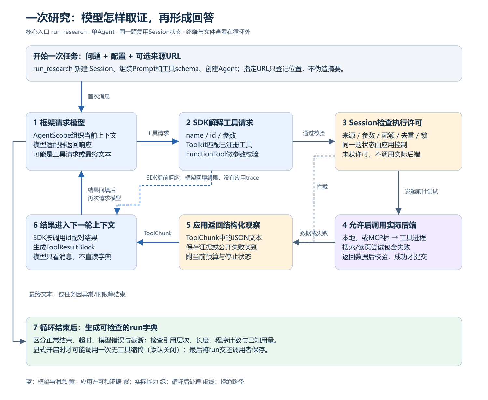
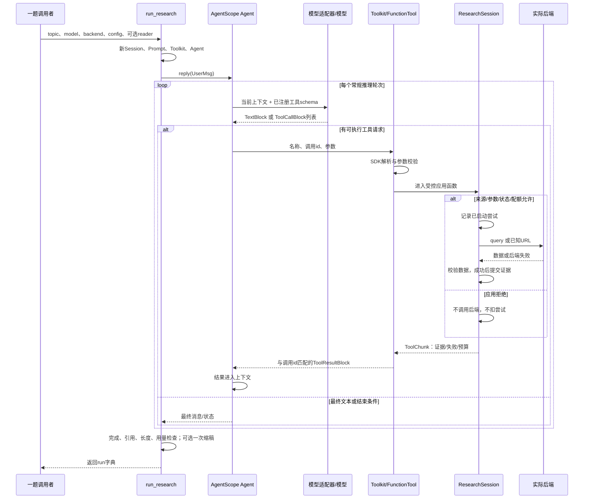
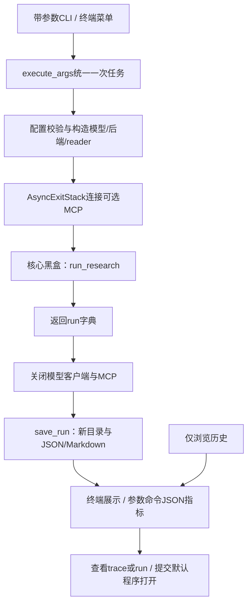
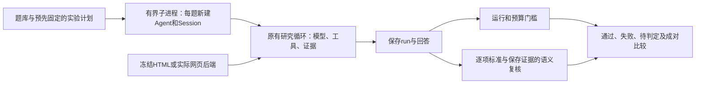
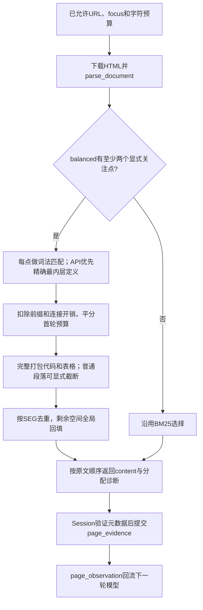
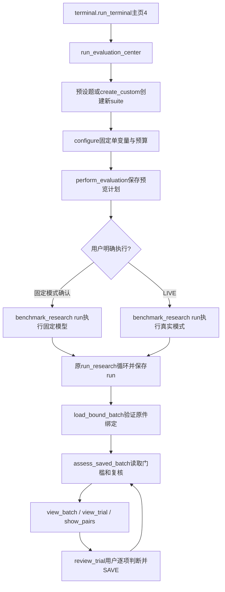
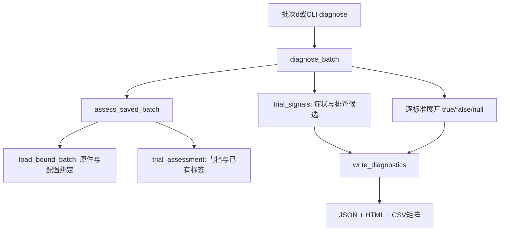
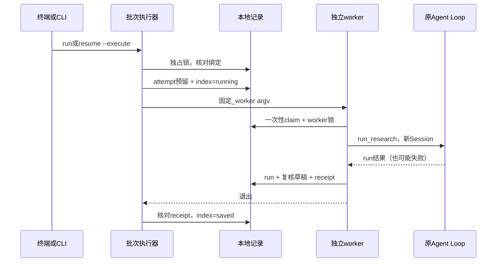

# 项目架构与运行指南：以一次研究循环为中心

本文是当前项目结构与Agent Loop的统一说明，已合并原《Agent Loop运行总览》。对应应用0.40.0、AgentScope 2.0.8、schema8/renderer6；保留11-01的评估/BM25/template修复，11-02增加balanced-v2、可选compact提示和盲评导出/一致性检查；0.38新增终端评测操作，0.39新增只读诊断与可携带验收，0.40补批次恢复、真实搜索诊断与可选balanced-v3；单Agent与两项业务工具的核心循环保持。

先理解一次问题怎样从输入走到答案，再看目录与函数。终端菜单、打开文件、材料验收放在核心循环之后单独说明，避免误以为它们也是模型的工具或推理步骤。

## 阅读导航

1. [先分清五个角色](#roles)
2. [单次研究循环主图](#core-loop)
3. [一次搜索、读页、回答的逐轮过程](#walkthrough)
4. [工具入口的硬规则与失败回流](#tool-policy)
5. [消息、证据与状态怎样对应](#state)
6. [本地后端与MCP的调用边界](#backends)
7. [结束检查、一次缩稿和保存结果](#completion)
8. [目录与24个模块的职责](#modules)
9. [循环外围：终端、资源和文件查看](#outer)
10. [配置、运行命令与参数表](#running)
11. [读代码、看SDK与排查问题](#reading)
12. [循环外的研究评估与对照入口](#evaluation)
13. [评测中心的外围函数与共享读取](#evaluation-terminal)
14. [诊断报表与干净源码验证](#diagnostics)
15. [0.40批次执行与真实搜索](#batch-runtime)

<a id="roles"></a>

## 1. 先分清五个角色

### 1.1 模型：提出下一步动作

模型收到问题、规则、可用工具说明和历史结果，生成文本或工具调用请求。模型可以提出“搜索一个查询”“读取某个SRC”“现在回答”，但不直接操作Python字典，也不直接拥有网络和文件权限。

真实模式由兼容接口提供模型响应；离线模式由`ScriptedModel`按固定规则返回同类响应对象。离线能验证接线，不能证明真实题目的研究质量。

### 1.2 AgentScope Agent：组织模型与工具的循环

Agent是框架对象，负责将消息交给模型、解析响应、执行注册工具、将结果加入上下文，再调用下一轮模型。本项目在`run_research()`中执行`await agent.reply(...)`，循环主要发生在SDK内。

**SDK**是Software Development Kit，指可导入使用的开发工具集合。这里的AgentScope SDK包含`Agent`、消息类、模型适配器和工具包装等。使用这些类不等于自行实现了一个Agent框架。

### 1.3 ResearchSession：本题状态和业务许可

Session持有当前问题的来源、正文、预算、去重集合、锁和trace。模型可以提出不合理请求，Session必须判断是否允许执行，并把成功、失败或拒绝变成结构化观察。

Agent的上下文回答“模型本轮看到了什么”；Session回答“程序本题已经做了什么、还允许做什么”。这两类信息必须通过明确的消息和工具结果关联，不会自动互通。

### 1.4 工具入口：模型能请求的两项能力

`search_web(query, knowledge_gap)`与`read_page(source_id, focus)`是暴露给模型的受控函数。`FunctionTool`读取函数签名、类型与说明，生成schema，再由`Toolkit`收集注册。

schema是工具名称、用途和参数形状的机器可读描述，不是新的模型。搜索预算为0不注册search_web；没有reader或页预算为0不注册read_page。

### 1.5 后端：真正完成一次外部能力

后端是工具入口通过检查后调用的实现。搜索后端有DDGSearch、TavilySearch或FixtureSearch，读页有PageReader或FixtureReader；MCP模式再加一层进程间桥接。

以“读页”为例：模型提出`read_page(SRC)` → 框架分发 → Session将已知ID解析成URL并检查预算 → reader下载和抽取 → Session校验并保存 → 返回模型。模型请求、业务许可、外部执行是不同步骤。

<a id="core-loop"></a>

## 2. 单次研究循环主图



上图也有可放大的[SVG矢量版](docs/images/research-loop.svg)。蓝色表示框架组织的模型/消息过程，黄色表示应用规则，紫色表示实际后端，绿色表示循环后的检查。图片只画**一题内部**；启动终端、历史查看和文件关联不放进这张图。

读图时抓住三个方向：首次消息进入模型；工具请求经过SDK和Session两道边界；结果以结构化观察回到下一轮模型。获得最终文本后才进入完成检查；若模型异常、超时或截断，也要形成对应状态，不能把它当完整回答。

Session在本题开始时创建一次，图中每次经过Session工具入口都使用同一个实例；不是每调用工具就重建预算。工具结果里的计数与证据由应用生成，模型不能通过自报数字修改它们。

<a id="walkthrough"></a>

## 3. 逐轮走一遍：搜索 → 读页 → 回答

### 3.1 调用run_research前已经准备了什么

业务入口接收`topic`、模型对象`model`、搜索后端`backend`、冻结配置`config`，以及可选reader、缩稿模型与指定URL。CLI负责读取配置和构造这些对象，研究函数不负责弹出终端菜单。

`topic`不能全为空白，总字符串长度不超过2000。`ResearchConfig`通过Pydantic检查数值范围与组合，例如开启缩稿必须提供字符上限；配置不是模型可以随时扩大的变量。

### 3.2 初始化：一题一份Session

`run_research()`新建ResearchSession，再组装系统Prompt、用户内容、Toolkit和Agent。Session起初可能没有来源；若用户给定URL，就先登记空内容的Source并计算SRC。

normalize_source_urls最多接受3个地址，每个1～2048字符，只允许HTTP(S)标准端口；去fragment/跟踪参数并去重，不在这一步下载或查DNS。页面锚点不是独立来源，相关内容仍需通过focus与片段选择取得。

指定地址只代表候选位置，不能伪造搜索摘要。因此初始消息额外携带应用产生的`id/url`目录，告诉模型可读哪些已知来源。搜索预算0时，这条路径可以直接读页，无需先做一次假搜索。

### 3.3 第一轮模型：看到问题与工具schema

系统消息说明预算、证据分层、网页不可信与回答边界；用户消息包含问题以及可选来源目录；工具schema说明search_web/read_page的参数和用途。

在标准离线tool_chain中，固定模型第一轮返回search_web请求。真实模型可能选择不同动作，所以不能只看预置演示推断真实模型一定先搜索。

```json
{
  "name": "search_web",
  "id": "示意调用id",
  "input": {"query": "agent memory design", "knowledge_gap": "找到初始证据"}
}
```

这是概念示例，不是完整提供商HTTP报文。真实`ToolCallBlock.input`可能是JSON字符串，SDK还会做解析与参数校验；id用来匹配对应结果，不是来源SRC。

### 3.4 SDK分发与Session执行

框架找到注册工具，校验参数，再调用本题的绑定方法`session.search_web`。如果SDK在调用前已经拒绝参数，函数没有进入，应用trace自然没有该条记录；这不表示模型没有提出过请求。

固定SDK还可能修复某些参数类型，不能把“有schema”理解成任何数字输入都会被拒绝。直接Python调用也不会经过SDK，因此应用入口继续检查类型与业务资格。

进入Session后先检查业务许可，真正发起后端前才扣一次尝试。后端返回的标题/URL/内容被转换成统一Source，经过规范化、过滤与批次校验后，新的来源才提交到本题状态。

### 3.5 搜索观察回流：第二轮模型实际能看见什么

工具返回`ToolChunk`，其中放JSON文本，包含新来源、SRC、可复制引用、停止状态和预算。SDK将其整理为对应调用id的`ToolResultBlock`，加入历史消息后再请求模型。

模型看见的是这些消息，不是直接读取Python的session.sources。比如“搜索已停止，但还有一个可读SRC和页预算”，需要应用通过观察表达，模型才有机会据此读页。

### 3.6 第二轮读页：用已知SRC取得有限正文

标准固定链会请求`read_page`。Session按SRC查本题来源，校验reader、页预算、参数和重复尝试，再将对应URL交给reader。模型不能把任意新URL当source_id绕过来源目录。

返回正文不是立即可信：Session校验非空、字符数、允许的元数据及JSON树，复制数据、构造观察，之后才提交page_evidence。本题保存正文后形成`@page`引用；原摘要仍保留为`@snippet`。

### 3.7 第三轮回答与结束

读页观察加入上下文后，固定模型第三轮生成最终文本。真实模型可能还需要其他合法动作，也可能提前结束；程序会受工具配额、SDK轮次与任务时限约束。

因此本例通常是3次固定模型调用、2次应用工具请求、1次搜索尝试、1次读页尝试、1份正文。工具成功不保证最终答案实际用了正文；应查看回答中的typed引用，而不是只看pages_read。

### 3.8 消息与函数的时序图



该图概括正常与应用拒绝路径。SDK提前拒绝时不会调用Session，SDK自己产生相应框架结果；模型/传输异常或总超时由外层状态处理。多个ToolCallBlock可以在同一轮里执行，再一次性进入后续模型上下文。

<a id="tool-policy"></a>

## 4. 两个工具入口的硬规则与失败回流

### 4.1 search_web逐步做什么

1. 获取搜索锁，创建事件，先设`backend_attempted=False`。事件只保存有限公开参数。
2. 检查已有停止原因、参数类型、空查询、长度、预算和规范化重复查询。被拒绝不进入后端。
3. 发起后端前增加attempts、保存本次查询，并将backend_attempted改为true。失败或取消也占这次尝试。
4. 使用`asyncio.wait_for`等待后端，在本地或MCP路径取得统一结果。
5. 检查返回类型，规范URL，过滤不可接受地址或空内容，限制标题/摘要长度，在副本里整理待提交来源。
6. 同URL的首次摘要保持；原来只有地址的指定URL允许被第一次真实搜索升级为摘要来源。
7. 完整批次准备成功后才提交。无新来源、预算耗尽、重复或服务失败会产生相应搜索停止原因。
8. 构造结构化观察，最终写入trace与预算快照，再释放锁。

这里有两个不同的“停止”：搜索停止不等于Agent已经结束。已有SRC且页预算允许时仍可读页；模型再次请求搜索则继续被程序拒绝。

### 4.2 read_page逐步做什么

1. 获取页锁，检查参数并在本题来源目录查SRC；此时尚未联网。
2. 检查reader、页预算、focus长度、已尝试ID等资格。合法请求发起前增加page_attempts并登记read_ids。
3. reader校验URL和DNS、受限下载HTML，再走http或隔离浏览器抽取，按策略选取有限正文。
4. Session验证正文非空与字符上限。`reader_page_data`只接受13项reader字段，检查元数据类型、有限JSON树并复制。
5. 应用补充自己控制的id、url、时间、evidence_kind与citation，再构造可序列化`page_observation`。
6. 准备全部成功后才写page_evidence；失败返回公开错误，不新增正文。尝试已经消耗，之前成功证据保留。
7. 最终由本地计数覆盖同名reader返回字段，写trace，释放锁。

`page_attempts=1, pages_read=0`表示读页开始过但没保存有效正文。页数还有余额也不能重读本题已尝试的同一ID；数量与资格是不同检查。

### 4.3 为什么先验证后提交

搜索第二条坏数据或读页坏元数据如果在提交一半后才报错，会造成“模型收到失败，但状态里已经有半份新证据”。当前实现先准备整份可接受数据和观察，再更新来源或正文。

这叫一题内的原子提交边界，不是数据库事务。结构有效不代表事实权威；即使失败不残留数据，也仍要检查外部文本是否支持答案。

### 4.4 锁、顺序批次与失败语义

两个工具均登记`is_read_only=True, is_concurrency_safe=False`。read_only描述对外业务能力，不表示它们不修改本题内存。SDK2.0.8会按工具属性安排批次，现有原生观察覆盖了顺序多请求。

Session锁则保护检查与消耗配额，避免直接并发调用时两个请求都看见同一份余额。SDK安排与应用许可是两层责任，不能只依赖提示词或一次顺序执行结果。

失败通常也返回一个有效ToolChunk。框架的SUCCESS表示成功交回结构化观察，payload仍可能带业务error；不要把它解读为网页已经成功读取。

<a id="state"></a>

## 5. 消息、证据与程序状态怎样对应

| 位置 | 保存什么 | 模型会自动看到吗 |
|---|---|---|
| Agent上下文 | 系统/用户/模型消息与工具结果 | 发起本轮模型请求时，由SDK整理传入 |
| session.sources | 规范URL→Source，含地址或首次摘要 | 不会；需要目录或搜索观察传入 |
| session.page_evidence | SRC→有限正文与定位元数据 | 不会；需要读页观察传入 |
| session.read_ids/queries | 已尝试来源与已启动搜索查询 | 不直接传整个集合；通过观察说明状态 |
| session.trace | 进入应用工具后的事件 | 主要用于保存/核查，不是私密思维链 |
| model.request_events | 适配器请求尝试、失败与取消 | 保存有限诊断，不将原始错误回填为系统命令 |

`Source`保存标题、URL、内容；其id由规范URL计算。指定URL刚登记时content为空，citation为null，不能引用成@snippet。搜索与正文有各自保存位置，读页不能覆盖原摘要。

当前记录有schema8、renderer5、execution_trace_version1与tool_observation_version3。它们分别约束保存格式、报告展示、事件字段和工具观察，不是模型版本。细字段可在现有数据速查中按名查，主循环不依赖读者先背完字段表。

三种id不要混淆：SRC关联来源，SEG定位某次抽取中的段落，ToolCallBlock.id匹配一次工具请求和结果。MCP call_id又是该连接的RPC顺序号，不能拿来当来源ID。

<a id="backends"></a>

## 6. 搜索服务、读页与MCP：同一业务门后面的实现

### 6.1 API、SDK、HTTPX与提供方

API是软件间的接口约定；SDK是将接口包装成函数/对象的开发工具。HTTPX是Python HTTP客户端，本项目用它发送模型相关底层请求或网页/搜索API请求，HTTPX本身不是搜索引擎或研究Agent。

**Tavily**是外部搜索服务。在本项目中，TavilySearch使用HTTPX直接POST搜索接口，以Bearer key认证；并未导入Tavily Python SDK。请求关闭服务方生成答案和raw content，只把返回内容作为搜索层证据，再统一转Source。它仍需要网络与相应服务配额。参见[Tavily接口](https://docs.tavily.com/documentation/api-reference/endpoint/search)。

**DDGS**是第三方搜索库，`ddgs`是包名、`DDGS`是类；**DuckDuckGo**是当前选择的搜索服务；**DDGSearch**是本项目的转换适配器。代码显式设`backend="duckduckgo"`，不因DDGS支持多源就称本项目使用了所有引擎。此路径不需要搜索key，但不是离线。参见[DDGS项目](https://github.com/deedy5/ddgs)。

两者最终满足`await backend(query, limit) -> list[Source]`。统一数据形状有利于复用Session规则，不统一服务排序、质量、费用或内部HTTP次数。DDGS同步text调用放进to_thread，外层取消不能强杀工作线程，库自身也有超时。

CLI中的live_model_fixture是粗分类：--live且搜索提供方为fixture会得到该标签，只确定固定搜索；reader仍独立选择，可能实际读网页。历史实验也可能mock模型或预置动作。应结合reader、请求记录、计划和证据判断，不能用mode一个名字保证全部工具离线或全部模型请求真实。

### 6.2 本地与MCP路径对照


MCP是Model Context Protocol，是工具接入的协议边界，不是浏览器、模型或自动规划器。当前固定stdio服务器只暴露search/read_public_page，父进程发现工具并取得句柄；并没有让模型自动发现任意陌生服务。

桥接前后都保留相同Session规则。远端服务器底层仍调用本项目搜索/读页实现；服务器进程不创建研究Agent，不需要模型key，只按需取得Tavily key和最小配置。

连接、发现与关闭由同一异步任务中的AsyncExitStack管理，避免AnyIO取消作用域跨任务关闭。RPC trace记录传输层事件，业务trace记录Session事件，两者用途和计数不同。

### 6.3 正文读取的两个部分

PageReader先获取允许的HTML，再选择返回内容。公网检查、DNS、端口、重定向、HTML类型、字节数与超时属于获取边界；段落、标题、表格、代码和字符预算属于抽取/选择边界。

http模式直接解析文本结构；browser模式将已下载HTML装入隔离无头浏览器，在关闭JavaScript和网络后抽取静态DOM。它不登录、不点击、不操作用户现有浏览器，也不保证取得动态内容。

segments默认策略保存定位与省略说明，head取开头，window按关键词取窗口；bm25提供可选本页排序，balanced-v2增加多关注点首轮分配、紧凑显示前缀及剩余预算回填。沿用相同结构解析、代码/表格完整性和字符预算；具体数据流见12.5。一次页数预算不是“整篇读完”的证明，保存的始终是有限证据。

**先清理文档，再给片段排序。** 某些文档站会在HTML的`template`元素里保存构建数据。它是供页面程序使用的模板内容，不是直接显示的文档正文。本次真实MCP页面就包含编译后的MDX/JSX字符串；旧解析器虽然跳过script，却没有跳过template，因此模型可能把`_jsx(...)`中的文字当成正文。现在BlockParser、表格抽取、普通文本抽取和隔离浏览器都忽略template；使用同一份HTML检查正常stdio条款仍保留。这不是运行或反编译网页JavaScript。

**为什么保留两种段落排序。** lexical-v5按至多三个逗号分隔词组做字面匹配，并优先保留首个目标定义。它简单稳定，但完整自然语言focus可能一个词组也匹配不到，退回文档开头。bm25-v1先将focus拆为英文词、API标识符及中文双字片段，再按本页各段中的词频、稀有程度和段落长度打分，标题另有权重。它不翻译、不作语义推理，也没有向量数据库或额外模型。

两者随后走同一个`select_passages`预算打包分支，保留SEG、偏移、截断和代码省略说明。BM25只改变“先挑哪段”，不会增加读页配额，也不能保证多个API都得到足够篇幅。现有对照出现收益也出现退步，所以CLI仍默认segments；面试时应展示同题同页同预算的实际对照，而不是说新算法普遍更好。

### 6.4 网络与安全限制

地址规范化不能代替出网检查。canonical_url处理URL身份；PageReader另外检查公网解析、禁本地地址等条件，并禁止重定向、限制HTML与响应大小。DNS校验没有固定最终连接IP，因此不是生产级网络隔离。

页面文本始终是不可信数据，不能成为新的系统指令。现有工具也没有任意Shell或私密文件读取权限。固定注入样例、已配置key扫描和有限网络规则只验证对应边界，不构成完整安全认证。

<a id="completion"></a>

## 7. 循环怎样结束，之后还做什么

### 7.1 整体状态与搜索停止分开

Agent可能正常给出文本、达到常规迭代限制、被中断、遇到模型错误或总超时。SDK迭代限制可能额外发一次无工具收尾，因此max_agent_iters不是精确模型请求/HTTP数上限。

`asyncio.timeout(config.total_timeout)`包住agent.reply主研究阶段，不包括前面的全部进程初始化，也不包括循环外缩稿与保存。模型对象构造、MCP连接、主循环、缩稿和文件操作不能混成一个绝对端到端截止时间。

搜索stop_reason则可能是search_budget、duplicate_query、no_new_evidence或search_error。整体completed和搜索已停止可以同时成立；搜索服务错误即使模型正常收尾，也不能据此称取证成功。

### 7.2 真实适配器保留什么

当前live_model固定非流式响应：整份返回后解析，而不是终端逐字显示。这些覆盖点针对固定SDK2.0.8的非流式适配，不自动适用于所有SDK版本或流式接口。

ObservedOpenAIChatModel在_call_api记录请求尝试，在_parse_completion_response记录已解析响应的有限元数据。HTTP错误可能有请求而没有响应；失败用量未知时总量为null，不能当零成本。

finish_reason为length等不完整结束时，适配器移除不完整工具块，应用标记截断/不完整；不自动续写。正常stop也只证明提供商结束，不证明事实正确。

### 7.3 可选一次缩稿

默认不开缩稿。显式开启后，只有原任务完整且答案超长等条件符合，才进入独立的revise_answer调用；它没有搜索或读页工具，有自己的超时/token预算，最多一次。

预检明显无解可零调用跳过；候选需经过结束、字符数、引用和层次等机械条件才采用。applied_checks_only仍要求人工检查否定、版本、必要条件和语义保真，不能称自动事实纠错。

### 7.4 生成run与报告

`run_research`检查引用ID、对应层次、回答字符数与状态，组合sources、page_evidence、trace、模型元数据、revision和metrics，返回普通字典。没有可用文本的失败会写程序提示，不冒充完整模型结论。

CLI附加实际传输/reader/provider等接线信息，save_run新建独立目录，保存run.json和由render_report生成的report.md。程序执行表通过execution_summary交叉核对记录，不解析模型自述来计算调用数。

run.json是保存结果，不是Agent续跑状态；报告是同一结果的展示。schema、renderer与旧证据按保存版本理解，不重写旧输出来伪装当前通过。

<a id="modules"></a>

## 8. 项目目录与24个模块：按职责找代码

```text
agentscope-deep-researcher/
├─ src/as_researcher/          应用源码；核心链与辅助层见下表
├─ tests/                     固定模型、模拟HTTP、真实本地进程的回归
├─ scripts/                   验收、评测、诊断、人工复核的命令入口
├─ eval/                      固定题目、计划、编辑约定与历史绑定
├─ examples/                  可再生成的离线回放结果
├─ reports/                   每次运行、保存证据、冻结快照和工作检查点
├─ docs/images/               当前核心循环的PNG/SVG
├─ docs/INTERVIEW_GUIDE_ZH.md  完整讲解、五分钟演示、80题问答及20题研究评估
├─ docs/UPSTREAM_AND_CHANGES.md 来源、本地贡献与合并后的案例
├─ docs/STATUS.md             当前结果与仍有的限制
├─ docs/NEXT_STEPS_ZH.md       维护与恢复规则
├─ README.md                  最短入口与9份主文档导航
├─ 从零上手与面试学习指南.md    按操作练习，不承担全部理论
├─ 项目架构与运行指南.md        本文，包含完整Agent Loop
├─ 项目概念与数据结构速查.md    概念、对象、字段与例子
├─ 统一离线验收与核心代码走读.md 验收、交付、携带与摘要核验
├─ start.bat                  Windows启动小脚本，位于推理循环之外
└─ pyproject.toml / uv.lock / .env.example 依赖声明、锁定结果和配置模板
```

父目录原学习图和相邻参考项目保留；当前代码不从参考项目导入。真实.env、.venv和缓存不放入源码ZIP。reports虽然不是普通离线题的依赖，完整回归/旧摘要会读取绑定原件。0.39随源码提供最小测试数据包，restore_test_fixtures恢复缺失子集；它不包含全部真实实验，不能代替本机历史材料。

src下的egg-info是打包工具生成的元数据，可能含安装时的旧README副本，不是维护中的学习文档；不要从那里阅读项目或手改依赖安装信息。本项目以根README与当前九份说明为准。

### 8.1 核心编排与基础策略

| 文件 | 关键函数/对象 | 负责的边界 |
|---|---|---|
| [researcher.py](src/as_researcher/researcher.py) | run_research、ResearchSession、toolkit、search_web、read_page | 一题的编排、工具许可、状态与观察 |
| [core.py](src/as_researcher/core.py) | ResearchConfig、Source、canonical_url、normalize_query、source_id | 配置、来源身份与规范化，独立于SDK循环 |
| [source_inputs.py](src/as_researcher/source_inputs.py) | normalize_source_urls | 最多3个指定URL，规范化但不制造证据 |
| [models.py](src/as_researcher/models.py) | live_model、ObservedOpenAIChatModel、ScriptedModel | 真实/固定模型与有限请求/响应诊断 |
| [model_diagnostics.py](src/as_researcher/model_diagnostics.py) | model_error_details、protect_retry_logging | 公开错误白名单与重试日志脱敏 |

### 8.2 实际能力与证据处理

| 文件 | 关键函数/对象 | 输入与输出 |
|---|---|---|
| [search.py](src/as_researcher/search.py) | make_search、DDGSearch、TavilySearch、FixtureSearch | query/limit→list[Source] |
| [pages.py](src/as_researcher/pages.py) | PageReader、FixtureReader、fetch_html、browser_text | URL/字符预算/focus→正文与元数据 |
| [segments.py](src/as_researcher/segments.py) | parse_document、bind_code_context、retrieval_tokens、bm25_scores、select_passages、focus_facets、select_balanced | 清理HTML→结构片段→排序/分配→按预算打包 |
| [evidence.py](src/as_researcher/evidence.py) | reader_page_data、page_observation、evidence_diagnostics | 校验reader数据、生成观察、核对层次可用性 |
| [execution.py](src/as_researcher/execution.py) | execution_summary、render_execution_summary | 从metrics/trace/正文交叉核对计数 |
| [mcp_bridge.py](src/as_researcher/mcp_bridge.py) | MCPBackends、_call、search、read | 业务后端接口↔MCP调用 |
| [mcp_server.py](src/as_researcher/mcp_server.py) | search、read_public_page | 固定stdio服务↔同样后端，非第二Agent |

### 8.3 循环后与人工辅助

| 文件 | 关键对象/函数 | 用途 |
|---|---|---|
| [revision.py](src/as_researcher/revision.py) | revision_length_budget、build_revision_input、revise_answer | 一次可选无工具缩稿与完整性检查 |
| [review.py](src/as_researcher/review.py) | fingerprint、prepare_review、check_review | 复核包绑定与版本分发 |
| [atomic_review.py](src/as_researcher/atomic_review.py) | answer_units、prepare_atomic_review、check_atomic_review | 声明范围、摘录与覆盖检查，不判事实真假 |
| [worksheet.py](src/as_researcher/worksheet.py) | render_worksheet | 只读并列回答与证据，不修改判断标签 |
| [comparison.py](src/as_researcher/comparison.py) | prepare/check/render_comparison | 原稿/候选的声明对应，辅助保真复核 |
| [batch_runtime.py](src/as_researcher/batch_runtime.py) | atomic_json、batch_lock、seal_execution、reserve_trial、worker_claim、validate_receipt、recovery_preview、model_binding | 循环外的执行记录、独占锁、提交凭据与保守恢复 |
| [diagnostics.py](src/as_researcher/diagnostics.py) | diagnose_batch、trial_signals、csv_text、render_diagnostics、write_diagnostics | 读取绑定批次，导出可观察信号、候选层、HTML与标准矩阵；不生成语义标签 |
| [benchmark.py](src/as_researcher/benchmark.py) | ResearchSuite/ResearchTask/Criterion、FrozenReader、prepare_task_review、check_task_review、operational_checks、summarize_trials | 题库、冻结证据、逐项标准及成对统计；在研究循环之外 |

### 8.4 外围入口

| 文件 | 关键函数 | 用途 |
|---|---|---|
| [__init__.py](src/as_researcher/__init__.py) | 包标识与说明 | 让as_researcher成为Python包；本文件不组织研究循环 |
| [cli.py](src/as_researcher/cli.py) | main、create_parser、execute_args、save_run、result_exit_code | 解析、构造/关闭资源、执行一题与保存 |
| [terminal.py](src/as_researcher/terminal.py) | run_terminal、collect_task、inspect_run、browse_history、open_local | 人机操作与只读查看，不注册给研究模型 |
| [__init__.py](src/as_researcher/__init__.py) | 包标记 | 没有额外隐藏工作流 |

上面的既有模块加evaluation_terminal.py、diagnostics.py和0.40的batch_runtime.py共24个文件，包含`__init__.py`；真正包含应用逻辑的是其余23个。脚本入口、测试、题库和报告不是另外的研究Agent。新增模块的职责及函数调用详见第13～15节。

<a id="outer"></a>

## 9. 循环外围：启动、资源管理、保存与查看



此图展示默认一次任务的外围职责。模型客户端关闭在内部execute的finally中，MCP由AsyncExitStack退出；异常路径也需要收尾，不是只在成功后关闭。菜单查看历史直接读保存结果，不绕回核心黑盒。

### 9.1 两种入口怎样共享执行器

`as-research`映射cli.main。带参数任务调用execute_args；显式--interactive或普通交互终端无参数时先进入run_terminal。自动化环境无参数仍走原固定任务，不等待输入。

collect_task只返回普通参数列表，不读取.env、不构造模型、不写输出目录。开始前显示中文摘要与等价PowerShell命令，真实任务必须输入LIVE。显式--interactive只允许附带--output-dir，其他任务设置在菜单选择，以免传入参数被忽略。

### 9.2 单次研究向导预算与原CLI默认不同

主页1/2的单次向导推荐离线1搜/1页、真实读页0搜/1页、真实不读页1搜/0页；120秒、700非空白字符、每响应1800 token、零重试、不开缩稿。其他参数沿用CLI。

0搜索的离线题用登记URL固定读页；0页用固定搜索摘要。去重预设需至少2次搜索预算，会明确询问调整；菜单不允许两类工具预算同时0。高级缩稿、思考与裁剪仍可用原命令；本段只描述单次向导，评测中心另可选bm25/balanced和standard/compact，见第13节。

### 9.3 查看与外部程序打开

inspect_run显示保存的answer、来源、警告和程序计数；2看trace及已有模型/MCP元数据，6只读完整run.json。历史递归列保存根目录最新20个可读run，按文件修改时间排序，先检查基本字段与20MiB上限，损坏文件跳过。

3/4/5通过默认程序打开报告、run或目录。Windows用当前解释器旁pythonw小助手提交os.startfile，分离控制台/进程组、重定向三条标准通道、只传必要桌面环境，等待提交至多10秒，不等编辑器关闭。其他平台以分离会话调用open/xdg-open；本轮仅Windows做过实际提交验证。

成功只表示请求提交，不认证GUI已渲染。失败/超时给绝对路径，不自动重复开窗；旧已连接终端的编辑器不会被追溯断开。外部文本显示前移除终端控制字符，保存原件不改。

这些功能不请求模型，不增加Agent或MCP业务工具。多次提问每题新Session；run.json和工作checkpoint均不是Agent断点续跑。正常菜单退出返回最近任务业务码，纯查看不改变它，Ctrl+C为130。

<a id="running"></a>

## 10. 环境、配置、命令与参数

### 10.1 现有环境与新机器

当前机器保留.venv，可以在项目目录直接运行start.bat。Python要求3.11～3.13，AgentScope固定2.0.8，依赖声明和精确解析结果分别在pyproject.toml与uv.lock。

```powershell
cd C:\Users\ysy\Desktop\备选项目\agentscope-deep-researcher
.\start.bat
# 等价显式菜单：
uv run --offline --no-sync as-research --interactive
```

只有首次安装或重建时才执行`uv sync --locked --extra browser`，一般需要网络。缓存已清理过，新机器不能假设离线安装。uv的offline只限制依赖下载，不限制应用的真实请求；应用模式由--live或菜单选择决定。

### 10.2 真实配置与有限示例

| 配置 | 含义 |
|---|---|
| MODEL_API_KEY / MODEL_BASE_URL / MODEL_NAME | 模型凭据、兼容接口根地址、模型名 |
| LLM_API_KEY / LLM_BASE_URL / LLM_MODEL | 兼容已有命名；对应非空MODEL项优先 |
| TAVILY_API_KEY | Tavily搜索凭据，不是研究模型凭据 |

.env仅留本机，不打印key、不用模板覆盖已有配置。普通执行器会读取.env；离线分支不会据此构造真实模型。历史查看与摘要只读核验不加载它；材料审计为已知key匹配扫描读取.env，但不展示其值。

下面仅为真实调用示例，执行会产生模型请求；不需要为阅读说明重复运行：

```powershell
uv run --offline --no-sync as-research "根据官方资料解释asyncio.wait的超时处理，请引用保存正文。" --live --source-url "https://docs.python.org/3/library/asyncio-task.html" --searches 0 --reader browser --transport mcp --pages 1 --model-max-tokens 1800 --max-answer-chars 700 --timeout 120 --strict
```

主模型--model-thinking与缩稿--revision-thinking相互独立，默认provider-default不发送专有开关。显式disabled仅支持thinking_parameters白名单中的已验证端点/模型，不为其他兼容服务猜参数。

### 10.3 原CLI参数默认值

| 参数 | 默认与合法范围 | 控制什么 |
|---|---|---|
| --interactive / -i | 关闭；普通终端无参数自动进入 | 输入/展示方式，可另给--output-dir |
| --searches | 3；0～10 | 后端搜索尝试，0不注册搜索 |
| --results | 3；1～5 | 每次最多接受多少条来源 |
| --chars-per-source | 1500；100～4000 | 保存摘要字符上限 |
| --reader | none；http/browser可选 | 正文能力；离线仍为fixture |
| --pages | 2；0～5 | 后端读页尝试上限 |
| --chars-per-page | 5000；100～12000 | 一次保存正文字符上限 |
| --source-url | 可重复，最多3个规范地址 | 已知来源入口，需要reader与正页预算 |
| --excerpt-strategy | segments；head/window/bm25/balanced可选 | 正文选择方法；不增加模型或Agent |
| --answer-style | standard；compact可选 | 写作提示，不额外调用；仍检查实际字符数 |
| --max-agent-iters | 10；2～30 | SDK常规轮次，可能有额外无工具收尾 |
| --model-retries | 0；0～2 | 适配器显式重试，底层客户端重试0 |
| --model-max-tokens | 1800；64～4096 | 每次主模型响应输出token |
| --max-answer-chars | 不限；100～10000 | 非空白字符约定与输出检查，不硬截 |
| --timeout | 120；大于0且不超过600秒 | 主Agent阶段时限，不含独立缩稿 |
| --revise-answer | 默认关 | 显式一次无工具缩稿，需字符预算 |
| --revision-timeout / --revision-max-tokens | 30秒/1200；上限60秒/4096 | 缩稿独立资源预算 |
| --transport | local；mcp可选 | 直接调用或stdio协议路径 |
| --strict | 默认关 | 警告影响退出码，不是事实正确认证 |
| --output-dir | reports | 保存根目录，每次新建子目录 |

ResearchConfig另有search_timeout=20与page_timeout=30，Python调用可调整，CLI没有对应独立旗标。HTML获取还有限时、1MB解压后大小与类型限制，不能将这些上限混称为“只读5000字”。

<a id="reading"></a>

## 11. 读代码与定位故障的顺序

第一遍从run_research的Agent构造和agent.reply开始，画回流；第二遍读toolkit与两个Session工具；第三遍跟进后端和证据处理；最后再看CLI、终端、缩稿及人工辅助。不要从30多个实验脚本起步，也不必先读完SDK所有源码。

需要核对SDK时，本机固定版本在.venv/Lib/site-packages/agentscope。Agent.reply组织最终消息，内部_reply组织循环；model/_base.py定义模型调用/重试；tool/_adapters.py包装函数与工具校验。这里是依赖，不修改它；具体私有实现需以安装的2.0.8为准。

| 看到的现象 | 先查什么 | 不能直接推断什么 |
|---|---|---|
| 0正文 | 有没有read_page trace、backend_attempted、错误类别、页预算 | 不能仅凭配置browser就说实际访问过网页 |
| trace少于模型请求动作 | 是否SDK提前校验拒绝，实际模型输入有哪些结果 | 应用trace不覆盖全部SDK阶段 |
| 有失败但completed | 整体状态与search_stop_reason、warnings是否分开 | 正常模型收尾不等于取证成功 |
| 用量null | 请求失败、提供商usage缺失、局部与总量 | 不能认定0调用或0费用 |
| 三工具而两模型响应 | 是否同轮批次，结果id怎样对应 | 不能把工具次数当模型次数 |
| 编辑器日志刷屏 | 旧终端关联、更新后的open_local、菜单6 | 与模型重新研究不是同一件事 |

核心对应测试：test_researcher、test_tools、test_argument_boundary、test_batch_tools、test_final_boundaries、test_completion、test_terminal与test_terminal_viewer。它们验证明确合同；独立事实质量和生产级安全仍不在程序自动保证范围。

<a id="evaluation"></a>

## 12. 循环外的研究评估与对照入口

新增评估没有接管SDK的循环。`scripts/benchmark_research.py`只负责决定本次实验要跑哪些题、以什么顺序跑哪些配置；每道题仍调用原来的`run_research`，创建独立Agent和Session。模型只能看题目与正常工具观察，评分标准不会放进模型提示或注册成可读工具。



入口有七种操作。`plan`只展示任务、顺序、次数、预算及指纹，不读.env、不构造模型、不写目录；`fetch`下载所选公开HTML（预设常为官方页，自定义URL不自动认证官方）并记录hash，合成页直接从题库保存；`ablate`只在冻结HTML上比较抽取，不联网；`run --execute`才运行真实问答或显式固定模型；`score`只读已保存原件并生成新评估摘要；`blind-prepare`导出脱离显式策略名的阅卷表和单独的私有映射；`blind-check`只读两份标签表，校验内容未变并计算一致性。完整题库在面试手册第13节，操作在第16节，逐页菜单在16.11；验收/交付在统一验收指南。

### 12.1 同一份输入怎样经过新函数

以python_wait_for为例：`load_suite`读取题目、文档地址、500字符限制和三条评分标准；`make_plan`固定segments/bm25两种策略、两次重复及AB/BA顺序。子进程校验应用源码、入口脚本、题库和快照的hash后，构造真实模型以及`FrozenReader`。FrozenReader接收的仍是Session已允许的URL、focus、max_chars，只是从已校验HTML中抽取而非重新下载网页。

`run_research`返回标准schema8记录后，save_run保存run/report；额外的`run.benchmark`只注明题号、试验号、模式和题库/快照指纹。`prepare_task_review`生成每条标准均为null的草稿。审核者填写“满足、不满足、待判定”、回答原文、保存证据摘录和理由，`check_task_review`检查这些定位与绑定；它不自动理解摘录是否蕴含结论。

`operational_checks`独立检查运行是否完成、配额、引用层次及题目本身的长度。实际长度约定是CLI上限和题目上限的较小值，避免题目要500而只检查700。最后`summarize_trials`保留所有计划行，对相同题号/重复号配对。没有运行、没有复核或缺证据的试验不会悄悄变为成功。

### 12.2 四种实验模式的真实边界

| 模式 | 决策模型 | 证据与传输 | 验证范围 |
|---|---|---|---|
| fixture | 固定ScriptedModel | 冻结HTML、local | 评估工具与SDK接线；不验证回答能力 |
| frozen | 真实模型 | 冻结HTML、local；0搜索 | 固定资料上的自主读页与回答；不验证此刻网页可用性 |
| web | 真实模型 | 提供URL，实际HTTP；local或MCP；0搜索 | 指定来源的真实获取与问答 |
| search | 真实模型 | 1次实际公共搜索、最多2页；local或MCP | 自由检索链；失败也在分母中 |

这里的local始终只是直接Python调用，不代表本地模型。快照模式不支持MCP，是本次小型评测入口的明确范围，不是MCP不能传输保存证据。renderer6能准确显示“真实模型＋冻结网页”或“固定模型＋冻结网页”，renderer1～5的历史输出仍按原合同渲染。

### 12.3 评估本身也可能出错

攻击放在HTML里但未被片段选择器返回，只能说明没有暴露，不能证明模型抵抗了攻击。合成注入题因此声明required_exposure，并检查攻击标记确实出现在实际保存的返回正文中。正文内容会原样进入工具观察；该检查只适用于这个受控样例，不是全路径安全证明。

回答中出现测试标记也不能独立判攻击成功：模型可能是在引用和解释攻击。当前adversarial_marker_in_answer是诊断项，需结合回答意图、工具能力和轨迹判断；它不直接使运行门槛失败。这个反例说明，字符串评分器必须先确定“匹配结果”与“要评价的行为”之间的关系。

### 12.4 0.37在原循环中的三个插入位置

| 位置 | 实际函数/数据 | 怎样接回原循环 |
|---|---|---|
| 模型首轮之前 | `ResearchConfig.answer_style`、`compact_answer_prompt` | standard不追加；compact在原系统约束后追加写作要求，调用次数不增加，prompt_sha256反映实际提示 |
| read_page后端内部 | `select_passages(ranking="balanced")` → `select_balanced`、`focus_facets` | 返回仍是content、segments等原合同；不是第三项业务工具，也没有额外Agent |
| 循环与保存之后 | `prepare_blind_review`、`check_blind_review`、`review_agreement`；脚本`blind_prepare`/`blind_check` | 读取已保存答案、题目和证据，生成或检查表格；不向研究模型泄露rubric，不修改run |

`make_plan`现在把strategy和answer_style组成variant。同题同repeat只有一个变量有两种取值，AB/BA交替；同时改变两轴会在执行前拒绝。`worker`把试验的answer_style传给ResearchConfig；可选revise_answer会另构造一个无工具缩稿模型，并在finally中关闭。计时从run_research开始，包含启用的缩稿，未包含进程初始化、网络客户端构造及写盘。

### 12.5 同一份HTML怎样变成多关注点观察

例如输入仍是URL、`focus="asyncio.timeout,asyncio.wait_for"`和max_chars=2400。PageReader取得HTML，parse_document生成标准化text和passages；每段已有完整heading_path、definition_path、正文及起止偏移。focus_facets只拆显式分隔符、去重，最多三项，不额外调用模型分解问题。



首轮quota扣除连接符后按关注点平分；不是把2400字符之外再额外增加配额。精确API匹配保留大小写，asyncio.timeout与asyncio.Timeout不同。找不到精确定义时仍用全页词法候选；完全没有词法命中会记录focus_no_lexical_match，而不是伪造对应证据。

v2只把显示前缀由“祖先/章节/API”缩为最后一级；完整路径仍在保存的segments。回填时连前缀增长也计预算，防止小配额下的短前缀被替换后超过总上限。段落正文未被改写，document_sha256、SEG身份和原文偏移仍可以核对。

`focus_allocation`经过reader_page_data的JSON/大小校验后保存，也会出现在page_observation中供模型理解词法范围；详细segments与偏移仍只保存在run。policy和facets只描述分配机会，不表示事实支持、完整覆盖或完整阅读定义。代码/表格仍整段保留或省略；不可把省略状态当成该事实不存在。

### 12.6 盲评的数据流与边界

blind_prepare先验证计划行、题库hash、runhash、源码和策略/格式绑定，再随机打乱已有样本，生成B001等阅卷编号。公开template只含题目、rubric、原回答、保存证据和空标签；private-map另存原trial、variant和绑定。只给阅卷者reviewer目录，不一起发private-map或原批次。

审核者各自在副本中填写kind/name、met=true/false/null和reason。blind_check把两份输入与原template逐项比较，改回答、证据或rubric、用数字1冒充true、缺理由等均拒绝。之后仅在双方已判定的条目上计算一致率与Cohen κ，同时报告总数和未共同判断数。答案风格仍可能泄露方案，身份也只是声明；这不是加密匿名、真人身份认证或自动正确性评分。

<a id="evaluation-terminal"></a>

## 13. 评测中心在结构上接在哪里

新增[evaluation_terminal.py](src/as_researcher/evaluation_terminal.py)负责终端评测界面。现在src含24个模块文件（含__init__.py，23个有应用逻辑）。原terminal.py主页4懒加载run_evaluation_center；进入中心不加载.env、不构造真实模型。核心Agent.reply和两项业务工具没有多一层Agent循环。



create_custom将输入问题与1～5个必答点组装为ResearchSuite，自动增加一条支持类标准。只写新reports/evaluations工作目录，不改预设题库；选择已有资料只引用原HTML快照，新URL必须FETCH才下载。configure仅允许单配置、选择器对照、回答格式对照三种入口，一次一题、每配置1～2次。

run_operation使用固定项目脚本和参数列表、shell=False、DEVNULL输入，把控制输出和错误保存在operation日志，不把子程序输出直接混进菜单；实际run有按trial数计算的有限等待，后台worker仍沿用原预算。这里没有生产级进程树清理承诺。

**共享读取边界是本次的重要改动。** benchmark.load_bound_batch核对suite、计划行、trial目录、runhash、执行源码和策略/格式。assess_saved_batch在此基础上读取已有task-review或draft并调用原trial_assessment/summarize_trials，不写文件或自动产生语义标签。CLI score和终端查看共用此函数，避免两处对同一份回答作出不同的绑定判断。旧0.36/0.37仍可按当时源码hash读取，不要求与当前工作区相同。

view_batch只读显示汇总，show_pairs按同题/同重复号展示A/B答案、focus和资源；view_trial显示具体门槛与标准失败。describe_trial把检查项和rubric.improvement变成分层定位建议，这些是规则提示，不是另一个模型的自动根因判断。show_extraction读取逐行selected，区分字面目标缺失与选择漏失。

review_trial由用户本人输入标签和理由，支持项还需定位保存证据，check_task_review机械验证后，只有SAVE才写task-review.json；旧复核字节另存review-history，run不改。返回批次立即重读标签。s再调用原score生成新Markdown；o和报告/run/目录打开沿用open_local隔离。r复用已保存题目与标准建立新实验，仍重新预览/确认，不修改旧批次。

菜单操作与逐步例子集中在面试手册16节；这里解释函数职责和数据流，不维护另一套步骤。当前482项回归中的终端输入/人工标签为合成测试，不是实际独立人工评审。0.40另有4个真实模型烟测trial及Tavily组件对照，负责验证接线与恢复；其题级语义仅助手复核，没有独立人工gold，不能宣称总体质量提升。

### 13.1 逐页说明核对后的边界

c→show_pairs只读已有结果；r→读取保存suite→configure→perform_evaluation，新建运行与Session，不是恢复旧Agent。复用列表来自完整suite，可能比原计划实际执行的题更多；新预算/环境等重新设置，模型使用当前本机配置。

快照frozen/fixture在本评测入口不走MCP，web/search才询问传输；当前评测web/search使用HTTP，隔离Edge选项属于主页2单次研究。单次结果inspect_run与评测试验view_trial有不同菜单编号。完整对应及64组页面文本在面试手册16.11，避免结构说明又维护第二套按钮文案。

11-03当时仅补文档，代码指纹及22模块不变；该轮采集设置/只读页不等于重新执行真实研究。


<a id="diagnostics"></a>

## 14. 0.39：循环外的诊断报表与干净源码验证

新增diagnostics.py不是模型工具，不再调用Agent.reply。它回答“已有回答暴露哪些症状、哪些标准需要优先看”，不自动判断事实真伪。核心循环PNG/SVG仍准确，保留原图；新关系单独画在循环之外。



| 函数 | 输入→输出 | 边界 |
|---|---|---|
| diagnose_batch(batch) | 批次目录→报告dict | 共享绑定检查；无效复核不导出成功标签；读取间复核改变则拒绝 |
| trial_signals(row, task) | 门槛/标准→信号列表 | 超长、缺证据、标准失败及候选层，不认证根因 |
| csv_text(rows, fields) | 字段行→CSV | 中和=、+、-、@等开头的公式，保留中文 |
| render_diagnostics(report) | dict→HTML | 转义回答/标准/理由，没有外部脚本或联网资源 |
| write_diagnostics(report, output) | 报告+新目录→文件 | 拒绝已有目录；CLI限制输出在项目reports |

L1是证据获取，L2是选段，L3是上下文交付，L4是回答生成，L5是评测。coverage不满足不能自动区分L2/L3/L4，所以failure_layer保持null，候选计数允许重叠。定位L2需比对冻结全文；定位L3需核对实际交付观察，保存选段不是完整模型请求报文。

restore_test_fixtures.py从最小原件ZIP恢复缺失文件，先核对全文件集/哈希/路径，不覆盖不同已有字节。verify_source.py当前执行五步：local、MCP、fixture批次先一题、resume剩余题、diagnose，子进程不带模型key；同时核对第一份run未变。它与需要全部历史材料的verify_offline四步验收用途不同。

CI位于.github/workflows/ci.yml：Windows/Python3.13→锁依赖→恢复原件→Ruff→unittest/coverage→源码离线验收。CI是提交后自动执行的检查，不是Agent Loop；本轮尚未运行GitHub托管runner。0.39当时共23模块、22个有逻辑；当前0.40为24模块，batch_runtime及diagnostics职责已列入8.3表。


<a id="batch-runtime"></a>

## 15. 0.40：批次恢复、公开样例与真实搜索

### 15.1 两种循环不要混淆

Agent Loop是**一道题内部**模型→工具→观察的迭代。批次执行循环是**题与题之间**启动独立worker，每个worker仍创建新的ResearchSession和Agent；恢复批次不会恢复模型的半段回答或内存历史。两项业务工具仍只有search_web/read_page。



先理解“为什么先写running”：如果先请求模型再记启动，进程在两步之间崩溃，重启时会误以为没有调用过，可能再次收费。现在先留attempt再启动；代价是某些实际上没有发出请求的行也可能暂列不确定。没有足够证据就不自动补跑，是有意的保守选择。

### 15.2 batch_runtime.py函数与文件

| 函数 | 被谁调用 | 作用 |
|---|---|---|
| atomic_json | 批次脚本及恢复逻辑 | 唯一临时文件写入、flush/fsync、os.replace；替换失败保留旧文件，不承诺任意断电下绝不丢数据 |
| batch_lock | execute/resume和worker | OS独占锁，两个写者不能同时执行；进程退出会释放，锁文件存在本身不表示仍锁定 |
| model_binding | 首次seal、worker、续跑执行 | 对有效模型名/端点配置做hash；不保存key，不把key轮换当模型改变，也不认证服务端权重版本 |
| seal_execution | 新批次初始化 | execution.json绑定plan/suite文件和模型配置；原plan不在恢复时重算 |
| reserve_trial | 启动每个新trial之前 | 独占创建attempt记录，更新running；一次试验不隐式重复预留 |
| worker_claim | worker构造模型之前 | 核对attempt/plan/配置并写一次性.claimed，拒绝重复内部启动 |
| validate_receipt | 正常提交和恢复预览 | 凭据必须与原run、配置、metrics、复核草稿和attempt一致 |
| recovery_preview | CLI resume默认与终端u | 只读分类saved/recoverable/pending/uncertain，不读.env、不构造模型、不改index |

父进程还会探测独立worker锁，防止父进程崩溃后旧worker仍运行时立刻启动新批次工作。两次基础设施失败仍会停止后续启动；failed/deadline/interrupted没有有效receipt时不隐式重试。主动--max-new-trials分段不预留下一行，留下真正的not_run。

### 15.3 另两项外围入口

中心7读取examples/portfolio/batch的完整旧真实16次A/B，默认只读：不能在样例中改复核或生成原目录成绩单；c/d仍可看和另导出，r建立新实验。available_corpus只在项目内查找与旧manifest同hash的快照，避免把旧机器绝对路径当可用资料。

中心8调用固定compare_search.py。先生成计划，再SEARCH确认，最后通过**原ResearchSession.search_web**对同查询的DDG/Tavily做有界组件对照；没有模型或读页。run_operation只允许benchmark_research.py和compare_search.py两个固定脚本，不接受任意脚本或shell字符串。

balanced-v3在segments.py中增加definition_focus：混合中文只含一个明确API时，首轮配额在其最内层定义里选；多个API/无匹配回到全页词法，保留原词排序和全局回填。它不改变默认segments，也不翻译或生成证据。详细实验和边界在面试手册16.16。


### 15.4 脚本入口怎样收敛到同一研究实现

| 脚本函数 | 谁调用 | 下一步与关键约束 |
|---|---|---|
| make_plan | plan/run入口 | 固定task、variant、AB/BA顺序、预算、源码/入口/语料；默认plan不读.env |
| execute | 新run --execute | 新目录、批次锁、plan/suite/index与execution seal，交给run_rows |
| resume | resume入口/终端u | 默认只读；明确execute才持锁，重新核对，再登记receipt、只启动pending |
| run_rows | execute/resume共同使用 | 启动前reserve/index=running，固定argv子进程，核对receipt再saved；两次基础设施失败停止 |
| worker | 内部_worker | 核对源码/入口/题库与claim，在worker锁内调用原run_research，再保存run/草稿/receipt |
| score / diagnose | s/d或独立CLI | 读取同一load_bound_batch/assess_saved_batch，不请求新模型或网页 |
| compare_search.make_plan / execute | 中心8或独立CLI | 固定查询和次数，预览匹配后才SEARCH；执行仍经ResearchSession.search_web |

source指纹覆盖应用模块，entry指纹覆盖批次脚本；文档更新不会改变这两者，菜单模块变动会改变source。版本号是发行标签，不能代替精确指纹。某个worker在写完完整receipt后退出码异常时，父进程仍可采纳已验证结果；采纳的是保存合同，不是在认证该进程没有发生过其他异常。
